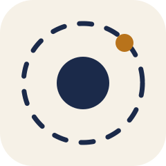
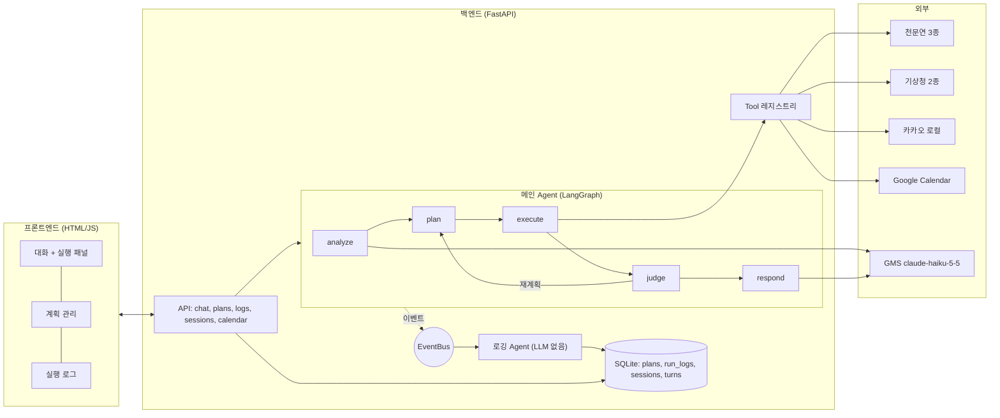

<p align="center">
  
</p>
<p align="center">
<em><b>Astrowatch(Astro + Overwatch):</b> Agent 기반 천문 관측 플래너</em>
</p>
<p align="center">


</p>

---

<p align="center">
  
</p>

> **오늘 밤, 어디서, 몇 시에 볼 수 있을까.**
> 하늘이 어둡고, 달이 방해하지 않고, 구름이 적은 시간을 계산해서 알려 주는 관측 플래너입니다.

보고 싶은 천문 현상과 내 시간을 말하면, Astrowatch는 천문연과 기상청 자료를 Tool로 불러 모아 "이 날 이 시간에 볼 수 있다" 또는 "이 조건으로는 볼 수 없다"를 근거와 함께 답합니다. 조건이 맞지 않으면 날짜와 현상, 지역을 바꿔 다시 찾고, 마음에 드는 추천은 관측 계획으로 저장해 캘린더에 넣을 수 있습니다.

| 항목 | 내용 |
|---|---|
| 과정 | SSAFY AI 코어 프로젝트 3회차 "Agent 기반 도메인 플래너 서비스" |
| 형태 | 개인 프로젝트, 2026-11-18 ~ 11-20 (3일) |
| 도메인 | 천문 관측. 2회차 RAG 프로젝트 [VastHorizon](https://github.com/bnbong/VastHorizon)의 우주 도메인을 이어받았다 |
| 한 줄 결과 | 외부 API 5종을 Tool 7개로 감싼 LangGraph Agent. 필수 요구사항 19건과 심화 캘린더 연동을 구현하고, 자동 테스트 298건과 실제 시나리오 11건으로 검증했다 |

---

## 1. 배경과 문제

### 왜 천문 관측인가

VastHorizon은 "별 하나를 알아갈 때마다 내 세계가 넓어진다"는 우주 안내서였습니다. 거기서 자연스럽게 다음 질문이 나왔습니다. **그래서 그 별을 실제로 언제, 어디서 볼 수 있는가.** 이 질문은 지식 검색으로는 답할 수 없습니다. 그날 그 장소의 하늘 상태를 계산해야 합니다.

### LLM 혼자서는 답할 수 없는 질문

"12월 14일 밤 서울에서 쌍둥이자리 유성우를 볼 수 있어?"에 답하려면 서로 다른 출처의 사실을 한 시간축 위에 겹쳐야 합니다.

| 알아야 하는 것 | 출처 | LLM만으로는 |
|---|---|---|
| 그날 서울의 천문박명 종료와 시작 시각 | 천문연 출몰시각 API | 그럴듯한 시각을 지어낸다 |
| 유성우 극대 시각과 달의 밝기(월령) | 천문연 천문현상, 월령 API | 해마다 다른 값을 모른다 |
| 그 시간대의 구름과 강수 | 기상청 단기, 중기예보 API | 예보를 알 수 없다 |
| 사용자의 시간과 귀가 제약 | 대화 | 대화 맥락에서 추출해야 한다 |

이 네 가지의 **교집합**이 30분 이상일 때만 "볼 수 있다"가 성립합니다. 하나라도 어긋나면 다른 날짜나 지역을 찾아야 하고, 끝까지 없으면 왜 없는지를 말해야 합니다.

### 목표

1. 요청을 조건으로 바꾸고, 필요한 Tool만 순서대로 불러 결과를 **코드로 판정**한다. LLM은 요청 해석과 문장 생성만 맡는다.
2. 충족 후보가 없으면 날짜, 현상, 지역 순으로 **재계획**하되 이미 받은 결과는 다시 부르지 않고, 상한에서 멈춘 이유를 밝힌다.
3. 모든 실행 과정을 이벤트로 남겨 사용자가 **근거를 따라갈 수 있게** 하고, 추천을 계획으로 저장해 캘린더까지 잇는다.
4. 확인할 수 없는 값은 지어내지 않는다. 대신 "늦어도 01:30까지 도착하면 30분 확보"처럼 **역산한 기준**을 준다.

---

## 2. 사용 흐름

| 1. 질문하면 추천 카드가 나온다 | 2. 후속 질문은 맥락을 이어받는다 |
|---|---|
|  |  |
| **3. 카드 한 장에 관측 창, 달, 날씨, 천체 고도가 한 축에 놓인다** | **4. 안 되면 이유를 말하고, 되묻는다** |
|  |  |

추천 카드의 헤드라인은 **관측 가능 시각**입니다. 그 아래 밤 타임바는 어두운 시간, 달이 떠 있는 구간, 시간별 날씨, 천체가 20° 이상 떠 있는 구간을 행별로 보여 주고, 그 교집합이 관측 창으로 강조됩니다. 오른쪽 실행 패널에서는 어떤 Tool을 왜 불렀고 LLM이 무엇을 판단했는지를 순서대로 볼 수 있습니다.


데모 영상 40초 원본: [docs/demo/astrowatch_demo.webm](docs/demo/astrowatch_demo.webm). 화면 21장 전체는 [검증 결과 11절](docs/VERIFICATION.md#11-스크린샷-데모-영상)에 있습니다.

---

## 3. 시스템 구조



| 영역 | 위치 (`backend/astrowatch/`) | 책임 |
|---|---|---|
| 메인 Agent | `agent/` | 5단계 실행 루프, 판정식, 재계획, 대화 맥락 |
| Tool | `tools/` | 공통 응답 봉투, 레지스트리, 입출력 계약, Tool 7개 |
| 외부 클라이언트 | `clients/` | 천문연, 기상청, 카카오, OpenWeatherMap, 캘린더 공급자 |
| 이벤트와 로깅 | `events/`, `logging_agent/` | 발행과 구독의 분리. 로깅 Agent는 받은 이벤트를 그대로 저장 |
| 저장소 | `storage/` | 계획, 수정 불가 실행 로그, 세션 맥락, 화면 복원용 대화 턴 |
| 천문 계산 | `astro/`, `data/` | 천체 고도와 남중, 행성 좌표, 카탈로그 294개, 지역 표 28곳 |
| API와 보안 | `app/` | 엔드포인트 17개, 요청 가드(CSRF, 크기, 속도), 보안 헤더, 로그 리댁션 |
| 화면 | `frontend/` | 프레임워크 없는 HTML/CSS/JS 3화면, 모바일 레이아웃 |

메인 Agent와 로깅 Agent는 이벤트 버스로만 이어집니다. 구독자가 없거나 예외를 내도 메인 흐름은 멈추지 않습니다.

---

## 4. 판단 방법

### 4-1. 다섯 단계

| 단계 | 하는 일 | LLM |
|---|---|---|
| analyze | 메시지와 이전 조건으로 의도 7종, 조건(기준, 선호, 제약), 고정 조건, 되물을 항목을 정한다 | 사용 (구조화 출력) |
| plan | 조건에 맞는 Tool 호출 순서를 짠다. 현상, 천체 고도, 박명과 월령, 예보, 관측지, 캘린더 순 | 규칙 |
| execute | 앞 Tool의 출력을 다음 입력으로 넘기며 호출한다. 실패는 기록하고 계속, 같은 인자는 캐시 재사용 | 없음 |
| judge | 후보마다 아래 판정식을 적용하고 사유와 역산 기준을 붙인다. 충족이 없으면 재계획 전략을 고른다 | 없음 |
| respond | 판정 결과를 추천, 근거 Tool, 제외 사유, 안내 문장으로 쓴다 | 사용 (실패 시 템플릿) |

### 4-2. 판정식

```
어두운 창 = [오늘 천문박명 종료, 다음 날 천문박명 시작]        출몰 Tool (두 날짜)
내 창     = [시작 가능 시각, 종료 시각]                        사용자 (없으면 어두운 창 전체)
현상 창   = 유성우는 극대 ±6시간, 천체는 고도 20° 이상 구간, 그 외는 어두운 창
시간 창   = 세 창의 교집합에서 달과 기존 일정이 겹치는 구간을 뺀 가장 좋은 구간
맑은 시간 = 시간 창 중 맑음(강수확률 30% 이하, 강수 없음)인 시간
```

| 판정 | 기준 |
|---|---|
| 충족 | 시간 창 30분 이상 **그리고** 맑은 시간 30분 이상 |
| 조건부 충족 | 시간 창은 되지만 예보 범위 밖. "D-3부터 확인" 안내와 역산 기준을 함께 준다 |
| 불충족 | 시간 창 30분 미만, 흐림이나 강수, 달빛(유성우는 월령 10~20, 희미한 천체는 7~23) |
| 판단 안 함 | 박명을 받지 못했거나 말한 천체를 현상 목록과 카탈로그에서 찾지 못함. 값을 지어내지 않고 되묻는다 |

### 4-3. 재계획

| 항목 | 규칙 |
|---|---|
| 발동 | 충족과 조건부 충족 후보가 모두 0개일 때만 |
| 전략 순서 | 같은 현상 다른 날짜(±2일) → 같은 기간 다른 현상 → 인접 지역 |
| 생략 | 사용자가 날짜, 현상, 지역을 고정했거나, 특정 천체를 지목했거나, 대상이 그 지역에서 뜨지 않을 때 |
| 재사용 | `(Tool, 인자)` 키 캐시. 재계획 회차에 같은 호출은 0회 |
| 상한 | 3회. 멈춘 이유를 5종으로 구분해 답한다(상한 도달, 대안 소진, 관측 불가, 고정 조건, 치명 오류) |

| 재계획 3회 후 상한에서 멈춘 답변 | 실행 타임라인의 재계획 구분선 |
|---|---|
|  |  |

### 4-4. 대화 맥락

세션에는 조건 객체, 직전 추천 요약, 최근 6턴만 남기고 Tool 원본은 남기지 않습니다. 후속 요청은 바뀐 값만 병합합니다("같은 날 장소만 대전으로"는 지역만 바뀌고 현상 조회는 캐시를 씁니다). 답변은 이전 조건에서 무엇이 바뀌었는지를 먼저 말합니다. 화면 복원은 별도의 대화 턴 표로 하며, 대화를 지워도 실행 로그는 남습니다.

---

## 5. Tool과 데이터

모든 Tool은 `{ok, data, note}` 또는 `{ok: false, error: {code, message}}` 봉투로 답합니다. 예외는 밖으로 나가지 않고, 메시지에 키나 URL, 스택을 담지 않습니다.

| Tool | 구분 | 언제 쓰나 | 출처 | 주요 실패 코드 |
|---|---|---|---|---|
| `search_sky_events` | 외부, 후보 | 볼 현상을 정하지 않았거나 기간 안의 현상을 찾을 때 | 천문연 천문현상 | NO_RESULT, AUTH |
| `get_night_window` | 외부, 상세 | 날짜와 지역의 어두운 시간과 달 | 천문연 출몰시각, 월령 | NO_WINDOW, AUTH |
| `get_sky_forecast` | 외부, 보조 | 후보 시간대의 구름과 강수 | 기상청 단기 → OpenWeatherMap → 기상청 중기 | OUT_OF_RANGE, AUTH |
| `search_observatory` | 외부, 보조 | 관측 장소 (반경 20km 이내) | 카카오 로컬 | NO_RESULT, AUTH |
| `lookup_sky_object` | 로컬 | 특정 천체나 행성이 그날 밤 언제 떠 있는지 | 카탈로그 294개 + 행성 궤도 계산 | NOT_FOUND |
| `get_calendar` | 로컬 또는 Google | 기존 일정과 겹치는지 | 로컬 DB 또는 Google Calendar | AUTH |
| `add_plan_to_calendar` | 로컬 또는 Google | 저장된 계획을 캘린더에 등록 (입력은 계획 번호만) | 위와 같음 | NOT_FOUND, AUTH |

Tool 사이의 데이터 흐름은 세 갈래입니다. 현상 Tool이 준 날짜가 박명과 예보 Tool의 입력이 되고, 지역 표의 위경도가 세 Tool에 공통으로 들어가며, 박명 창이 예보 Tool의 시각 목록이 됩니다.

천체 카탈로그는 VastHorizon의 항목 데이터(Wikidata 기반)를 변환했고, 고도와 남중 계산은 JPL Horizons와 대조해 적경과 적위 차이가 0.03° 이내였습니다. 외부 API의 출처와 이용 조건, 호출 한도는 [부록 B](#부록-b-외부-api-출처와-이용-조건)에 있습니다.

---

## 6. 검증 결과

### 6-1. 대표 시나리오

명세의 대표 시나리오 7종과 보충 4종을 실제 키로 실행하고 결과를 `samples/run_*.json`에 남겼습니다(2026-11-20, LLM은 `claude-haiku-5-5`). 재계획과 상한은 실제 예보로는 재현되지 않아 날씨만 모의 공급자(모든 시간 흐림)로 바꿨습니다.

| 시나리오 | 요청 | 확인한 것 |
|---|---|---|
| R1 한 번에 충족 | 12/14 서울 22~02시 쌍둥이자리 유성우 | 조건부 충족, 관측 창 240분, 월령 5.5, 늦어도 01:30 도착, 예보는 D-3부터 |
| R2 재계획 | 주말 21~24시 대전, 흐리면 다른 날 | 날짜 → 현상 → 인접 지역 3회. 회차마다 현상과 박명 결과를 재사용 |
| R3 상한 도달 | 다음 주 서울 보름달 피해 유성 | 3회 후 멈추고 "날짜 범위나 지역을 넓혀 볼까요?" |
| R4 Tool 실패 | 대전 천문대 20km, 카카오 키 없음 | 장소만 AUTH 경고. 시간과 날씨 판정은 정상 |
| R5 Tool 불필요 | 안녕, 이거 어떻게 써? | Tool 0회, 사용법 안내 |
| R6 맥락 유지 | 같은 날 장소만 대전으로 | 날짜와 시간 유지, 지역만 갱신, 현상 조회 재사용 |
| R7 되묻기 | 밤 11시 전엔 들어와야 해 | Tool 호출 전에 지역과 시작 시각을 묻는다 |
| 보충 | 안드로메다 은하 보기 좋은 날짜 | 날짜 미지정은 10일 범위로, 은하 고도와 달 회피 구간으로 판정, 충족 2건 |
| 보충 | 화성 제일 잘 보이는 시간대 | 사실 질문으로 분류, 남중 기준으로 답변 |
| 보충 | 2월 30일 | 존재하지 않는 날짜는 외부 호출 없이 되묻기 |
| 보충 | 카탈로그에 없는 천체 | 판단 보류, 비슷한 이름 되묻기 |

| 카카오 키가 없을 때: 장소만 실패하고 판정은 진행 | 안드로메다 은하: 고도와 달 회피로 판정 |
|---|---|
|  |  |

### 6-2. 자동 테스트와 외부 리뷰

| 검증 | 내용 |
|---|---|
| 자동 테스트 | 298건 통과, 2건 건너뜀(POSIX 전용). 키와 네트워크 없이 `samples/`의 실제 응답을 fixture로 쓴다 |
| 외부 리뷰 | 다른 모델(Codex)이 브라우저와 HTTP로 20개 시나리오를 실제 실행해 결함 8건을 찾았고, 수정 후 재검증에서 모두 해소됐다. 기록은 [output/e2e-review/](output/e2e-review/) |
| 비기능 | 키는 환경변수로만, 화면에 비노출, Tool 실패 시 계속 진행, 재계획 상한, 응답 시간 실측, 모듈 분리, 출처 기록. 상세는 [검증 결과 9절](docs/VERIFICATION.md#9-48-비기능-요구사항) |

세부 근거와 테스트 이름은 [docs/VERIFICATION.md](docs/VERIFICATION.md), 실행 로그 전문은 [docs/RUN_LOG_SAMPLE.md](docs/RUN_LOG_SAMPLE.md)에 있습니다.

---

## 7. 개발 과정에서 바뀐 설계

기획 검증과 실제 실행에서 드러난 사실에 따라 설계를 바꾼 기록입니다.

| 발견 | 설계 변경 |
|---|---|
| 12/14 유성우는 예보 범위 밖이라 "충족"이 성립할 수 없다 | 판정을 충족, 조건부 충족, 불충족 3단계로 |
| 카카오로 지오코딩하면 카카오 키 누락 시 날씨와 박명까지 실패한다 | 지역 표를 로컬에 두고 출몰 API는 위경도 버전 사용 |
| 개발 네트워크에서 Open-Meteo 차단, 카카오 반경 20km 상한 | 백업 예보를 기상청 중기예보와 OpenWeatherMap으로, 반경 20km 고정 |
| "안드로메다 은하 보기 좋은 날짜"가 되묻기만 반복 | 날짜 없음은 되묻지 않고 기본 범위를 쓰고 그 사실을 밝힌다 |
| 은하는 천문현상 목록에 없어 엉뚱한 유성우를 추천 | 천체 카탈로그와 고도 계산으로 "떠 있는 시간"만 창으로, 달이 진 뒤 구간으로 자른다 |
| "화성 제일 잘 보이는 시간대"에 키워드 규칙이 틀린 Tool을 고른다 | 사실 질문의 Tool 선택을 LLM 판단으로 바꾸고 판단 이유를 이벤트에 기록 |
| LLM이 지나가듯 말한 지역과 현상까지 "고정"으로 묶어 재계획이 1회 만에 끝난다 | 고정은 명시적 표현만, 단일 날짜만 자동 고정 |
| 후속 요청의 답변이 "바꿀 부분이 없다"고 설명한다 | 이전 조건과의 차이를 응답 단계에 넘겨 바뀐 항목을 먼저 말하게 |
| GMS의 OpenAI 경로가 마지막 날 사용 불가 | 공급자 설정 하나로 Anthropic 호환 경로(`claude-haiku-5-5`)로 전환 |

개발은 Claude(설계와 계약, 오케스트레이션) → Opus 에이전트(모듈 구현) → Codex(코드 리뷰와 실제 E2E) 순환으로 진행했고, 공통 응답 봉투, 스키마, State, 이벤트, DB 계약을 먼저 고정한 뒤 모듈을 병렬로 구현했습니다.

---

## 8. 결론과 한계

**결론.** 외부 API를 Tool로 감싸고 판정을 코드에 두면, LLM은 요청 해석과 문장 생성만으로도 "언제 볼 수 있는가"에 근거 있는 답을 낼 수 있었습니다. 대표 시나리오 7종은 모두 의도한 경로(충족, 재계획, 상한, Tool 실패, Tool 불필요, 맥락 유지, 되묻기)로 끝났고, 외부 리뷰가 찾은 결함도 판정 로직이 아니라 요청 해석과 문장 생성에 몰려 있어 설계의 분리가 유효했습니다. 재계획에서 같은 호출을 다시 하지 않는 것과, 멈춘 이유를 5종으로 구분한 것은 실행 로그로 확인할 수 있습니다.

**한계.**

| 항목 | 내용 |
|---|---|
| 지원 지역 | 로컬 지역 표 28곳. 없는 지역은 되묻는다 |
| 예보 범위 | 오늘부터 10일. 그 밖은 조건부 충족으로만 답한다 |
| 천체 | 카탈로그 294개와 행성 7개(저정밀 궤도). 없는 천체는 고도를 추정하지 않는다 |
| LLM | GMS 키는 2026-11-20 이후 사용 불가. 키가 없으면 사용법 안내와 템플릿 응답만 한다 |
| 미구현 심화 | RAG 검색(F3022), 이상 징후(F3020), Planner/Worker(F3021) |
| Google 등록 | 토큰 발급과 일정 조회는 실제 계정으로 확인했고, 등록은 개인 일정이 생기지 않도록 가짜 클라이언트 테스트로만 검증했다 |

**향후.** VastHorizon의 Chroma 색인을 로컬 Tool로 감싸면 배경지식 질문(F3022)을 바로 붙일 수 있습니다. 세션별 실패 수와 소요 시간 집계 API, 계획에 판정 등급 저장, "오늘 밤 하늘 요약" API가 다음 후보입니다.

---

## 부록 A. 요구사항 대응

| 구분 | 번호 | 구현 위치 또는 근거 |
|---|---|---|
| Tool | F3001~F3004 | `tools/` 레지스트리와 Tool 7개. 후보 조회, 상세(박명과 월령), 보조(예보와 관측지) |
| Agent | F3005~F3011 | `agent/nodes.py` 5단계, `judge.py` 판정식, `replan.py` 전략과 상한, `memory.py` 맥락 |
| 로깅 | F3012~F3014 | `events/bus.py` 이벤트 9종, `logging_agent/` LLM 없는 저장, 조회와 삭제 API만 제공(수정 불가) |
| 계획 | F3015~F3016 | `storage/plans.py`, 겹침 알림, 수정과 삭제 즉시 반영 |
| API와 화면 | F3017~F3019 | 엔드포인트 17개, 화면 3개, 실행 타임라인과 처리 중 표시, 키 누락 안내 |
| 심화 | F3023 | 로컬 캘린더 구현체를 설정 하나로 Google Calendar로 교체. 입력은 계획 번호만 |
| 비기능 | NF3001~NF3007 | 환경변수 키, 로그 리댁션, Tool 실패 처리, 상한 3회, 응답 시간 실측, 모듈 분리, 출처 표 |

요구사항별 상세 근거는 [docs/REQUIREMENTS.md](docs/REQUIREMENTS.md)와 [docs/VERIFICATION.md](docs/VERIFICATION.md)에 있습니다.

## 부록 B. 외부 API 출처와 이용 조건

| API | 제공 | Tool | 호출 한도 | 이용 조건 |
|---|---|---|---|---|
| 천문현상 정보 `AstroEventInfoService` | 한국천문연구원, data.go.kr [15012691](https://www.data.go.kr/data/15012691/openapi.do) | `search_sky_events` | 엔드포인트당 일 10,000 | 이용허락범위 제한 없음 |
| 출몰시각 정보 `RiseSetInfoService` | 위와 같음 [15012688](https://www.data.go.kr/data/15012688/openapi.do) | `get_night_window` | 위와 같음 | 제한 없음 |
| 월령 정보 `LunPhInfoService` | 위와 같음 [15012689](https://www.data.go.kr/data/15012689/openapi.do) | `get_night_window` | 위와 같음 | 제한 없음 |
| 단기예보 `VilageFcstInfoService_2.0` | 기상청, data.go.kr [15084084](https://www.data.go.kr/data/15084084/openapi.do) | `get_sky_forecast` | 위와 같음 | 공공누리 1유형 (출처 표시) |
| 중기육상예보 `MidFcstInfoService` | 기상청, data.go.kr | `get_sky_forecast` | 위와 같음 | 공공누리 1유형 |
| 로컬 키워드 검색 | 카카오 | `search_observatory` | 일 100,000 | 결과 저장 금지. `place_id`와 `place_url`만 저장, 반경 최대 20km |
| SSAFY GMS (`claude-haiku-5-5`, Anthropic 호환 경로) | SSAFY | analyze, respond | 총 30,000 크레딧, 1회 1크레딧, 2026-11-20까지 | 교육용. OpenAI 경로(`gpt-6-luna`)가 11/20 사용 불가라 전환 |
| OpenWeatherMap 5일 예보 (선택) | OpenWeather | `get_sky_forecast` 백업 | 분당 60, 월 100만 (공개값) | 무료 플랜 약관 |
| Google Calendar API (심화) | Google | `get_calendar`, `add_plan_to_calendar` | 미확인 | 본인 계정, OAuth 테스트 사용자 |

한도는 2026-11-18에 확인한 값입니다.

## 부록 C. 실행 방법

```bat
python -m venv .venv && .venv\Scripts\activate && pip install -r requirements.txt
copy .env.example .env            :: 키 입력 (docs/SETUP.md 2절)
cd backend && ..\.venv\Scripts\python -m uvicorn astrowatch.app.main:app --reload --port 8000
```

브라우저에서 http://127.0.0.1:8000 을 엽니다. 키가 하나도 없어도 서버는 뜨고, 없는 키에 해당하는 기능만 안내 문구로 대체됩니다. 테스트는 `backend`에서 `python -X utf8 -m pytest`로 키 없이 실행합니다. API 키 발급 절차, 환경변수, 보안 설정은 [docs/SETUP.md](docs/SETUP.md)에 있습니다.

## 부록 D. 문서와 저장소 구조

| 문서 | 내용 |
|---|---|
| [docs/ASTROWATCH_PLAN.md](docs/ASTROWATCH_PLAN.md) | 기획안 (도메인, API, 판단식, 일정, 기획 검증 기록) |
| [docs/REQUIREMENTS.md](docs/REQUIREMENTS.md) | 요구사항 정의서 (도메인판) |
| [docs/AGENT_DESIGN.md](docs/AGENT_DESIGN.md) | Agent 설계 문서 |
| [docs/TOOL_SPEC.md](docs/TOOL_SPEC.md) | Tool 정의서 |
| [docs/API_SPEC.md](docs/API_SPEC.md) | API 명세서 |
| [docs/VERIFICATION.md](docs/VERIFICATION.md) | 검증 결과 (스크린샷 21장 표 포함) |
| [docs/RUN_LOG_SAMPLE.md](docs/RUN_LOG_SAMPLE.md) | 실행 로그 샘플 |
| [docs/SETUP.md](docs/SETUP.md) | 설치, 키, 환경변수, 보안 설정 |
| [docs/screenshots/](docs/screenshots/), [docs/demo/](docs/demo/) | 화면 21장, 데모 영상 |
| [output/e2e-review/](output/e2e-review/) | 외부(Codex) E2E 리뷰와 재검증 원문 |

```
backend/astrowatch/   agent, tools, clients, events, logging_agent, storage, astro, data, app
backend/tests/        pytest 300건 (키 없이 실행)
backend/scripts/      API 점검, Google 토큰 발급, 카탈로그 생성, 시나리오 재실행, 화면 캡처
frontend/             index.html, plans.html, logs.html, css, js
samples/              외부 API 원본 응답과 시나리오 실행 결과 (키 제거)
docs/                 문서, 스크린샷, 데모 영상, 브랜드 이미지
```
