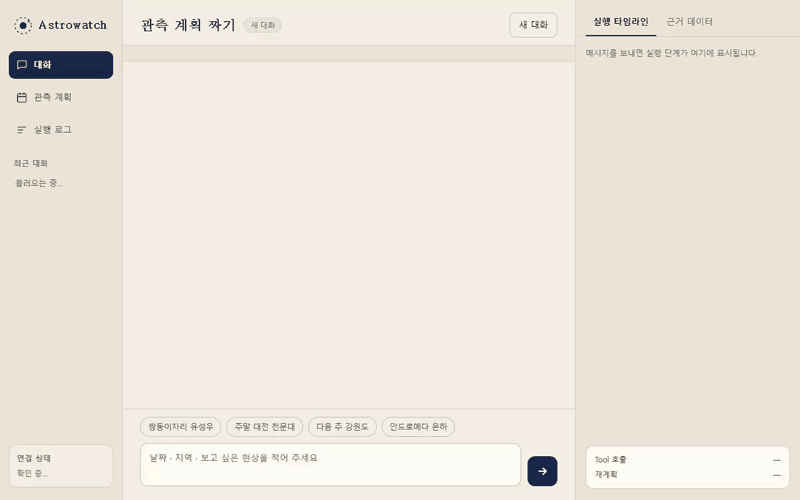
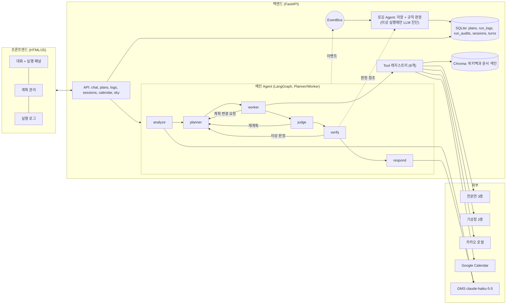
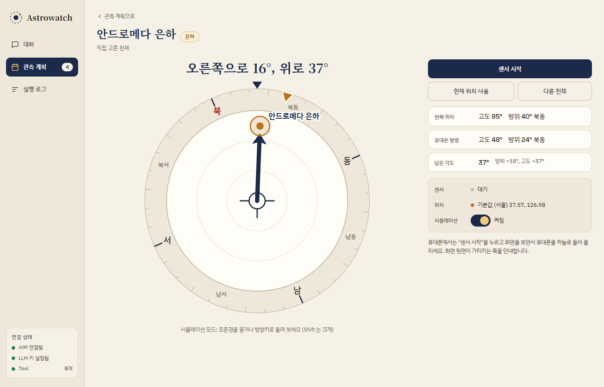
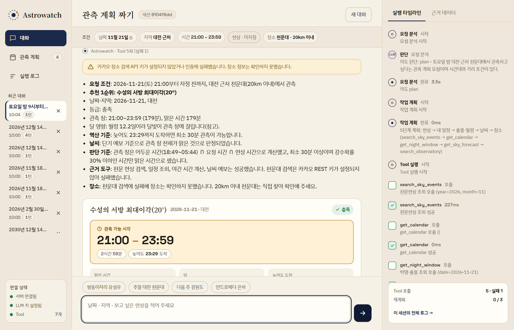
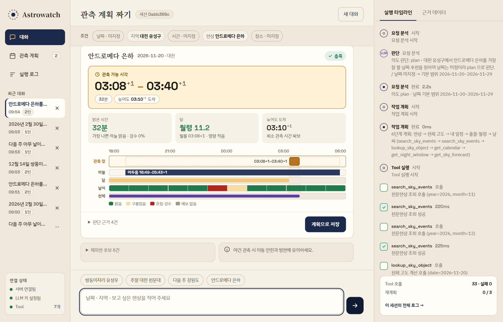

<p align="center">
  
</p>
<p align="center">
<em><b>Astrowatch (Astro + Overwatch):</b> 에이전트 기반 천문 관측 플래너</em>
</p>
<p align="center">


</p>

---

<p align="center">
  
</p>

> **"오늘 밤, 어디서 몇 시에 별을 볼 수 있을까?"**  
> 하늘이 어둡고, 달빛 방해가 적으며, 구름 없는 맑은 시간을 계산해 주는 **천문 관측 플래너**입니다.

관측하고 싶은 현상과 비어 있는 시간을 자연어로 입력하면, **한국천문연구원**과 **기상청** 데이터를 분석해 최적의 관측 시점을 찾아줍니다.

- **근거 있는 관측 추천**: "언제 볼 수 있는지", 혹은 "왜 볼 수 없는지"를 데이터 근거와 함께 제시
- **스마트 자율 재계획**: 날씨나 달빛이 방해하면 날짜, 현상, 지역을 바꿔가며 대안 탐색
- **캘린더 원클릭 연동**: 추천받은 관측 일정을 Google Calendar 및 로컬 일정에 즉시 저장
- **배경지식 질문과 하늘 가리키기**: 위키백과 기반 RAG 검색으로 출처가 붙은 답을 주고, 밤에는 휴대폰을 들어 계획한 천체의 방향을 찾아 줌

| 구분 | 내용 |
|---|---|
| **프로젝트** | SSAFY AI 코어 3회차 "Agent 기반 도메인 플래너 서비스" (개인 / 3일) |
| **도메인** | 천문 관측 ([VastHorizon](https://github.com/bnbong/VastHorizon) 우주 도메인 계승) |
| **핵심 성과** | 외부 API 5종과 로컬 데이터를 8개 Tool로 연동한 LangGraph Agent (Planner/Worker 분리) / 심화 4종(F3020~F3023) 구현 / 자동 테스트 440건 통과 |

---

## 1. 프로젝트 배경 및 문제 정의

### 왜 천문 관측인가?

지식 기반 우주 안내서였던 이전 프로젝트([VastHorizon](https://github.com/bnbong/VastHorizon))에서 자연스럽게 다음 질문으로 이어졌습니다.

> **"그래서 그 별을 실제로 언제, 어디서 볼 수 있는가?"**

이 질문은 문서 검색(RAG)만으로는 답할 수 없습니다.  
특정 날짜와 장소의 **하늘 상태(박명, 월령, 날씨, 고도)를 실시간으로 교차 계산**해야 하기 때문입니다.

---

### LLM 단독 처리의 한계

"12월 14일 밤 서울에서 쌍둥이자리 유성우를 볼 수 있어?"라는 질문에 답하려면 4가지 사실의 **교집합(최소 30분 이상)** 을 구해야 합니다.

| 필요한 정보 | 데이터 출처 | LLM 단독 처리 시 문제점 |
|---|---|---|
| **천문박명 시각** (완전한 어둠) | 천문연 출몰시각 API | 그럴듯한 시각을 허구로 지어냄 (환각) |
| **극대 시각 및 월령** (달의 방해) | 천문연 천문현상 및 월령 API | 매년 바뀌는 주기 데이터를 알지 못함 |
| **시간별 구름량 및 강수** | 기상청 단기 및 중기예보 API | 실시간 기상 예보 접근 불가 |
| **사용자 가용 시간** | 대화 입력 | 정형화된 시간 제약식으로 환원하지 못함 |

> [!IMPORTANT]
> 네 조건이 모두 겹치는 **'관측 창'이 30분 이상**이어야 관측이 성립합니다.  
> 하나라도 어긋나면 대체 일정을 재계획하고, 불가능하다면 명확한 이유를 제시해야 합니다.

---

### 핵심 해결 목표

1. **결정론적 코드 판정**  
   - LLM은 '요청 해석'과 '답변 작성'만 담당  
   - 관측 성립 여부는 외부 API 데이터를 바탕으로 **엄밀한 수식 코드로 판정**

2. **비용 효율적 자율 재계획 (Replanning)**  
   - 조건 불충족 시 `날짜(±2일) -> 현상 -> 인접 지역` 순으로 대안 탐색 (최대 3회)  
   - 이미 조회한 API 결과는 캐시하여 **중복 호출 0회** 보장

3. **투명한 추론 추적**  
   - 에이전트의 판단 과정을 타임라인 이벤트로 실시간 기록

4. **환각 없는 역산 기준 제시**  
   - 확인할 수 없는 정보는 꾸며내지 않음  
   - 예: "늦어도 01:30까지 도착해야 30분 관측 확보"와 같이 **역산된 마지노선** 안내

---

## 2. 사용 흐름 및 화면 구성

| 1. 맞춤형 추천 카드 | 2. 맥락 유지 후속 질문 |
|:---:|:---:|
|  |  |
| **3. 단일 타임라인 (밤 타임바)** | **4. 불가능 사유 안내 및 능동적 되묻기** |
|  |  |

### 화면 읽는 법
- **추천 카드 헤드라인**: 가장 추천하는 최적 관측 시간대 표시
- **밤 타임바 (Night Timebar)**: 4가지 요소가 한눈에 들어오는 직관적 시각화
  1. `어두운 밤`: 천문박명 기준 빛 공해 없는 시간
  2. `달 구간`: 월출과 월몰 및 달빛 간섭 구간
  3. `날씨`: 시간별 맑음, 흐림, 강수 예보
  4. `천체 고도`: 관측 가능한 유효 고도(20° 이상) 구간  
  (모든 조건이 겹치는 최적의 구간을 **'관측 창'**으로 강조)
- **우측 실행 패널**: Tool 호출 내역 및 LLM 판단 근거를 실시간 확인



- **데모 영상 (40초)**: [docs/demo/astrowatch_demo.webm](docs/demo/astrowatch_demo.webm)  
- **전체 화면 25장**: [docs/VERIFICATION.md (11절)](docs/VERIFICATION.md#11-스크린샷-데모-영상)

---

## 3. 시스템 아키텍처



| 모듈 계층 | 위치 (`backend/astrowatch/`) | 주요 역할 |
|---|---|---|
| **메인 Agent** | `agent/` | Planner/Worker 제어 루프, 판정식, 자율 재계획, 대화 세션 맥락 관리 |
| **Tool 계층** | `tools/` | 표준 응답 봉투(`Envelope`), Tool 레지스트리, 입출력 계약, 도구 8종 |
| **RAG 검색** | `rag/` | 위키백과 수집, 청크 분할, Chroma 색인, 하이브리드 검색 (제목 일치 + 벡터) |
| **외부 연동** | `clients/` | 천문연, 기상청, 카카오, OWM API 및 캘린더 연동, 에러 격리 |
| **이벤트 및 로깅** | `events/`, `logging_agent/` | Pub/Sub 이벤트 버스 기반 로깅 (무손실 저장), 규칙 기반 이상 징후 판정, 이상 실행에만 LLM 진단 |
| **저장소** | `storage/` | SQLite 기반 관측 계획, 불변 실행 로그, 판정 결과, 세션 및 대화 턴 관리 |
| **천문 계산** | `astro/`, `data/` | 천체 고도, 방위각, 남중 계산, 행성 궤도 산출, 카탈로그 294개, 유성우 복사점 12개 |
| **API 및 보안** | `app/` | 21개 REST 엔드포인트, CSRF 및 Rate Limit 보안 가드, 민감정보 마스킹 |
| **프론트엔드** | `frontend/` | Vanilla HTML/CSS/JS 4화면 (대화, 계획, 로그, 하늘 가리키기), 반응형 모바일 레이아웃 |

> [!NOTE]
> **완전한 비동기 분리**: 메인 Agent와 로깅 Agent는 경량 `EventBus`로만 연결됩니다.  
> 로깅 구독자에 지연이나 예외가 발생해도 메인 판정 흐름은 중단 없이 정상 작동합니다.

---

## 4. 판단 및 추론 메커니즘

### 4-1. 실행 사이클 (Planner/Worker 구조)

| 단계 | 수행 내용 | LLM 사용 |
|---|---|:---:|
| **1. analyze** | 사용자 발화와 이전 맥락에서 의도(계획, 사실, 배경지식, 캘린더 등), 관측 조건(기준, 선호, 제약), 되물을 항목 추출 | **사용** (JSON) |
| **2. planner** | 조건을 작업 목록(Task List)으로 분해 (현상 -> 고도 -> 박명/월령 -> 예보 -> 장소 -> 캘린더), 고정 인자 표시 | 규칙 (Worker 요청을 규칙으로 못 풀 때만 LLM) |
| **3. worker** | 작업마다 Tool 호출. 실패는 격리하고 동일 인자는 캐시 재사용 | 인자를 고치면 달라질 실패(결과 없음 등)에만 LLM |
| **4. judge** | 관측 후보군에 판정식을 적용해 성립 여부 판정 (미충족 시 재계획 트리거) | 미사용 |
| **5. verify** | 로깅 Agent의 규칙 판정(반복 호출, 과다 재계획, 계획 외 호출)을 참조. 이상이면 Planner가 작업 목록을 한 번 다시 구성 | 미사용 |
| **6. respond** | 판정 결과, 추천 시간, 근거 Tool 데이터, 제외 사유를 종합해 답변 생성 | **사용** (폴백 지원) |

`AGENT_STRUCTURE=classic`으로 바꾸면 분리 전의 5단계(analyze, plan, execute, judge, respond) 그래프로 실행되며, 두 구조의 비교는 [5-2절](#5-2-planner와-worker-분리-f3021)에 있습니다.

---

### 4-2. 관측 가능성 판정식

```text
어두운 창  = [오늘 천문박명 종료, 내일 천문박명 시작]       (천문연 출몰 API)
내 창      = [시작 가능 시각, 종료 시각]                   (사용자 지정, 기본값: 어두운 창)
현상 창    = 유성우는 극대 ±6시간 / 일반 천체는 고도 20° 이상
시간 창    = (어두운 창 ∩ 내 창 ∩ 현상 창) - (달빛 방해 + 개인 일정)
맑은 시간  = 시간 창 중 맑은 구간 (강수확률 30% 이하 및 무강수)
```

| 최종 판정 | 판정 기준 |
|---|---|
| **충족 (Satisfied)** | 시간 창 **30분 이상** 확보 및 맑은 시간 **30분 이상** |
| **조건부 충족** | 시간 창은 충분하나 기상 예보 범위(D-3) 밖: "D-3일 전 기상 확인" 및 도착 역산 기준 안내 |
| **불충족** | 시간 창 30분 미만, 날씨 악화(흐림/비), 또는 달빛 간섭 (월령 10~20일 등) |
| **판단 유보 (되묻기)** | 박명 데이터 수신 실패 또는 카탈로그 미등재 천체: 임의 생성 없이 사용자에게 재질의 |

---

### 4-3. 자율 재계획 (Replanning)

관측 창이 나오지 않을 때 시스템이 스스로 대안을 찾는 복구 전략입니다.

- **발동 조건**: '충족' 및 '조건부 충족' 후보가 **0건**일 때만 발동
- **전략 순서**: 1. 같은 현상 다른 날짜 (±2일) -> 2. 같은 기간 다른 현상 -> 3. 인접 지역 확장
- **호출 최적화**: `(Tool, 인자)` 캐시로 재계획 회차에서 **동일 API 중복 호출 0회**
- **상한 제어**: 최대 **3회**까지 시도 후 중단 사유 안내 (상한 도달, 대안 소진, 관측 불가 등)

| 3회 재계획 후 상한 도달 시 안내 | 실행 타임라인 상의 재계획 구분선 |
|:---:|:---:|
|  |  |

---

### 4-4. 효율적인 대화 맥락 유지

- **가벼운 세션 상태**: 원본 데이터 대신 `조건 객체`, `직전 추천 요약`, `최근 6턴`만 압축 유지
- **스마트 파라미터 병합**: "같은 날 장소만 대전으로" 입력 시 날짜와 시간은 유지하고 지역만 갱신
- **데이터 캐시 재사용**: 변경되지 않은 천문현상 정보는 캐시에서 즉시 불러와 호출 절약
- **독립된 감사 로그**: 대화 내역을 지워도 시스템 실행 로그(Audit Log)는 DB에 영구 보존

---

## 5. 심화 기능 적용

필수 기능이 끝난 뒤 심화 과제 네 가지(F3020~F3023)를 모두 구현했고, 명세 밖의 기능으로 휴대폰 하늘 가리키기를 더했습니다.

### 5-1. 로깅 Agent의 이상 징후 판정 (F3020)

로깅 Agent가 저장한 실행 로그만 근거로, LLM 없이 이벤트를 대조하고 횟수를 세어 판정합니다.

| 판정 규칙 | 조건 | 근거 이벤트 |
|---|---|---|
| **반복 호출** | 같은 Tool을 같은 입력으로 한 턴에 2회 이상 실제 호출 (캐시 재사용은 제외) | `tool_call` |
| **과다 재계획** | 재계획이 기준 횟수(기본 3) 이상이거나 상한 도달 | `replan` |
| **계획 외 호출** | Planner의 작업 목록(또는 계획 단계의 `planned_tools`)에 없는 Tool 호출 | `planner_tasks`, `tool_call` |
| **판정 불가** | 대조할 이벤트가 없을 때. '이상 없음'으로 두지 않음 | (없음) |

- **진단은 판정과 분리**: 이상으로 판정한 실행에만 LLM이 원인(어느 Agent 쪽 문제인지, 무엇을 고치면 되는지)을 세 문장 이내로 진단하고 별도 열에 저장합니다. 정상 실행에는 LLM을 호출하지 않고, 진단이 실패해도 판정과 로그는 남습니다.
- **메인 Agent가 참조**: 직전 판정은 상태(`audit`)로 Planner에 전달되고, 응답(`ChatResponse.audit`)과 실행 패널의 "로깅 Agent" 행, 로그 화면의 배지와 판정 패널에 보입니다.
- **검증**: `backend/scripts/make_anomalies.py`가 정상, 반복 호출, 과다 재계획, 계획 외 호출, 근거 없음 5가지 실행을 만들어 모두 기대한 판정이 나오는 것을 확인했습니다 (`samples/audit_samples.json`).


### 5-2. Planner와 Worker 분리 (F3021)

| 역할 | 하는 일 | LLM을 부르는 조건 | 부르지 않는 조건 |
|---|---|---|---|
| **Planner** | 요청을 작업 목록(`TaskList`)으로 분해하고 고정 인자를 표시. 판정 재계획, Worker의 계획 변경 요청, 로깅 Agent의 이상 판정을 받아 목록을 다시 구성 | Worker 요청을 규칙으로 매핑할 수 없을 때만 전략 선택 | 그 밖의 모든 경우 (요청 해석은 analyze가 담당) |
| **Worker** | 작업마다 Tool 호출, 결과를 `WorkerResult`로 반환 | 인자를 고치면 결과가 달라질 실패(결과 없음, 대상 없음, 잘못된 입력)에서 재시도/건너뜀/계획 변경 요청 중 하나를 고를 때 | 정상 경로, 키 오류 같은 치명 실패, 필수 인자 누락, 모호한 지역 |
| **로깅 Agent** | 수행 결과 검증(5-1의 규칙 판정) | 이상 판정 실행의 원인 진단에만 | 정상, 판정 불가 |

- 재시도는 같은 Tool로만 상한(`WORKER_MAX_RETRY`, 기본 2) 안에서 하고, Planner가 사용자 조건으로 고정한 인자는 바꾸지 않습니다. 고정 인자를 바꾸려는 LLM 판단은 거부하고 건너뜀으로 기록합니다.
- 작업 목록(`planner_tasks`), 수행 결과(`worker_result`), Worker 판단(`worker_decision`)은 모두 실행 로그에 이벤트로 남아 로깅 Agent가 계획 외 호출과 고쳐 부른 호출을 구분할 수 있습니다.

**구조 변경 전후 비교** (`backend/scripts/compare_structures.py`, 실제 LLM, 시나리오 6종 평균)

| 구성 | 재계획 횟수 | Tool 호출 | 요청당 LLM 호출 | 응답 시간 |
|---|:---:|:---:|:---:|:---:|
| 분리 전 (classic) | 1.17 | 15.17 | 1.33 | 17.1초 |
| Planner/Worker, Worker LLM 끔 | 1.17 | 15.17 | 1.33 | 16.0초 |
| Planner/Worker, Worker LLM 켬 | 1.17 | 15.17 | 1.50 | 16.1초 |

정상 경로(R1, R4, R6)는 세 구성이 같고 Worker의 LLM 호출은 0회였습니다. 존재하지 않는 유성우를 지목한 요청에서는 분리 구조가 결과 없음을 바로 Planner에 넘겨 판정 한 번을 건너뛰었고, Worker LLM을 켠 구성만 LLM이 계획 변경 요청을 골라 호출이 1회 늘었습니다. 시나리오별 표는 [docs/AGENT_DESIGN.md](docs/AGENT_DESIGN.md)와 `samples/structure_compare.json`에 있습니다.

### 5-3. RAG 검색 Tool (F3022)

| 항목 | 내용 |
|---|---|
| 문서 | 한국어 위키백과 321건 (카탈로그 천체 294개, 용어 27개). 요약 본문만 저장, CC BY-SA 4.0 (`data/space_docs.json`) |
| 색인 | Chroma, 로컬 ONNX 임베딩(all-MiniLM-L6-v2, 키 불필요), 724 청크. `EMBEDDING_PROVIDER=gms`로 OpenAI 호환 임베딩 선택 가능 |
| Tool | `search_space_docs(query, k)`: 제목/별칭 일치 가산 + 벡터 검색, 문서별 중복 제거. 실패 코드 `NO_INDEX`(색인 없음), `INDEX_MISMATCH`(임베딩 불일치), `NO_RESULT` |
| 선택 조건 | 정의, 원리, 역사처럼 외부 API로 확인할 수 없는 질문은 `knowledge` 의도로 분류. 언제/몇 시/날씨/고도가 들어간 질문은 그대로 관측 계획이나 사실 질문으로 처리 |
| 답변 형식 | 검색된 문서만 근거로 답하고 끝에 "출처:" 목록(제목, 링크, 라이선스)을 붙임. 색인이 없으면 "아직 문서를 모으지 못했습니다(색인 없음)"와 생성 명령 안내 |


VastHorizon의 Chroma 저장소 코드(임베딩 식별 정보 기록과 검사)를 이식했고, 색인은 `scripts/collect_space_docs.py`와 `scripts/build_space_docs.py`로 다시 만들 수 있습니다.

### 5-4. 캘린더 연동 Tool (F3023)

입출력 형식을 먼저 정하고 로컬 SQLite 구현체로 동작을 확인한 뒤, 설정값 하나(`CALENDAR_PROVIDER=google`)로 Google Calendar 구현체로 바꿨습니다. 등록 Tool은 계획 번호만 받고 제목과 시각은 저장소에서 읽어 모델이 값을 지어낼 수 없으며, 조회한 일정은 관측 창 판정에서 겹치는 구간을 빼는 데 쓰입니다.

### 5-5. 휴대폰으로 하늘 가리키기 (명세 외 추가)

저장한 계획의 천체를 밤하늘에서 찾도록 돕는 화면입니다. 계획의 천체(카탈로그 294개, 행성과 달, 유성우 복사점 12개)를 적경/적위로 풀어 주는 API(`/api/sky/target`)와, 휴대폰 방향 센서와 위치로 "왼쪽으로 35°, 위로 12°"처럼 안내하는 `pointer.html`로 이루어집니다. 4° 안에 들어오면 조준 완료로 표시하고, 지평선 아래면 떠오르는 시각을 알려 줍니다.

| 데스크톱 시뮬레이션 모드 | 휴대폰 화면 |
|:---:|:---:|
|  |  |

방향 센서와 위치는 HTTPS 또는 localhost에서만 동작하므로, 휴대폰 테스트 방법(USB 포트 포워딩, 터널)은 [docs/SETUP.md](docs/SETUP.md)에 정리했습니다. VastHorizon의 방향 계산 코드를 이식했고 실제 기기 검증과 나침반 보정은 남은 과제입니다.

---

## 6. 도구(Tool) 및 데이터 연동

모든 Tool은 표준 봉투(`{ok, data, note}` 또는 `{ok: false, error: {code, message}}`) 형태로 안전하게 응답하며, 키나 내부 URL 등의 민감정보를 절대 노출하지 않습니다.

| Tool 명칭 | 분류 | 주요 역할 및 호출 시점 | 데이터 출처 | 에러 코드 |
|---|:---:|---|---|:---:|
| `search_sky_events` | 외부 공공 | 기간 내 주요 천문 현상(유성우, 일식 등) 탐색 | 천문연 천문현상 API | `NO_RESULT` |
| `get_night_window` | 외부 공공 | 일자 및 지역별 천문박명(어둠) 시간대와 월령 조회 | 천문연 출몰 및 월령 API | `NO_WINDOW` |
| `get_sky_forecast` | 외부 공공 | 시간대별 구름량과 강수 확률 조회 (백업 연계) | 기상청 단기 -> OWM -> 중기 | `OUT_OF_RANGE` |
| `search_observatory` | 외부 상용 | 반경 20km 이내 추천 천문대 스팟 검색 | 카카오 로컬 검색 API | `NO_RESULT` |
| `lookup_sky_object` | 로컬 계산 | 행성 및 딥스카이 천체의 실시간 고도와 남중 계산 | 카탈로그(294개) + 궤도 계산 | `NOT_FOUND` |
| `search_space_docs` | 로컬 RAG | 정의, 원리 같은 배경지식 질문에 근거 문서와 출처 검색 | 위키백과 색인(Chroma, 321문서) | `NO_INDEX` |
| `get_calendar` | 캘린더 | 관측 희망 시간대의 기존 개인 일정 충돌 확인 | 로컬 DB / Google Calendar | `AUTH` |
| `add_plan_to_calendar`| 캘린더 | 추천된 관측 계획을 캘린더 일정으로 등록 | 로컬 DB / Google Calendar | `NOT_FOUND` |

### 데이터 파이프라인
1. **현상 -> 박명 및 예보**: 천문현상 이벤트 발생일이 박명 계산 및 날씨 예보의 입력으로 연결
2. **지역 좌표 주입**: 내장된 28개 기준 도시 좌표가 위치 기반 Tool 전반에 공통 주입
3. **박명 창 -> 예보 필터**: 천문박명 시간대가 기상 예보의 시간대별 필터링 기준으로 사용

> [!NOTE]
> **천문 데이터 정밀도**: 자체 천체 카탈로그(294개)의 고도 및 남중 시각 계산식은 **NASA JPL Horizons** 데이터와 대조하여 적경과 적위 편차가 0.03° 이내임을 검증했습니다.

---

## 7. 품질 검증 및 테스트 결과

### 7-1. 실전 시나리오 테스트 (12종)

실제 API 키와 LLM(`claude-haiku-5-5`) 환경에서 12개 시나리오를 실행하고 검증 결과를 `samples/run_*.json`에 기록했습니다.  
(기상 악화 재계획 R2, R3은 실제 날씨 대신 모의 흐림 공급자로 검증)

#### 핵심 시나리오 (R1 ~ R7)

| 시나리오 | 사용자 요청 | 핵심 검증 결과 |
|---|---|---|
| **R1. 단일 충족** | 12/14 서울 22~02시 쌍둥이자리 유성우 | 조건부 충족 (관측 창 240분, 월령 5.5일)<br>- "늦어도 01:30까지 도착" 역산 기준 제시 |
| **R2. 자율 재계획** | 주말 21~24시 대전 (흐리면 대안 탐색) | 날씨 악화 감지 -> 날짜, 현상, 인접지역 순으로 3회 재계획<br>- 이전 회차 데이터 캐시 재사용 확인 |
| **R3. 상한 도달** | 다음 주 서울 보름달 피해 유성우 관측 | 보름달 간섭으로 3회 재계획 후 한도 도달<br>- 탐색 중단 사유 및 조건 확장 대안 제안 |
| **R4. 장애 격리** | 대전 천문대 검색 (카카오 키 누락) | 장소 검색만 `AUTH` 경고 처리, 관측 판정은 정상 완료 |
| **R5. 도구 미사용** | "이 서비스는 어떻게 사용하는 건가요?" | Tool 호출 0회, 에이전트 안내 문구 즉각 반환 |
| **R6. 맥락 유지** | "같은 날 장소만 대전으로 바꿔줘" | 기존 날짜와 시간 유지, 지역만 대전으로 갱신<br>- 기조회된 천문현상 캐시 재사용 |
| **R7. 능동적 되묻기**| "밤 11시 전에는 들어와야 해" | 관측 일시와 지역 누락 감지 -> Tool 호출 전 되묻기 |

#### 보충 시나리오 (예외 처리)

| 구분 | 질의 내용 | 처리 방식 및 검증 결과 |
|---|---|---|
| **딥스카이 탐색** | 안드로메다 은하 보기 좋은 날 | 날짜 미지정 시 10일 탐색 -> 고도 및 달빛 회피 계산으로 2건 추천 |
| **천문 사실 질의** | 화성이 제일 잘 보이는 시간대 | 사실 질문으로 분류 -> 당일 화성 남중 시각 기준 관측 시간 안내 |
| **유효하지 않은 날짜**| 2월 30일 관측 요청 | 역법상 없는 날짜 -> 외부 API 호출 없이 즉시 재입력 요청 |
| **미등재 천체** | 카탈로그에 없는 천체 질의 | 임의 생성(환각) 방지 -> 판단 유보 및 유사 천체 되묻기 |
| **배경지식 질의** | 안드로메다 은하는 어떤 천체이고 우리 은하와 어떤 관계인가 | `knowledge` 의도 -> RAG Tool 1회 호출 -> 문서 근거와 출처 2건을 붙여 답변 |

| 장애 격리: 카카오 키 누락 시에도 판정 정상 수행 | 안드로메다 은하: 고도 및 월령 회피 종합 판정 |
|:---:|:---:|
|  |  |

---

### 7-2. 자동화 테스트 및 외부 교차 검증

- **자동화 테스트 440건 통과**:  
  `samples/`의 실제 API 응답을 Fixture로 격리하여 외부 키나 네트워크 없이 100% 재현 가능한 독립 테스트 구축 (POSIX 전용 2건 제외 전원 통과).
- **외부 모델(Codex) 교차 E2E 리뷰**:  
  독립 모델이 브라우저 및 HTTP 환경에서 20개 시나리오를 심층 실행하여 8건의 결함 도출 -> 전량 개선 및 재검증 완료 ([output/e2e-review/](output/e2e-review/)).
- **비기능 요구사항 충족**:  
  환경변수 기반 키 관리, UI 및 로그 민감정보 마스킹, 밀리초 단위 응답 시간 측정, 장애 격리 및 출처 표기 완료 ([검증 결과 9절](docs/VERIFICATION.md#9-48-비기능-요구사항)).

- **상세 검증 문서**: [docs/VERIFICATION.md](docs/VERIFICATION.md)  
- **실행 감사 로그 샘플**: [docs/RUN_LOG_SAMPLE.md](docs/RUN_LOG_SAMPLE.md)

---

## 8. 프로젝트 결론 및 한계점

### 성과 및 시사점
- **판정과 생성의 분리**:  
  외부 API를 Tool로 감싸고 **핵심 판정을 코드 로직**에 둠으로써, LLM 고유의 환각(Hallucination) 없이 신뢰도 높은 천문 관측 일정을 도출했습니다.
- **아키텍처 유효성 입증**:  
  외부 교차 리뷰에서 발견된 결함들이 비즈니스 판정식이 아닌 문장 표현 및 템플릿 영역에 국한되어, '판정과 생성의 분리' 설계가 옳았음을 증명했습니다.

---

### 현재의 한계점

| 항목 | 현재 수준 및 한계 | 대응 방식 |
|---|---|---|
| **지원 지역** | 국내 28개 기준 도시 좌표 지원 | 미지원 지역 입력 시 지원 도시 되묻기 |
| **예보 범위** | 당일 기준 최대 10일 예보 | 10일 초과 시 '조건부 충족' 처리 및 D-3 재확인 권장 |
| **천체 데이터** | 294개 딥스카이 천체 + 행성 7개 | 미등재 천체는 임의 추정 없이 판단 유보 |
| **RAG 범위** | 위키백과 요약 321건, 로컬 임베딩(MiniLM)은 한국어 유사도가 낮음 | 제목 일치 가산과 유사도 임계값(0.75)으로 보완, 모자라면 `NO_RESULT`로 답함 |
| **하늘 가리키기** | 실제 기기 미검증, 나침반 보정 없음 | 데스크톱 시뮬레이션과 수학 테스트로 검증, 상대 방향만 주는 기기는 상하 안내만 제공 |

---

### 향후 발전 과제
- **임베딩 품질 개선**: 다국어 임베딩 모델로 한국어 검색 품질을 높이고 문서 범위를 전체 본문으로 확장
- **하늘 가리키기 실기기 검증**: 나침반 보정과 iOS/Android 실기기 테스트
- **운영 지표 모니터링**: 세션별 Tool 실패율 및 단계별 지연 시간(Latency) 통계 API 구축
- **데일리 밤하늘 브리핑**: 접속 시 "오늘 밤 내 지역 추천 관측 요약"을 제공하는 홈 피드 API 추가

---

## 부록 A. 요구사항 명세 대응표

| 구분 | 요구사항 ID | 구현 모듈 및 핵심 근거 |
|---|:---:|---|
| **Tool 계층** | F3001 ~ F3004 | `tools/` 레지스트리 및 8개 도구 (후보 탐색, 박명과 월령, 기상, 관측지, 천체, 캘린더, 문서 검색) |
| **에이전트 제어** | F3005 ~ F3011 | `agent/nodes.py`, `planner.py`, `worker.py` 실행 루프, `judge.py` 판정식, `replan.py` 재계획 상한 제어 |
| **이벤트 및 로깅** | F3012 ~ F3014 | `events/bus.py` 9종 이벤트, `logging_agent/` 무손실 적재 (불변 로그) |
| **계획 관리** | F3015 ~ F3016 | `storage/plans.py`, 일정 충돌 감지 알림 및 실시간 수정과 삭제 |
| **API 및 UI** | F3017 ~ F3019 | 21개 REST API, 4종 웹 화면, 실행 타임라인 시각화, 누락 키 안내 |
| **심화 과제** | F3020 | `logging_agent/audit.py` 규칙 판정 3종과 판정 불가, `diagnosis.py` 이상 실행 한정 LLM 진단, 로그 화면 판정 패널 |
| **심화 과제** | F3021 | `agent/planner.py`, `worker.py`, `verify.py` 분리 구조, 작업 목록과 결과 이벤트, 구조 전후 비교 스크립트 |
| **심화 과제** | F3022 | `rag/` 수집과 색인, `tools/space_docs.py`, 출처가 붙는 `knowledge` 답변, `NO_INDEX` 형식 |
| **심화 과제** | F3023 | 설정 하나로 로컬 DB와 Google Calendar 간 무중단 전환 |
| **추가 기능** | (명세 외) | `astro/targets.py`, `/api/sky`, `pointer.html` 휴대폰 하늘 가리키기 |
| **비기능 요건** | NF3001 ~ NF3007 | 환경변수 키 격리, 민감정보 마스킹, 3회 상한, 응답 시간 실측 로깅 |

- **요구사항별 세부 구현 근거**: [docs/REQUIREMENTS.md](docs/REQUIREMENTS.md) | [docs/VERIFICATION.md](docs/VERIFICATION.md)

---

## 부록 B. 외부 API 출처 및 이용 조건

| 서비스 명칭 | 제공 기관 | 연동 Tool | 호출 한도 | 라이선스 및 약관 |
|---|---|:---:|:---:|---|
| **천문현상 정보** | 한국천문연구원 ([15012691](https://www.data.go.kr/data/15012691/openapi.do)) | `search_sky_events` | 일 10,000회 | 이용허락범위 제한 없음 |
| **출몰시각 정보** | 한국천문연구원 ([15012688](https://www.data.go.kr/data/15012688/openapi.do)) | `get_night_window` | 일 10,000회 | 이용허락범위 제한 없음 |
| **월령 정보** | 한국천문연구원 ([15012689](https://www.data.go.kr/data/15012689/openapi.do)) | `get_night_window` | 일 10,000회 | 이용허락범위 제한 없음 |
| **단기예보 조회** | 기상청 ([15084084](https://www.data.go.kr/data/15084084/openapi.do)) | `get_sky_forecast` | 일 10,000회 | 공공누리 제1유형 (출처 표시) |
| **중기육상예보** | 기상청 (공공데이터포털) | `get_sky_forecast` | 일 10,000회 | 공공누리 제1유형 (출처 표시) |
| **로컬 키워드 검색**| 카카오 (Kakao Local API) | `search_observatory` | 일 100,000회 | 결과 영구 저장 금지 (`place_id`만 허용) |
| **SSAFY GMS** | SSAFY (`claude-haiku-5-5`) | `analyze`, `respond` | 30,000 크레딧 | 교육용 (~2026-11-20) |
| **OpenWeatherMap** | OpenWeather (5일 예보 백업) | `get_sky_forecast` | 분당 60회 | 무료 플랜 약관 |
| **Google Calendar**| Google Cloud Platform | `get_calendar` 등 | 기본 할당량 | OAuth 2.0 Test User |
| **한국어 위키백과** | 위키미디어 재단 (MediaWiki API) | `search_space_docs` (색인 수집) | 명시적 한도 없음, 요청 간격 1초와 User-Agent 준수, 429 시 대기 | 본문 CC BY-SA 4.0 (출처와 라이선스를 답변에 표기) |

---

## 부록 C. 설치 및 실행 가이드

```bat
:: 1. 가상환경 생성 및 활성화, 패키지 설치
python -m venv .venv && .venv\Scripts\activate && pip install -r requirements.txt

:: 2. 환경변수 파일 복사 및 API 키 입력 (docs/SETUP.md 2절 참조)
copy .env.example .env

:: 3. 백엔드 FastAPI 서버 실행
cd backend && ..\.venv\Scripts\python -m uvicorn astrowatch.app.main:app --reload --port 8000
```

- **웹 브라우저 접속**: [http://127.0.0.1:8000](http://127.0.0.1:8000)
- **독립 테스트 실행**: `backend` 디렉터리에서 `python -X utf8 -m pytest` 실행 (외부 키 불필요)
- **상세 환경 설정**: [docs/SETUP.md](docs/SETUP.md)

### Render 배포 (HTTPS 데모, 휴대폰 테스트)

저장소 루트의 [render.yaml](render.yaml)이 무료 웹 서비스 하나를 정의합니다. Render 대시보드에서 **New > Blueprint**로 GitHub 저장소를 고르면 빌드 때 RAG 색인을 만들고 `uvicorn`으로 실행합니다.

| 항목 | 내용 |
|---|---|
| 직접 넣을 값 | `DATA_GO_KR_KEY`, `KAKAO_REST_KEY` (선택: `GMS_KEY`, `OPENWEATHER_KEY`). 접근 토큰 `APP_ACCESS_TOKEN`은 자동 생성되며 첫 접속 때 입력 |
| 자동 처리 | Render가 주는 `RENDER_EXTERNAL_URL`을 허용 출처와 Host에 자동 포함, 프록시 헤더로 실제 IP 기준 속도 제한, 캘린더는 로컬 구현체 |
| 제한 | 무료 플랜은 영구 디스크가 없어 계획과 로그가 재배포 때 초기화되고, 15분 유휴 뒤 첫 요청이 느립니다 |

단계별 절차와 제한은 [docs/SETUP.md 5절](docs/SETUP.md#5-render-배포)에 있습니다.

---

## 부록 D. 프로젝트 문서 및 디렉터리 구조

| 문서 | 핵심 내용 |
|---|---|
| [docs/ASTROWATCH_PLAN.md](docs/ASTROWATCH_PLAN.md) | 프로젝트 기획서 (도메인, API, 판단 로직, 일정) |
| [docs/REQUIREMENTS.md](docs/REQUIREMENTS.md) | 요구사항 정의서 (기능 및 비기능 세부 사양) |
| [docs/AGENT_DESIGN.md](docs/AGENT_DESIGN.md) | LangGraph 에이전트 상세 아키텍처 설계서 |
| [docs/TOOL_SPEC.md](docs/TOOL_SPEC.md) | 8개 도구 인터페이스 및 입출력 계약 명세서 |
| [docs/API_SPEC.md](docs/API_SPEC.md) | FastAPI RESTful API 엔드포인트 명세서 |
| [docs/VERIFICATION.md](docs/VERIFICATION.md) | 품질 검증 종합 보고서 (실전 테스트 12건, 심화 4종 확인 항목, 스크린샷 25장) |
| [docs/RUN_LOG_SAMPLE.md](docs/RUN_LOG_SAMPLE.md) | 에이전트 실행 감사 로그 원본 샘플 |
| [docs/SETUP.md](docs/SETUP.md) | 환경 설치, API 키 발급, 환경변수 및 보안 가이드 |
| [docs/DESIGN_CHANGES.md](docs/DESIGN_CHANGES.md) | 3일간의 아키텍처 변경 및 개발 여정 기록 |
| [output/e2e-review/](output/e2e-review/) | 외부 모델(Codex)의 독립 E2E 리뷰 및 재검증 원문 |

```
backend/astrowatch/   에이전트(agent), 도구(tools), RAG(rag), 외부API(clients), 이벤트(events), 로깅(logging_agent), 저장소(storage), 천문계산(astro), 웹(app)
backend/tests/        pytest 442건 테스트 스위트 (외부 키/네트워크 없이 100% 독립 실행)
frontend/             Vanilla JS 반응형 4개 화면 (대화창, 계획 관리, 실행 로그, 하늘 가리키기)
samples/              외부 API 실제 응답, 12개 시나리오 실행 결과 로그, 판정 샘플, 구조 비교 결과
docs/                 프로젝트 문서, 스크린샷 25장, 데모 영상, 디자인 에셋
data/                 천체 카탈로그, 위키백과 문서(space_docs.json), 색인과 DB(커밋 제외)
```
