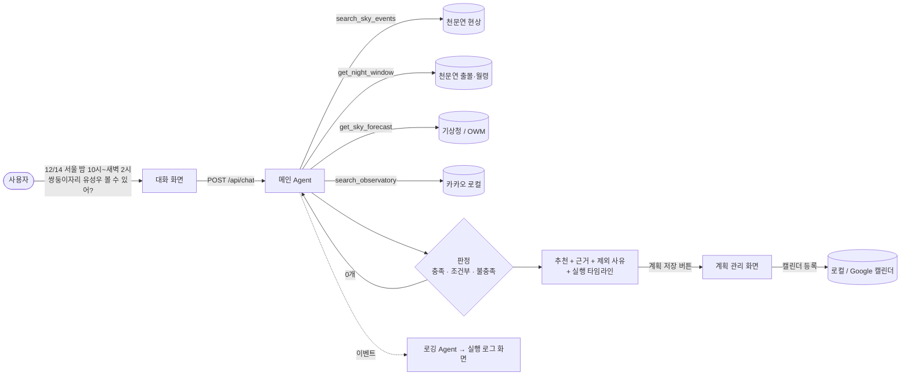

# Astrowatch · Agent 기반 천문 관측 플래너

> 보고 싶은 천문 현상과 내 시간을 말하면, **하늘이 어둡고 · 달이 방해하지 않고 · 구름이 적은 시간과 장소**를 골라 관측 계획을 만들고 캘린더에 넣어 준다.
>
> SSAFY AI 코어 프로젝트 3회차 (개인) · 갱신일 2026-11-18

| 항목 | 내용 |
|---|---|
| 핵심 | LangGraph 5노드 Agent(analyze → plan → execute → judge → respond) + 외부 API Tool 4종 + 로컬 Tool 3종 |
| 판단 | 관측 창 = 어두운 시간 ∩ 내 시간 ∩ 현상 시간, 맑은 시간 ≥ 30분 — **전부 코드로 계산** (LLM은 요청 해석·문장 생성만) |
| 저장 | 관측 계획(겹침 알림) · 실행 로그(수정 불가) · 대화 맥락 — SQLite |
| 심화 | **F3023 캘린더 연동 구현** (로컬 → Google 교체). F3020 · F3021 · F3022 미구현 |
| 실행 환경 | Windows 11 · Python 3.12 (venv) |

---

## 1. 데모 흐름



| 화면 | 경로 | 내용 |
|---|---|---|
| 대화 | `/` (`frontend/index.html`) | 답변 · 추천 카드 · 실행 타임라인(재계획 구분) · 경고 배너 |
| 계획 관리 | `/plans.html` | 목록 · 상세 · 수정 · 삭제 · 캘린더 등록 |
| 실행 로그 | `/logs.html` | 세션 목록 · 상세(seq 순) · 삭제 |
| API 문서 | `/docs` | FastAPI Swagger |

---

## 2. 실행 방법 (Windows)

```bat
:: 1) 가상환경 · 의존성
python -m venv .venv
.venv\Scripts\activate
pip install -r requirements.txt

:: 2) 환경변수 — 값을 채운다 (3절)
copy .env.example .env

:: 3) 서버
cd backend
..\.venv\Scripts\python -m uvicorn astrowatch.app.main:app --reload --port 8000
```

브라우저: http://127.0.0.1:8000 · API 문서: http://127.0.0.1:8000/docs

**테스트** (키 · 네트워크 없이 `samples/` fixture 로 실행)

```bat
cd backend
..\.venv\Scripts\python -X utf8 -m pytest
```

> 키가 하나도 없어도 서버는 뜬다. LLM 키가 없으면 사용법 안내만, 외부 키가 없으면 해당 Tool 이 `AUTH` 로 실패하고 나머지는 진행한다.
> 재계획·상한을 재현하려면 `.env` 에 `WEATHER_PROVIDER=mock` (모든 시간 흐림 고정).

---

## 3. API 키 발급 · 설정

| 키 | 발급 절차 | `.env` |
|---|---|---|
| 공공데이터포털 | ① [data.go.kr](https://www.data.go.kr) 회원가입 ② **활용신청 5건**: 천문연 천문현상(15012691) · 출몰시각(15012688) · 월령(15012689), 기상청 단기예보(15084084) · 중기예보(`MidFcstInfoService`) ③ 마이페이지 → **일반 인증키(Decoding)** 복사 | `DATA_GO_KR_KEY` |
| 카카오 | ① developers.kakao.com 앱 생성 ② **REST API 키** 복사 ③ 앱 설정에서 **카카오맵(로컬) 사용 활성화** | `KAKAO_REST_KEY` |
| SSAFY GMS | GMS 에서 키 발급 (OpenAI 호환, base_url 기본값 사용) | `GMS_KEY` |
| OpenWeatherMap (선택) | openweathermap.org 무료 키 | `OPENWEATHER_KEY` |
| Google Calendar (심화) | ① Cloud Console 프로젝트 · Calendar API 사용 ② OAuth 동의 화면(테스트) + **테스트 사용자** 등록 ③ OAuth 클라이언트 **데스크톱 앱** JSON → `secrets/google_client_secret.json` ④ `cd backend && python scripts/google_auth.py` → 브라우저 로그인 → `secrets/google_token.json` ⑤ `CALENDAR_PROVIDER=google` | `GOOGLE_*`, `CALENDAR_PROVIDER` |

주의

- data.go.kr 키는 발급 후 동기화에 시간이 걸릴 수 있다(약 1시간, 기획안 12절).
- Encoding 키를 넣어도 `%` 가 있으면 코드가 Decoding 값으로 되돌린다(`backend/astrowatch/config.py`).
- `.env` · `secrets/` 는 커밋하지 않는다(`.gitignore`).

### 환경변수 (`.env.example` 기준 · 값은 쓰지 않음)

| 변수 | 기본값 | 용도 |
|---|---|---|
| `GMS_KEY` | — | LLM 키 (analyze · respond) |
| `OPENAI_BASE_URL` | GMS 엔드포인트 | OpenAI 호환 base_url |
| `LLM_MODEL` | `gpt-6-luna` | 모델 |
| `LLM_REASONING_EFFORT` | `none` | gpt-6-luna 는 tools 사용 시 `none` 필수 |
| `EMBEDDING_MODEL` | `text-embedding-3-small` | F3022 용 (미사용) |
| `DATA_GO_KR_KEY` | — | 천문연 3종 · 기상청 2종 공통 |
| `KAKAO_REST_KEY` | — | 관측지 검색 |
| `WEATHER_PROVIDER` | `kma` | `kma` / `mock` |
| `OPENWEATHER_KEY` | — | 선택. 5일 예보 백업 |
| `MAX_REPLANS` | `3` | 재계획 상한 (NF3004) |
| `MIN_OBS_MINUTES` | `30` | 충족 최소 관측 시간 |
| `TIMEZONE` | `Asia/Seoul` | |
| `DB_PATH` | `data/astrowatch.db` | SQLite |
| `CHROMA_DIR` | `data/chroma` | F3022 용 (미사용) |
| `CALENDAR_PROVIDER` | `local` | `local` / `google` |
| `GOOGLE_CLIENT_SECRET_FILE` | `secrets/google_client_secret.json` | |
| `GOOGLE_TOKEN_FILE` | `secrets/google_token.json` | |
| `GOOGLE_CALENDAR_ID` | `primary` | |
| `APP_HOST` / `APP_PORT` | `127.0.0.1` / `8000` | |

---

## 4. 기능 구현 상태

| 번호 | 요구사항 | 상태 | 구현 위치 |
|---|---|---|---|
| F3001 | Tool 명세 정의 · 등록 | ✅ | `tools/base.py`, `tools/registry.py`, `tools/contracts.py` |
| F3002 | 후보 조회 (천문현상) | ✅ | `tools/sky_events.py` |
| F3003 | 상세 조회 (박명·출몰·월령) | ✅ | `tools/night_window.py` |
| F3004 | 보조 정보 (예보 · 관측지) | ✅ | `tools/sky_forecast.py`, `tools/observatory.py` |
| F3005 | 요청 분석 | ✅ | `agent/nodes.py` analyze |
| F3006 | 작업 계획 | ✅ | `agent/nodes.py` plan |
| F3007 | Tool 호출 · 결과 통합 | ✅ | `agent/nodes.py` execute |
| F3008 | 제약 적합성 판단 | ✅ | `agent/judge.py` |
| F3009 | 재계획 (결과 재사용 · 상한) | ✅ | `agent/replan.py`, `agent/nodes.py` judge |
| F3010 | 대화 맥락 | ✅ | `agent/memory.py`, `storage/sessions.py` |
| F3011 | 최종 응답 (근거 · 제외 사유) | ✅ | `agent/nodes.py` respond, `agent/prompts.py` |
| F3012 | 실행 이벤트 발행 | ✅ | `events/bus.py` |
| F3013 | 실행 로그 저장 (LLM 없음) | ✅ | `logging_agent/agent.py`, `storage/run_logs.py` |
| F3014 | 로그 조회 · 삭제 (수정 없음) | ✅ | `app/api/logs.py` |
| F3015 | 계획 저장 · 조회 (겹침 알림) | ✅ | `storage/plans.py`, `app/api/plans.py` |
| F3016 | 계획 수정 · 삭제 | ✅ | 〃 + `frontend/js/plans.js` |
| F3017 | FastAPI | ✅ | `app/main.py`, `app/api/*.py` |
| F3018 | 프론트엔드 | ✅ | `frontend/` (HTML · CSS · JS) |
| F3019 | 실행 과정 · 상태 표시 | ✅ | `frontend/js/timeline.js`, `frontend/js/chat.js` |
| F3020 | 이상 징후 판단 (심화) | ❌ 미선택 | — |
| F3021 | Planner · Worker (심화) | ❌ 미선택 | — |
| F3022 | RAG 검색 Tool (심화) | ❌ 미구현 | `knowledge` 의도는 "미지원" 안내 |
| F3023 | 캘린더 연동 Tool (심화) | ✅ 구현 | `tools/calendar.py`, `clients/calendar_provider.py` |

경로는 `backend/astrowatch/` 기준. 상세: [docs/REQUIREMENTS.md](docs/REQUIREMENTS.md)

---

## 5. 외부 API 출처 · 이용 조건 (NF3007)

| API | 제공 | 쓰임 (Tool) | 호출 한도 | 이용 조건 |
|---|---|---|---|---|
| 천문현상 정보 `AstroEventInfoService` | 한국천문연구원 · data.go.kr [15012691](https://www.data.go.kr/data/15012691/openapi.do) | `search_sky_events` | 엔드포인트당 일 10,000 | 이용허락범위 제한 없음 |
| 출몰시각 정보 `RiseSetInfoService` | 〃 [15012688](https://www.data.go.kr/data/15012688/openapi.do) | `get_night_window` | 〃 | 제한 없음 |
| 월령 정보 `LunPhInfoService` | 〃 [15012689](https://www.data.go.kr/data/15012689/openapi.do) | `get_night_window` | 〃 | 제한 없음 |
| 단기예보 `VilageFcstInfoService_2.0` | 기상청 · data.go.kr [15084084](https://www.data.go.kr/data/15084084/openapi.do) | `get_sky_forecast` | 〃 | 공공누리 1유형 (출처 표시) |
| 중기육상예보 `MidFcstInfoService` | 기상청 · data.go.kr | `get_sky_forecast` | 〃 | 공공누리 1유형 |
| 로컬 키워드 검색 | 카카오 | `search_observatory` | 일 100,000 | **결과 저장 금지 → 계획에는 `place_id` · `place_url` 만 저장**, 반경 최대 20km |
| SSAFY GMS (`gpt-6-luna`) | SSAFY | analyze · respond | 총 30,000 크레딧 · 1회 1크레딧 · **2026-11-20까지** | 교육용 |
| OpenWeatherMap 5일 예보 (선택) | OpenWeather | `get_sky_forecast` 백업 | 분당 60 · 월 100만 (공개값) | 무료 플랜 약관 |
| Google Calendar API (심화) | Google | `get_calendar`, `add_plan_to_calendar` | 미확인 | 본인 계정 · OAuth 테스트 사용자 |

한도는 2026-11-18 사용자 확인값(기획안 3절). 천체 카탈로그 `backend/astrowatch/data/sky_objects.json` 은 이전 프로젝트 VastHorizon `data/items.json` 에서 변환했다.

---

## 6. 문서

| 문서 | 내용 |
|---|---|
| [docs/ASTROWATCH_PLAN.md](docs/ASTROWATCH_PLAN.md) | 기획안 (도메인 · API · 판단식 · 일정) |
| [docs/REQUIREMENTS.md](docs/REQUIREMENTS.md) | 요구사항 정의서 (F3001~F3023 · NF3001~NF3007) |
| [docs/AGENT_DESIGN.md](docs/AGENT_DESIGN.md) | Agent 설계 (단계 · 재계획 · 판정 · 이벤트 · 맥락) |
| [docs/TOOL_SPEC.md](docs/TOOL_SPEC.md) | Tool 정의서 (7종 · 실패 코드 · 확장) |
| [docs/API_SPEC.md](docs/API_SPEC.md) | API 명세서 |
| [docs/VERIFICATION.md](docs/VERIFICATION.md) | 검증 결과 (4장 항목 · 대표 시나리오 · E2E 리뷰) |
| [docs/RUN_LOG_SAMPLE.md](docs/RUN_LOG_SAMPLE.md) | 실행 로그 샘플 (R1 전체 · R2 재계획 구간) |

---

## 7. 제약 · 알려진 한계

| 항목 | 내용 |
|---|---|
| 지원 지역 | 로컬 지역 표 28곳(`data/regions.py`). 없는 지역은 되묻는다 |
| 예보 범위 | 오늘 ~ +10일. 그 밖은 **조건부 충족**(날씨 미판단, "D-3부터 확인") |
| Open-Meteo | 개발 네트워크에서 차단되어 사용하지 않음 |
| 천체 | 카탈로그 294개 + 행성 7개(저정밀 궤도 요소). 카탈로그에 없는 천체는 고도를 추정하지 않고 판단 보류 |
| 저장 의도 | 채팅으로 "저장해 줘" 는 화면의 **계획 저장** 버튼을 안내 (채팅으로 직접 저장 안 함) |
| F3022 | RAG Tool 미구현 → 배경지식 질문은 미지원 안내 |
| GMS | 2026-11-20 이후 사용 불가 → LLM 없이 사용법 안내 · 템플릿 응답만 |
| 응답 시간 | 실제 E2E 중앙값 6.30초 · 최대 34.84초(수정 전 잘못된 날짜 사례). 부하 시험은 하지 않음 |
| 샘플 | `samples/run_*.json` 은 E2E 리뷰 수정 **이전** 캡처라 `stop_reason` · `replan_limit` 필드가 없다 → 3일차 재캡처 예정 |
