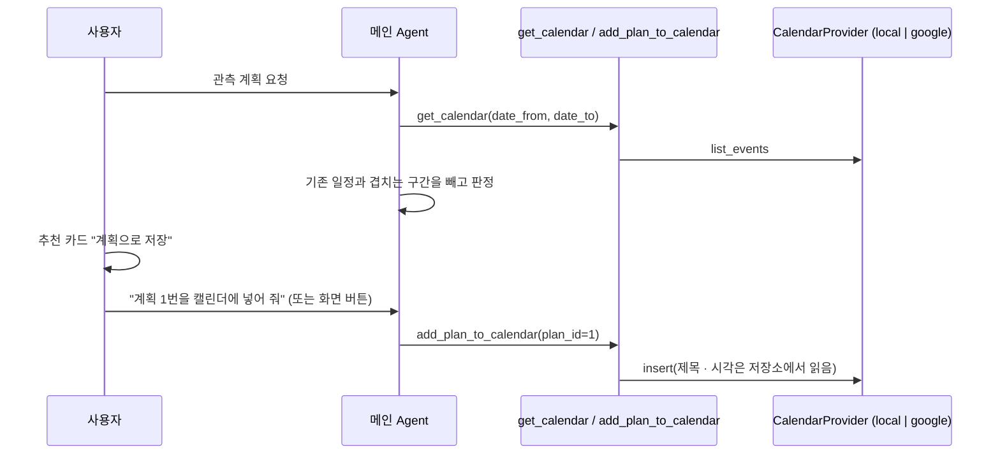

# Astrowatch — Agent 기반 천문 관측 플래너

> 보고 싶은 천문 현상과 내 시간을 말하면, **하늘이 어둡고 · 달이 방해하지 않고 · 구름이 적은 시간과 장소**를 골라 관측 계획을 만들고 캘린더에 넣어 준다.

| 항목 | 내용 |
|---|---|
| 과정 | SSAFY AI 코어 프로젝트 3회차 · "Agent 기반 도메인 플래너 서비스" |
| 형태 | 개인 프로젝트 · 2026-11-18 ~ 11-20 |
| 도메인 | 천문 관측 (2회차 RAG 프로젝트 [VastHorizon](https://github.com/bnbong/VastHorizon)의 우주 도메인 계승) |
| 기술 | Python 3.12 · LangGraph 1.2 · FastAPI · SQLite · HTML/CSS/JS |
| 결과 | 필수 F3001~F3019 전부 구현 · 심화 F3023(캘린더) 구현 · 자동 테스트 236건 · 실제 E2E 20 시나리오 리뷰 반영 |

---

## 1. 요약

**문제.** "12월 14일 밤 서울에서 쌍둥이자리 유성우를 볼 수 있어?" 는 LLM 혼자서는 답할 수 없다. 그날의 천문박명·월출몰, 극대 시각, 예보, 사용자의 귀가 시각을 **겹쳐 계산**해야 한다.

**해결.** 외부 API 5종을 Tool 로 감싸고, 메인 Agent 가 요청을 분석 → 계획 → 호출 → 판정 → 응답으로 처리한다. 판정은 전부 코드가 하고 LLM 은 요청 해석과 문장 생성만 맡는다. 충족 후보가 없으면 날짜 → 현상 → 지역 순으로 최대 3회 재계획하며 이미 받은 결과는 재사용한다. 실행 과정은 이벤트로 발행되어 로깅 서브 Agent 가 세션 단위로 기록한다.

**결과.**

| 지표 | 값 |
|---|---|
| 요구사항 | 필수 19/19 · 심화 1/4 (F3023) |
| Tool | 외부 API 4종 + 로컬 3종 (천체 카탈로그 · 캘린더 조회 · 캘린더 등록) |
| 자동 테스트 | 236건, 키 · 네트워크 없이 통과 |
| 실제 검증 | 대표 시나리오 7종 + Codex 실제 E2E 20 시나리오(브라우저 포함) → 결함 8건 수정 |
| 응답 시간 | 실제 요청 중앙값 6.3초 (LLM 2회 호출 포함) |

---

## 2. 도메인 선택과 근거

| 선택 조건 | 충족 | 근거 |
|---|---|---|
| 서로 다른 정보를 주는 외부 API 3종 이상 | ✅ | 천문연(현상 · 출몰 · 월령) · 기상청(단기 · 중기예보) · 카카오 로컬(관측지) |
| Tool 결과와 제약을 비교해야 답할 수 있는 요청 | ✅ | 박명 · 월령 · 구름 · 내 시간의 교집합이 있어야 "볼 수 있다"가 성립 |
| 재계획이 의미 있음 | ✅ | 흐리거나 달이 밝으면 다른 날짜 · 현상 · 인접 지역으로 다시 찾는다 |
| 저장 · 관리할 결과물 | ✅ | 관측 계획(현상, 날짜, 시작 · 종료, 장소). 같은 밤 시간 겹침 알림 |
| 위험 도메인 여부 | 아님 | 면책 불필요. 야간 외출 안전 · 눈 예보 시 결빙 주의 문구만 |

**LLM 만으로 답하면 틀리는 이유**

| 요청 | LLM 만으로는 |
|---|---|
| "토요일 밤 서울 구름 많아?" | 예보를 모른다 |
| "12/14 유성우, 몇 시부터 어두워져?" | 그날 서울의 천문박명 · 월출 시각을 지어낸다 |
| "안드로메다 은하 제일 잘 보이는 날짜" | 월령과 그날 은하의 고도를 모른다 |

---

## 3. 시스템 구조

```mermaid
flowchart LR
  subgraph FE[프론트엔드 · HTML/JS]
    C[대화 + 실행 패널] --- P[계획 관리] --- L[실행 로그]
  end
  subgraph BE[백엔드 · FastAPI]
    API[/api/chat · plans · logs · calendar]
    subgraph AG[메인 Agent · LangGraph]
      A[analyze] --> PL[plan] --> E[execute] --> J[judge] --> R[respond]
      J -->|재계획| PL
    end
    REG[Tool 레지스트리]
    BUS((EventBus))
    LOG[로깅 Agent<br/>LLM 없음]
    DB[(SQLite<br/>plans · run_logs · sessions)]
  end
  subgraph EXT[외부]
    K1[천문연 3종] ; K2[기상청 2종] ; K3[카카오 로컬] ; K4[Google Calendar] ; LLM[GMS gpt-6-luna]
  end
  FE <--> API --> AG
  E --> REG --> K1 & K2 & K3 & K4
  A & R --> LLM
  AG -. 이벤트 .-> BUS --> LOG --> DB
  API --> DB
```

| 영역 | 위치 (`backend/astrowatch/`) | 책임 |
|---|---|---|
| Agent | `agent/` graph · nodes · judge · replan · memory · service · prompts | 실행 루프, 판정식, 재계획, 대화 맥락 |
| Tool | `tools/` base · registry · contracts · 7개 Tool | 공통 응답 봉투, 등록, 입출력 계약 |
| 클라이언트 | `clients/` kasi · kma · kakao · owm · calendar_provider | 외부 API 호출만 (키 · URL 은 메시지에 넣지 않음) |
| 이벤트 | `events/bus.py` | 발행 · 구독. 구독자 없거나 죽어도 메인 흐름 유지 |
| 로깅 | `logging_agent/agent.py` | 이벤트를 받은 그대로 세션별 저장 |
| 데이터 | `storage/` plans · run_logs · sessions, `schema.sql` | 계획 CRUD, 수정 불가 로그, 세션 맥락 |
| 천문 계산 | `astro/` altaz · planets · catalog, `data/sky_objects.json` | 천체 고도 · 남중, 행성 좌표, 카탈로그 294개 |
| 지역 | `data/regions.py` | 지역명 → 위경도 · 기상청 격자 · 중기예보 구역 (로컬 표) |
| API · 화면 | `app/`, `frontend/` | 9개 경로, 화면 3개 |

---

## 4. 메인 Agent 설계

### 4-1. 실행 단계

| 단계 | 입력 → 출력 | LLM |
|---|---|---|
| analyze | 메시지 + 이전 조건 → 의도 7종, 조건(기준 · 선호 · 제약), 고정 조건, 되묻기 | **사용** (structured output) |
| plan | 조건 → Tool 호출 순서 (현상 → 천체 고도 → 박명 · 월령 → 예보 → 관측지 → 캘린더) | 규칙 |
| execute | 계획 → Tool 결과. 앞 Tool 출력을 다음 입력으로, 실패는 기록 후 계속, 같은 인자는 캐시 재사용 | 없음 |
| judge | 결과 → 후보별 판정 · 사유 · 역산 기준. 충족 0개면 재계획 전략 선택 | 없음 |
| respond | 판정 → 추천 · 근거 · 제외 사유 · 안내 문장 | **사용** (실패 시 템플릿) |

### 4-2. 판정식 (F3008)

```
어두운 창 = [오늘 천문박명 종료, 다음 날 천문박명 시작]      ← 출몰 Tool (두 날짜)
내 창     = [시작 가능, 종료]                                ← 사용자 (없으면 어두운 창 전체)
현상 창   = 유성우: 극대 ±6h · 천체: 고도 20° 이상 구간 · 그 외: 어두운 창
시간 창   = 세 창의 교집합 → 달 · 기존 일정과 겹치는 구간을 빼고 가장 좋은 구간
맑은 시간 = 시간 창 중 맑음(강수확률 ≤30%, 강수 없음)인 시간
```

| 판정 | 조건 |
|---|---|
| 충족 | 시간 창 ≥ 30분 **그리고** 맑은 시간 ≥ 30분 |
| 조건부 충족 | 시간 창은 되는데 예보가 없음(범위 밖) → "D-3부터 확인" 안내, 역산 기준은 제시 |
| 불충족 | 시간 창 < 30분, 흐림 · 강수, 달빛(유성우 월령 10~20 · 희미한 천체 7~23) |
| 판단 안 함 | 박명을 못 받았거나 사용자가 말한 천체를 현상 목록 · 카탈로그에서 찾지 못함 → 값을 지어내지 않고 되묻기 |

확인할 수 없는 값(실제 유성 수, 예보 밖 날씨)은 추정하지 않고 **"늦어도 HH:MM 도착하면 30분 확보"** 처럼 역산한 기준만 준다.

### 4-3. 재계획 (F3009)

| 항목 | 규칙 |
|---|---|
| 조건 | 충족 + 조건부 충족 후보가 0개일 때만 |
| 전략 순서 | ① 같은 현상 다른 날짜(±2일) → ② 같은 기간 다른 현상 → ③ 인접 지역 |
| 생략 | 사용자가 날짜 · 현상 · 지역을 고정했거나, 특정 천체를 지목했거나(②), 대상이 그 지역에서 뜨지 않을 때 |
| 재사용 | `(tool, 인자)` 키 캐시 — 재계획 회차에 같은 호출 0회 (테스트 · 실행 로그로 확인) |
| 상한 | `MAX_REPLANS=3`. 종료 사유를 5종으로 구분해 응답(`stop_reason`): 상한 도달 · 대안 소진 · 관측 불가 · 고정 조건 · 치명 오류 |

### 4-4. 대화 맥락 (F3010)

세션에 **조건 객체 · 직전 추천 요약 · 최근 6턴**만 보관하고 Tool 원본은 남기지 않는다. 후속 요청은 바뀐 값만 병합한다("같은 날 장소만 대전으로" → 지역만 갱신, 현상 조회는 재사용).

---

## 5. Tool 설계

공통 응답 `{ok, data, note?}` / `{ok: false, error: {code, message}}`. 예외는 밖으로 나가지 않고, 메시지에 키 · URL · 스택을 넣지 않는다.

| Tool | 구분 | 언제 쓰나 | 출처 | 주요 실패 코드 |
|---|---|---|---|---|
| `search_sky_events` | 외부 · 후보 | 볼 현상을 정하지 않았거나 기간 안의 현상을 찾을 때 | 천문연 천문현상 | NO_RESULT · AUTH |
| `get_night_window` | 외부 · 상세 | 날짜 · 지역의 어두운 시간과 달을 알아야 할 때 | 천문연 출몰 · 월령 | NO_WINDOW · AUTH |
| `get_sky_forecast` | 외부 · 보조 | 후보 시간대의 구름 · 강수 | 기상청 단기 → OWM → 중기 순 | OUT_OF_RANGE · AUTH |
| `search_observatory` | 외부 · 보조 | 관측 장소를 찾을 때 (반경 ≤ 20km) | 카카오 로컬 | NO_RESULT · AUTH |
| `lookup_sky_object` | 로컬 | 특정 천체 · 행성이 그날 밤 언제 떠 있는지 | 카탈로그 294 + 행성 궤도 계산 | NOT_FOUND |
| `get_calendar` | 로컬 → Google | 기존 일정과 겹치는지 | 로컬 DB / Google Calendar | AUTH |
| `add_plan_to_calendar` | 로컬 → Google | 저장된 계획을 캘린더에 (입력은 **계획 번호만**) | 〃 | NOT_FOUND · AUTH |

Tool 사이 데이터 흐름: 현상 Tool 의 날짜 → 박명 · 예보 Tool 의 입력, 지역 표의 위경도 → 세 Tool 공통, 박명 창 → 예보 Tool 의 시각 목록.

---

## 6. 로깅 Agent 와 실행 로그 (F3012~F3014)

| 항목 | 설계 |
|---|---|
| 이벤트 9종 | session_start · stage_start · stage_end · tool_call · tool_result(소요 ms) · llm_decision(판단 + 이유) · replan · error · session_end |
| 분리 기준 | 발행 측은 구독자를 모른다. 구독자가 없거나 예외를 내도 메인 Agent 는 정상 응답 (테스트) |
| 저장 | 로깅 Agent 가 이벤트를 받은 즉시 세션 · seq 순으로 SQLite 에 덧붙임. **LLM 사용 없음**. 재시작 후에도 seq 이어짐 |
| 조회 · 삭제 | 목록 · 상세 · 삭제 API 만 제공. 수정 API 없음 + DB 트리거로 UPDATE 차단 |

---

## 7. 화면 (F3018 · F3019)

| 화면 | 구성 |
|---|---|
| 대화 | 조건 스트립(잡힌 조건 · 미지정 표시) · 추천 카드(판정 배지, 관측 창 · 맑은 시간 · 달 · 늦어도 도착, **밤 타임바**: 어두운 시간 · 달 · 시간별 하늘 · 내 창 · 극대를 한 줄에) · 제외 사유 · 종료 사유 스트립 · 우측 실행 타임라인(단계 · Tool · LLM 판단 · 재계획 구분선) |
| 계획 관리 | 밤 단위 그룹 목록 · 상세 서랍(수정 · 삭제 · 캘린더 등록 상태) · 겹침 알림 |
| 실행 로그 | 세션 목록 · 유형 필터 · 이벤트 표(payload 열람) · 삭제 |

디자인은 시안 2안을 비교해 "Almanac"(크림 바탕 · 세리프 제목 · 잉크 남색)을 채택했다. 상태는 색과 함께 모양(○ 단계 · □ Tool · △ 조건부 · ✕ 실패)으로 구분한다.

<!-- 스크린샷: docs/screenshots/ (3일차 추가) -->

---

## 8. 구현 결과

### 필수 기능

| 번호 | 요구사항 | 상태 | 핵심 구현 |
|---|---|---|---|
| F3001 | Tool 명세 정의 · 등록 | ✅ | 레지스트리 데코레이터, 외부/로컬 구분, 공통 봉투 |
| F3002 | 후보 조회 Tool | ✅ | 천문현상 월별 조회, 기본 범위 "오늘~+9일" 과 추정 표시 |
| F3003 | 상세정보 조회 Tool | ✅ | 박명 · 월출몰(당일 · 다음 날) · 월령, 값 없으면 판단 보류 |
| F3004 | 보조 정보 검색 Tool | ✅ | 예보(공급자 3단 폴백) · 관측지(결과 없음 응답 정의) |
| F3005 | 요청 분석 | ✅ | 기준 · 선호 · 제약 추출, 존재하지 않는 날짜 되묻기, 한 밤 접기 |
| F3006 | 작업 계획 | ✅ | Tool 순서 구성, 인사 · 사실 질문은 계획 생략 또는 1개 |
| F3007 | Tool 호출 · 통합 | ✅ | 출력 → 입력 전달, 실패 기록 후 진행, 캐시 |
| F3008 | 제약 적합성 판단 | ✅ | 4-2 판정식, 역산 기준 |
| F3009 | 재계획 | ✅ | 전략 3종, 재사용, 상한, 종료 사유 |
| F3010 | 대화 맥락 | ✅ | 조건 병합, 고정 조건, 요약만 보관 |
| F3011 | 최종 응답 | ✅ | 추천 · 근거 Tool · 제외 사유 · 안전 문구 |
| F3012 | 실행 이벤트 발행 | ✅ | 9종, 세션 식별자, 구독자 비의존 |
| F3013 | 실행 로그 저장 | ✅ | 로깅 Agent, LLM 없음 |
| F3014 | 로그 조회 · 삭제 | ✅ | 수정 API 없음 (405) |
| F3015 | 계획 저장 · 조회 | ✅ | 겹침 알림(저장은 허용), 한 트랜잭션 |
| F3016 | 계획 수정 · 삭제 | ✅ | 화면 즉시 반영 |
| F3017 | FastAPI | ✅ | 9개 경로, Pydantic 모델, 오류 상세 비노출 |
| F3018 | 프론트엔드 | ✅ | HTML/CSS/JS, 화면 3개, 모바일 |
| F3019 | 실행 과정 · 상태 | ✅ | 타임라인, 재계획 구분, 처리 중, 키 누락 안내 |

### 심화 · 비기능

| 번호 | 내용 | 상태 |
|---|---|---|
| F3023 | 캘린더 연동 Tool | ✅ 로컬 구현체 → Google 교체, 계획 번호만 입력, 기존 일정을 판정에 반영 |
| F3022 | RAG 검색 Tool | ❌ 미구현 (배경지식 질문은 미지원 안내) |
| F3020 · F3021 | 이상 징후 · Planner/Worker | ❌ 미선택 |
| NF3001~3007 | 키 환경변수 · 화면 비노출 · Tool 실패 처리 · 재계획 상한 · 응답 시간 · 모듈 분리 · 출처 기록 | ✅ (상세: [검증 결과 9절](docs/VERIFICATION.md)) |

---

## 9. 검증 결과

### 대표 시나리오 (명세 4.7)

| # | 요청 | 유형 | 결과 |
|---|---|---|---|
| R1 | 12/14 서울 22~02시 쌍둥이자리 유성우 | 한 번에 충족 | 조건부 충족 · 관측 창 240분 · 월령 5.5 · 늦어도 01:30 도착 · 예보는 D-3부터 |
| R2 | 주말 21~24시 대전, 흐리면 다른 날 | 재계획 | 날짜 → 현상 → 인접 지역 3회, 회차마다 현상 · 박명 결과 재사용 (mock 예보) |
| R3 | 다음 주 서울 보름달 피해 유성 | 상한 도달 | 3회 후 멈추고 "날짜 범위나 지역을 넓혀 볼까요?" |
| R4 | 대전 천문대 20km + 카카오 키 없음 | Tool 실패 | 장소만 `AUTH` 경고, 시간 · 날씨 판정은 정상 |
| R5 | 안녕, 이거 어떻게 써? | Tool 불필요 | Tool 0회, 사용법 안내 |
| R6 | 같은 날 장소만 대전으로 | 맥락 유지 | 날짜 · 시간 유지, 지역만 갱신, 현상 조회 재사용 |
| R7 | 밤 11시 전엔 들어와야 해 | 되묻기 | Tool 호출 전 지역 · 시작 시각 질문 |

보충: 안드로메다 은하 "보기 좋은 날짜"(날짜 미지정 → 10일 범위, 은하 고도 · 월몰 이후 구간으로 판정), 화성 "제일 잘 보이는 시간대"(사실 질문, 남중 기준).

### 실제 E2E 리뷰 (Codex · 20 시나리오 · Edge 브라우저)

| 발견 | 수정 |
|---|---|
| 카탈로그에 없는 천체를 "충족"으로 추천 | 판단 보류 + 비슷한 이름 되묻기, 재계획 생략 |
| 2월 30일을 날짜 미지정으로 처리 | 존재하지 않는 날짜 · 뒤집힌 범위는 외부 호출 없이 되묻기 |
| 재계획 0회인데 "상한 도달" 배너 | 종료 사유 5종 분리, 상한값과 실행 횟수 분리 |
| 자정 넘김 한 밤을 이틀로 확대 | LLM 의 "한 밤" 판단이 있을 때만 접기 |
| 없는 캘린더 기능으로 유도 | F3023 구현 + 미제공 시 정직한 안내 |
| 공백 입력이 LLM 호출 · Markdown 노출 · 문서 미완성 | trim 후 422 · 안전한 Markdown 렌더러 · 문서 7종 |

자동 테스트 236건은 모두 키 · 네트워크 없이 `samples/` 의 실제 응답을 fixture 로 쓴다. 상세: [docs/VERIFICATION.md](docs/VERIFICATION.md), 전체 실행 로그 샘플: [docs/RUN_LOG_SAMPLE.md](docs/RUN_LOG_SAMPLE.md).

---

## 10. 심화 기능 적용 요약 — F3023 캘린더 연동



- 입출력 형식을 먼저 정하고 **로컬 SQLite 구현체**로 동작을 확인한 뒤, 설정값 하나(`CALENDAR_PROVIDER=google`)로 **Google Calendar API** 구현체로 교체했다. Tool 입출력은 동일하다.
- 등록 Tool 은 계획 식별자만 받는다. 제목과 시각은 저장소에서 읽어 모델이 값을 지어낼 수 없다.
- 조회한 일정은 판정에 반영된다. 관측 창과 겹치면 겹치는 구간을 빼고 남는 구간으로 줄이거나 불충족으로 처리하고 사유에 일정 제목을 남긴다.
- 실제 Google 계정으로 조회 · 등록이 동작하는 것을 확인했다.

---

## 11. 외부 API 출처 · 이용 조건 (NF3007)

| API | 제공 | Tool | 호출 한도 | 이용 조건 |
|---|---|---|---|---|
| 천문현상 정보 `AstroEventInfoService` | 한국천문연구원 · data.go.kr [15012691](https://www.data.go.kr/data/15012691/openapi.do) | `search_sky_events` | 엔드포인트당 일 10,000 | 이용허락범위 제한 없음 |
| 출몰시각 정보 `RiseSetInfoService` | 〃 [15012688](https://www.data.go.kr/data/15012688/openapi.do) | `get_night_window` | 〃 | 제한 없음 |
| 월령 정보 `LunPhInfoService` | 〃 [15012689](https://www.data.go.kr/data/15012689/openapi.do) | `get_night_window` | 〃 | 제한 없음 |
| 단기예보 `VilageFcstInfoService_2.0` | 기상청 · data.go.kr [15084084](https://www.data.go.kr/data/15084084/openapi.do) | `get_sky_forecast` | 〃 | 공공누리 1유형 (출처 표시) |
| 중기육상예보 `MidFcstInfoService` | 기상청 · data.go.kr | `get_sky_forecast` | 〃 | 공공누리 1유형 |
| 로컬 키워드 검색 | 카카오 | `search_observatory` | 일 100,000 | **결과 저장 금지 → `place_id` · `place_url` 만 저장**, 반경 최대 20km |
| SSAFY GMS (`gpt-6-luna`) | SSAFY | analyze · respond | 총 30,000 크레딧 · 1회 1크레딧 · 2026-11-20까지 | 교육용 |
| OpenWeatherMap 5일 예보 (선택) | OpenWeather | `get_sky_forecast` 백업 | 분당 60 · 월 100만 (공개값) | 무료 플랜 약관 |
| Google Calendar API (심화) | Google | `get_calendar`, `add_plan_to_calendar` | 미확인 | 본인 계정 · OAuth 테스트 사용자 |

한도는 2026-11-18 확인값. 천체 카탈로그는 VastHorizon `data/items.json`(Wikidata 기반)에서 변환했고, 행성 위치는 JPL Horizons 와 대조해 적경 · 적위 차이 0.03° 이내였다.

---

## 12. 개발 과정과 설계 변경

기획 검증(명세 2.7)과 실제 실행에서 드러난 사실에 따라 설계를 바꾼 기록이다.

| 발견 | 설계 변경 |
|---|---|
| 12/14 유성우는 예보 범위 밖이라 "충족"이 성립할 수 없음 | 판정을 **충족 · 조건부 충족 · 불충족** 3단계로 |
| 카카오로 지오코딩하면 카카오 키 누락 시 날씨 · 박명까지 실패 | 지역 표를 **로컬**에 두고 출몰 API 는 위경도 버전 사용 |
| 개발 네트워크에서 Open-Meteo 차단, 카카오 반경 20km 상한 | 백업 예보를 기상청 중기예보 · OWM 으로, 반경 20km 고정 |
| "안드로메다 은하 보기 좋은 날짜"가 되묻기만 반복 | 날짜 없음은 되묻지 않고 **기본 범위**를 쓰고 그 사실을 밝힘 |
| 은하는 천문현상 목록에 없어 엉뚱한 유성우를 추천 | **천체 카탈로그**(294개) + 고도 계산으로 "떠 있는 시간"만 창으로, 달이 진 뒤 구간으로 자름 |
| "화성 제일 잘 보이는 시간대"에 키워드 규칙이 틀린 Tool 선택 | 사실 질문의 Tool 선택을 **LLM 판단**(5종)으로 바꾸고 판단 이유를 이벤트에 기록 |
| LLM 이 단순 언급한 지역 · 현상까지 "고정"으로 묶어 재계획이 1회 만에 소진 | 고정은 명시적 표현만, 단일 날짜만 자동 고정 |
| Codex 실제 E2E 에서 8건 | 9절 표 |

개발은 Claude(오케스트레이션 · 설계 · 계약) → Opus 에이전트(모듈 구현) → Codex(모듈별 코드 리뷰 · 실제 E2E) 순환으로 진행했고, 모든 모듈은 계약 파일(공통 응답 · 스키마 · State · 이벤트 · DB)을 먼저 고정한 뒤 병렬로 구현했다.

---

## 13. 한계와 향후 과제

| 항목 | 내용 |
|---|---|
| 지원 지역 | 로컬 지역 표 28곳. 없는 지역은 되묻는다 |
| 예보 범위 | 오늘 ~ +10일. 그 밖은 조건부 충족 |
| 천체 | 카탈로그 294개 + 행성 7개(저정밀 궤도). 없는 천체는 고도를 추정하지 않는다 |
| F3022 | RAG Tool 미구현. VastHorizon 의 Chroma 색인을 로컬 Tool 로 감싸면 추가 가능 |
| GMS | 2026-11-20 이후 사용 불가 → LLM 없이 사용법 안내 · 템플릿 응답만 |
| 샘플 | `samples/run_*.json` 과 E2E 기록은 리뷰 수정 **이전** 캡처 → 새 UI · 새 필드 기준 재캡처 예정 |
| 향후 | 세션 실패 수 · 소요 시간 집계 API, 계획에 판정 등급 저장, 오늘 하늘 요약 API |

---

## 14. 실행 방법 · 문서

```bat
python -m venv .venv && .venv\Scripts\activate && pip install -r requirements.txt
copy .env.example .env            :: 키 입력 (docs/SETUP.md 2절)
cd backend && ..\.venv\Scripts\python -m uvicorn astrowatch.app.main:app --reload --port 8000
```

API 키 발급 절차와 환경변수 전체는 [docs/SETUP.md](docs/SETUP.md) 참고.

| 문서 | 내용 |
|---|---|
| [docs/ASTROWATCH_PLAN.md](docs/ASTROWATCH_PLAN.md) | 기획안 (도메인 · API · 판단식 · 일정 · 기획 검증 기록) |
| [docs/REQUIREMENTS.md](docs/REQUIREMENTS.md) | 요구사항 정의서 (F3001~F3023 · NF3001~NF3007 도메인판) |
| [docs/AGENT_DESIGN.md](docs/AGENT_DESIGN.md) | Agent 설계 문서 |
| [docs/TOOL_SPEC.md](docs/TOOL_SPEC.md) | Tool 정의서 |
| [docs/API_SPEC.md](docs/API_SPEC.md) | API 명세서 |
| [docs/VERIFICATION.md](docs/VERIFICATION.md) | 검증 결과 |
| [docs/RUN_LOG_SAMPLE.md](docs/RUN_LOG_SAMPLE.md) | 실행 로그 샘플 |
| [docs/SETUP.md](docs/SETUP.md) | 설치 · 키 · 환경변수 |
| [output/e2e-review/REVIEW.md](output/e2e-review/REVIEW.md) | Codex 실제 E2E 리뷰 원문 |
