<p align="center">
  
</p>
<p align="center">
<em><b>Astrowatch (Astro + Overwatch):</b> 에이전트 기반 천문 관측 플래너</em>
</p>
<p align="center">


</p>

---

<p align="center">
  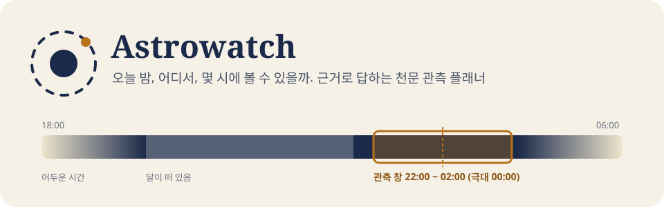
</p>

> **"오늘 밤, 어디서 몇 시에 별을 볼 수 있을까?"**  
> 하늘이 어둡고, 달빛 방해가 적으며, 구름 없는 맑은 시간을 계산해 주는 **천문 관측 플래너**입니다.

- **라이브 서비스 접속(2026/11/20 이후 링크 사용 불가)**: [https://astrowatch-jqtv.onrender.com/](https://astrowatch-jqtv.onrender.com/)

### 프로젝트 핵심 요약

| 구분 | 주요 내용 |
|---|---|
| **프로젝트** | SSAFY AI 코어 3회차 "Agent 기반 도메인 플래너 서비스" (개인 / 3일) |
| **도메인** | 천문 관측 ([VastHorizon](https://github.com/bnbong/VastHorizon) 우주 도메인 계승 및 발전) |
| **라이브 배포** | Render 클라우드 HTTPS 서비스 운영 중(2026/11/20 이후 링크 사용 불가) ([서비스 접속](https://astrowatch-jqtv.onrender.com/)) |
| **핵심 성과** | 5종 공공 API 및 8개 도구 연동 / Planner와 Worker 계층 분리형 LangGraph 에이전트 구축 / 심화 요구사항 4종 완수 / 자동화 테스트 440건 전원 통과 |

---

## 1. 프로젝트 배경 및 문제 정의

### 왜 천문 관측인가?

지식 기반 우주 안내서였던 이전 프로젝트([VastHorizon](https://github.com/bnbong/VastHorizon))에서 자연스럽게 다음 질문으로 이어졌습니다.

> **"그래서 그 별을 실제로 언제, 어디서 볼 수 있는가?"**

이 질문은 단순한 문서 검색(RAG)만으로는 해결할 수 없습니다.  
특정 날짜와 관측 장소의 **하늘 상태(천문박명, 월령, 날씨, 천체 고도)를 실시간으로 교차 계산**해야 비로소 답을 내릴 수 있기 때문입니다.

---

### LLM 단독 처리의 한계

"12월 14일 밤 서울에서 쌍둥이자리 유성우를 볼 수 있어?"라는 질문에 답하려면 4가지 사실의 **교집합(최소 30분 이상)** 을 구해야 합니다.

| 필요한 정보 | 데이터 출처 | LLM 단독 처리 시 문제점 |
|---|---|---|
| **천문박명 시각** (완전한 어둠) | 천문연 출몰시각 API | 정확한 계산 대신 그럴듯한 시각을 허구로 생성 (환각) |
| **극대 시각 및 월령** (달의 방해) | 천문연 천문현상 및 월령 API | 매년 바뀌는 주기 데이터를 알지 못함 |
| **시간별 구름량 및 강수** | 기상청 단기 및 중기예보 API | 실시간 기상 예보 접근 불가 |
| **사용자 가용 시간** | 대화 입력 | 복잡한 대화에서 정형화된 시간 제약식을 추출 및 유지하지 못함 |

> [!IMPORTANT]
> 네 가지 조건이 모두 겹치는 **'관측 창'이 30분 이상** 확보되어야 관측이 성립합니다.  
> 조건이 어긋나면 대체 일정을 재계획하고, 불가능하다면 명확한 이유를 제시해야 합니다.

---

### 핵심 해결 목표

1. **결정론적 코드 판정**  
   - LLM은 '사용자 요청 해석'과 '친절한 답변 작성'만 전담  
   - 관측 성립 여부는 외부 API 데이터를 바탕으로 **엄밀한 수식 코드로 판정**

2. **비용 효율적 자율 재계획 (Replanning)**  
   - 조건 불충족 시 `날짜(±2일) -> 현상 -> 인접 지역` 순으로 대안 탐색 (최대 3회)  
   - 이미 수집한 API 결과는 캐시하여 **중복 호출 0회** 보장

3. **투명한 추론 추적**  
   - 에이전트의 모든 판단 과정을 타임라인 이벤트로 실시간 기록

4. **환각 없는 역산 기준 제시**  
   - 확인할 수 없는 정보는 꾸며내지 않음  
   - 예: "늦어도 01:30까지 도착해야 30분 관측 확보"와 같이 **역산된 마지노선** 안내

---

## 2. 시스템 아키텍처 및 핵심 워크플로우

### 2-1. 전체 시스템 계층 구조

전체 시스템은 외부 종속성을 철저히 분리하고 장애를 격리할 수 있도록 계층형 구조로 설계되었습니다.

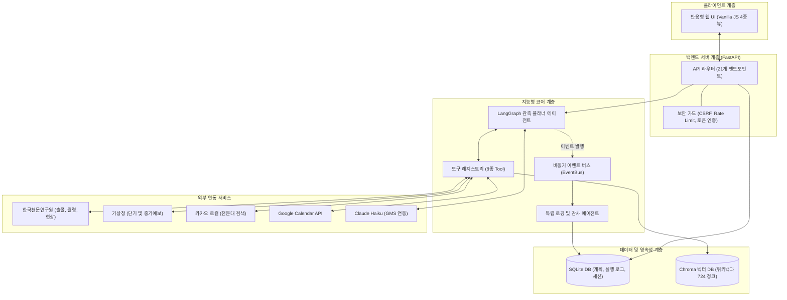

| 모듈 계층 | 역할 및 책임 |
|---|---|
| **메인 Agent** | Planner와 Worker 제어 루프, 결정론적 판정식, 자율 재계획, 대화 세션 맥락 관리 |
| **Tool 계층** | 표준 응답 봉투(`Envelope`), Tool 레지스트리, 입출력 스키마 계약, 도구 8종 |
| **RAG 지식 검색** | 위키백과 문서 기반 Chroma 벡터 색인, 하이브리드 검색 (제목 가중치 + 벡터 유사도) |
| **외부 연동** | 한국천문연구원, 기상청, 카카오, OpenWeatherMap, Google Calendar 통신 및 에러 격리 |
| **이벤트 및 로깅** | Pub/Sub 이벤트 버스 기반 비동기 로깅, 규칙 기반 이상 징후 판정, 이상 실행 한정 LLM 진단 |
| **저장소** | SQLite 기반 관측 계획 관리, 불변 실행 로그, 감사 판정 결과, 세션 상태 보관 |
| **천문 계산 엔진** | 천체 고도, 방위각, 남중 계산, 행성 궤도 산출, 294개 천체 카탈로그, 유성우 복사점 매핑 |
| **API 및 보안** | 21개 REST 엔드포인트, CSRF 방어, Rate Limit 가드, 로그 민감정보 마스킹 |
| **웹 프론트엔드** | 순수 HTML5, CSS3, Vanilla JS 기반 4개 반응형 뷰 (대화, 계획, 로그, 하늘 가리키기) |

> [!NOTE]
> **완전한 비동기 분리**: 메인 Agent와 로깅 Agent는 경량 `EventBus`로만 연결됩니다.  
> 로깅 구독자에 지연이나 예외가 발생해도 메인 관측 판정 흐름은 중단 없이 정상 작동합니다.

---

### 2-2. Planner와 Worker 계층형 제어 루프

LangGraph 기반의 에이전트는 계획 수립(Planner)과 도구 실행(Worker), 그리고 검증(Verify) 단계로 역할을 나누어 세밀한 오류 복구와 제어를 수행합니다.

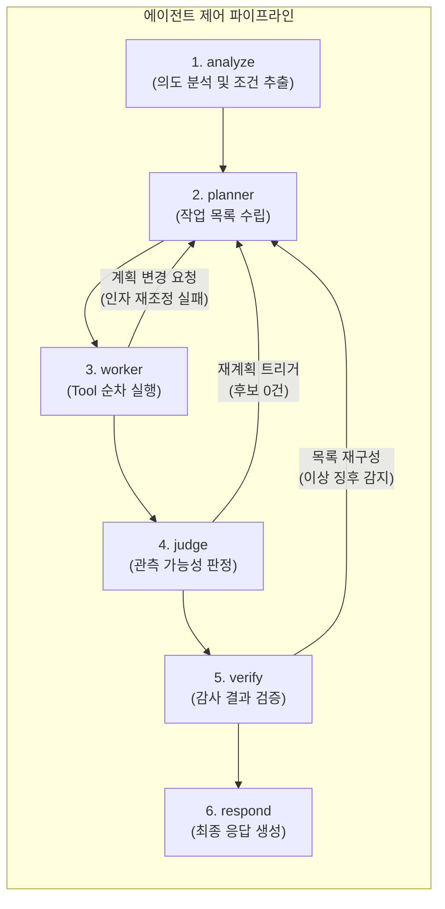

| 단계 | 수행 내용 | LLM 사용 여부 |
|---|---|:---:|
| **1. analyze** | 사용자 발화와 이전 맥락에서 의도(계획, 사실, 배경지식, 캘린더 등), 관측 조건(기준, 선호, 제약), 되물을 항목 추출 | **사용** (JSON) |
| **2. planner** | 조건을 작업 목록(Task List)으로 분해 (현상 -> 고도 -> 박명/월령 -> 예보 -> 장소 -> 캘린더), 고정 인자 표시 | **규칙 기반**<br>(Worker 요청을 규칙으로 풀지 못할 때만 LLM) |
| **3. worker** | 작업 목록에 따라 Tool 순차 호출. 실패는 안전하게 격리하고 동일 인자는 캐시 재사용 | 인자 조정으로 해결 가능한 실패(결과 없음 등)에만 LLM |
| **4. judge** | 관측 후보군에 판정식을 적용해 성립 여부 판정 (미충족 시 재계획 트리거) | 미사용 |
| **5. verify** | 로깅 Agent의 규칙 판정(반복 호출, 과다 재계획, 계획 외 호출) 참조. 이상 감지 시 Planner가 작업 목록을 1회 재구성 | 미사용 |
| **6. respond** | 판정 결과, 추천 시간, 근거 Tool 데이터, 제외 사유를 종합해 친절한 답변 생성 | **사용** (폴백 지원) |

---

### 2-3. 사용자 핵심 워크플로우

| 1. 맞춤형 추천 카드 | 2. 맥락 유지 후속 질문 |
|:---:|:---:|
| 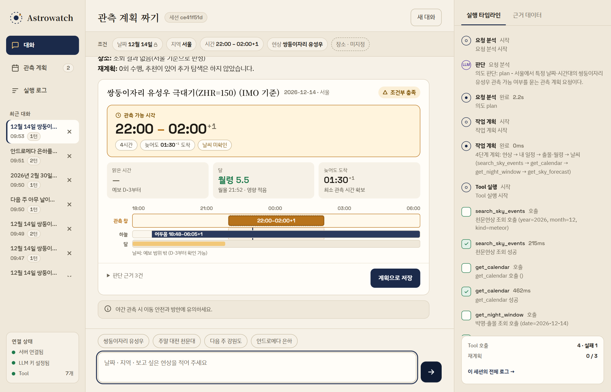 |  |
| **3. 단일 타임라인 (밤 타임바)** | **4. 불가능 사유 안내 및 능동적 되묻기** |
| 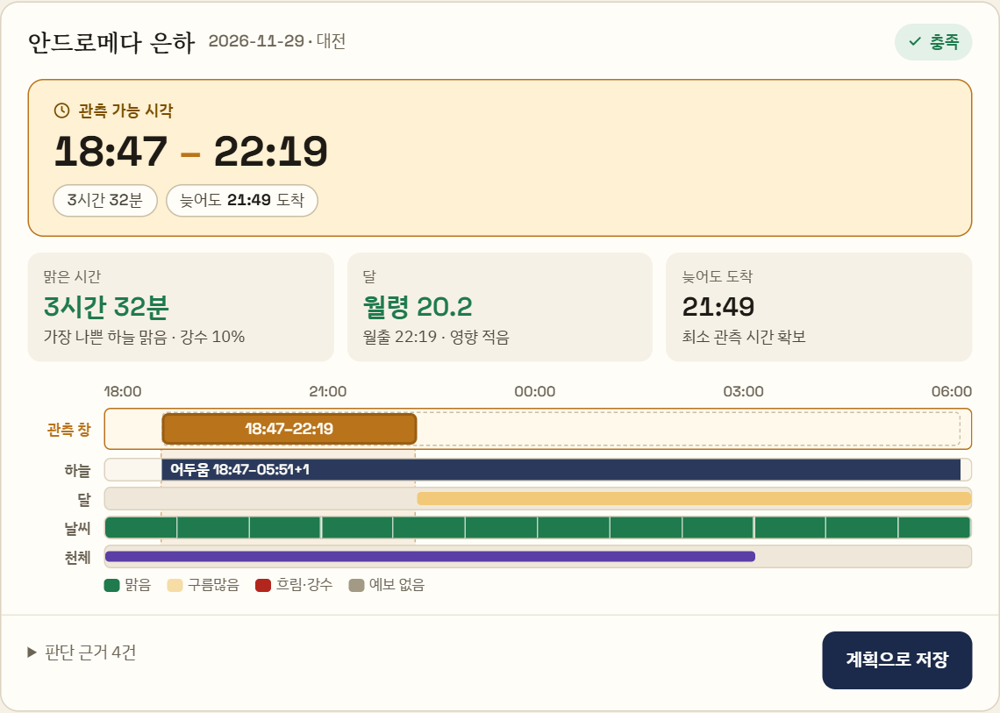 | 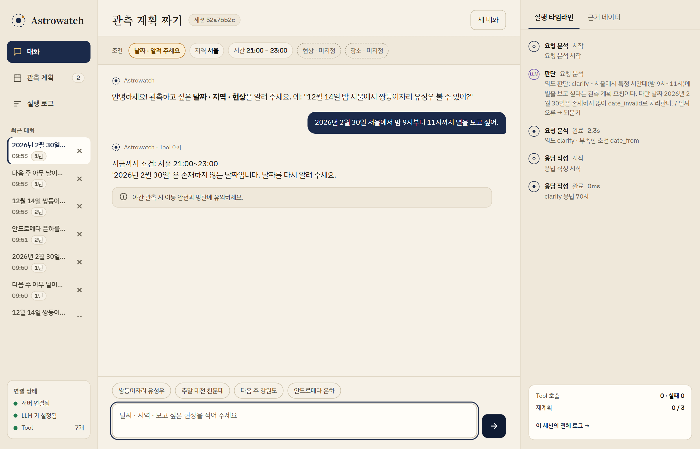 |

- **추천 카드 헤드라인**: 가장 추천하는 최적의 관측 시간대 제시
- **밤 타임바 (Night Timebar)**: 4가지 핵심 조건을 한눈에 시각화
  1. `어두운 밤`: 천문박명 기준 빛 공해 없는 시간
  2. `달 구간`: 월출과 월몰 및 달빛 간섭 구간
  3. `날씨`: 시간별 맑음, 흐림, 강수 예보
  4. `천체 고도`: 관측 가능한 유효 고도(20° 이상) 구간  
  *(모든 조건이 겹치는 최적의 구간을 **'관측 창'** 으로 강조)*
- **우측 실행 패널**: Tool 호출 내역 및 LLM 판단 근거를 실시간 타임라인으로 투명하게 확인


- **시연 데모 영상 (40초)**: [docs/demo/astrowatch_demo.webm](docs/demo/astrowatch_demo.webm)  
- **상세 화면 캡처 25장**: [docs/VERIFICATION.md (11절)](docs/VERIFICATION.md#11-스크린샷-데모-영상)

---

## 3. 관측 판정 방법론 및 핵심 지표

### 3-1. 핵심 판정 지표 정의

신뢰할 수 있는 관측 가능 여부 판단을 위해 정의된 4대 핵심 지표와 기준입니다.

| 지표명 | 물리적 의미 및 판정 목적 | 데이터 출처 | 통과 임계값(Threshold) |
|---|---|---|---|
| **어두운 창** | 태양이 지평선 아래 18° 이하로 내려가 완전한 어둠이 보장되는 구간 | 천문연 출몰시각 API | 천문박명 종료 시각부터 익일 천문박명 시작 시각까지 |
| **내 창** | 사용자가 외출 및 관측 가능한 가용 시간대 | 사용자 대화 입력 | 사용자 지정 구간 (미지정 시 어두운 창 전체) |
| **현상 창** | 목표 천체가 육안 또는 망원경으로 관측 가능한 물리적 구간 | 천문연 현상 API / 자체 궤도 계산 | 유성우: 극대 시각 ±6시간 / 일반 천체: 고도 20° 이상 구간 |
| **맑은 시간** | 구름이 없고 비나 눈이 오지 않는 기상 적합 구간 | 기상청 단기 및 중기예보 API | 강수 확률 30% 이하이면서 강수 형태가 '없음'인 시간 |

---

### 3-2. 관측 창 판정 알고리즘 및 4대 판정 분류

각 도구에서 수집된 시간 구간을 수학적으로 결합하고 기상 조건을 검증하는 의사결정 흐름도입니다.

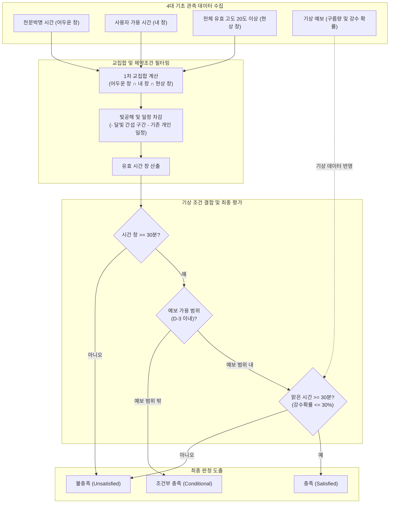

```text
시간 창   = (어두운 창 ∩ 내 창 ∩ 현상 창) - (달빛 방해 구간 + 기존 개인 일정)
맑은 시간 = 시간 창 중 기상 조건이 맑은 구간 (강수확률 30% 이하 및 무강수)
```

| 최종 판정 결과 | 엄격한 판정 기준 | 사용자 안내 방식 |
|---|---|---|
| **충족 (Satisfied)** | 시간 창 **30분 이상** 확보 및 맑은 시간 **30분 이상** 확보 | 최적 관측 시간대와 함께 도착 마지노선 안내 |
| **조건부 충족** | 시간 창은 30분 이상 확보되었으나 기상청 단기예보 범위(D-3) 밖 | 관측 창 추천과 함께 "D-3일 전 기상 재확인 필요" 명시 |
| **불충족** | 시간 창 30분 미만, 날씨 악화(흐림/비), 강한 달빛 간섭 | 탈락 사유(흐림, 월령 등)를 구체적으로 밝히고 대안 탐색 |
| **판단 유보 (되묻기)** | 박명 데이터 수신 실패 또는 카탈로그 미등재 천체 요청 | 값을 임의로 지어내지 않고 사용자에게 필수 정보 재질의 |

---

### 3-3. 자율 재계획 (Replanning) 규칙

조건을 만족하는 관측 창이 없을 때 에이전트가 스스로 대안을 찾는 자동 복구 체계입니다.

- **발동 조건**: 관측 후보군 중 '충족' 및 '조건부 충족' 결과가 **0건**일 때에만 발동
- **전략 우선순위**: `1. 같은 현상 다른 날짜 (±2일)` -> `2. 같은 기간 다른 현상` -> `3. 인접 지역 확장`
- **비용 최적화**: `(Tool, 인자)` 캐시를 적용하여 재계획 회차에서 **동일 API 중복 호출 0회** 보장
- **상한 제어**: 최대 **3회**까지 시도 후 중단 사유 안내 (상한 도달, 대안 소진, 관측 불가 등)

| 3회 재계획 후 상한 도달 시 안내 화면 | 실행 타임라인 상의 회차별 재계획 구분 표시 |
|:---:|:---:|
| 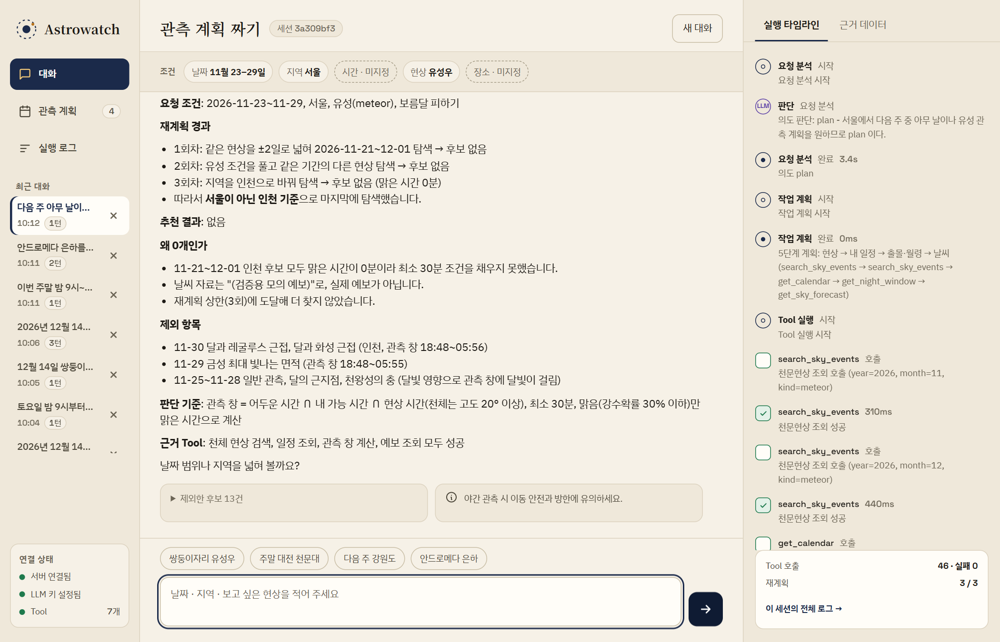 | 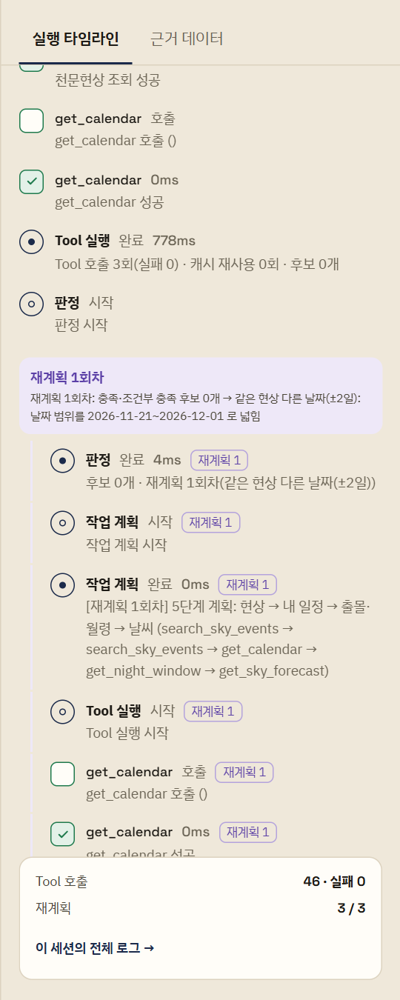 |

---

## 4. 심화 기능 구현 및 실측 성과

필수 요구사항을 완수한 후, 에이전트의 완성도를 높이기 위해 4가지 심화 과제(F3020 ~ F3023)와 추가 사용자 편의 기능을 구현했습니다.

### 4-1. 로깅 Agent 기반 이상 징후 자율 진단 (F3020)

저장된 실행 로그를 바탕으로, 고비용 LLM 대신 결정론적 규칙을 적용해 에이전트의 오작동을 자동 감지합니다. 이상 징후가 감지되었을 때에만 선택적으로 LLM을 호출하여 문제 원인을 정밀 진단합니다.

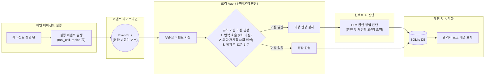

| 판정 규칙 | 세부 판정 조건 | 대조 대상 근거 이벤트 |
|---|---|---|
| **반복 호출** | 동일한 Tool을 동일한 입력값으로 한 턴 내 2회 이상 실제 호출 (캐시 재사용 제외) | `tool_call` |
| **과다 재계획** | 재계획 시도가 기준 횟수(3회) 이상 발생했거나 재계획 상한에 도달한 경우 | `replan` |
| **계획 외 호출** | Planner가 수립한 작업 목록에 포함되지 않은 Tool을 임의 호출한 경우 | `planner_tasks`, `tool_call` |
| **판정 불가** | 대조할 기준 이벤트가 존재하지 않는 경우 (임의로 정상 처리하지 않고 상태 격리) | (없음) |

- **진단과 판정의 분리**: 이상 징후로 판정된 실행에 한해서만 LLM이 원인과 개선책을 3문장 이내로 진단합니다. 정상 실행에서는 LLM을 호출하지 않아 비용을 절감합니다.
- **실측 검증 성과**: 정상, 반복 호출, 과다 재계획, 계획 외 호출, 판정 불가 등 5가지 대표 이상 유형에 대한 모의 실행 결과, 시스템이 모든 이상 징후를 누락 없이 100% 감지함을 실측 검증했습니다 (`samples/audit_samples.json`).

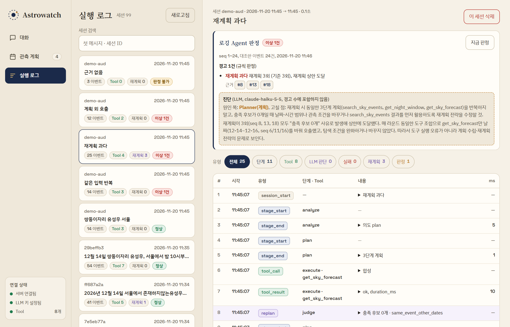

---

### 4-2. Planner와 Worker 계층 분리 및 성능 비교 (F3021)

복잡한 관측 계획을 효율적으로 수립하기 위해 에이전트 역할을 계층적으로 분리했습니다.

| 역할 | 전담 업무 | LLM 호출 조건 | LLM 미호출 조건 |
|---|---|---|---|
| **Planner** | 요청을 작업 목록(`TaskList`)으로 분해하고 고정 인자 지정. 관측 판정 재계획, Worker의 계획 변경 요청, 로깅 Agent의 이상 판정을 수신하여 목록 재구성 | Worker의 요청을 규칙으로 매핑할 수 없을 때에만 전략 선택 | 그 외 모든 일반 계획 수립 (요청 해석은 analyze 단계가 전담) |
| **Worker** | 작업 목록에 맞춰 개별 Tool 순차 호출, 결과를 `WorkerResult`로 반환 | 인자 조정을 통해 해결 가능한 실패(결과 없음, 대상 미발견)에서 재시도 및 변경을 판단할 때 | 정상 실행, API 키 오류 등 치명적 시스템 장애, 필수 인자 누락 |
| **로깅 Agent** | 실행 결과의 실시간 이상 징후 검증 | 이상으로 판정된 실행의 심층 원인 진단 시에만 호출 | 정상 판정 및 판정 불가 상태 |

**구조 변경 전후 실측 성능 비교** (실제 LLM 환경, 6종 대표 시나리오 평균치)

| 아키텍처 구성 | 평균 재계획 횟수 | 평균 Tool 호출 수 | 요청당 평균 LLM 호출 수 | 평균 응답 시간 |
|---|:---:|:---:|:---:|:---:|
| 분리 전 기본 구조 (Classic) | 1.17회 | 15.17회 | 1.33회 | 17.1초 |
| Planner/Worker 분리 (Worker LLM 비활성화) | 1.17회 | 15.17회 | 1.33회 | 16.0초 |
| Planner/Worker 분리 (Worker LLM 활성화) | 1.17회 | 15.17회 | 1.50회 | 16.1초 |

- **분석 결론**: 정상 흐름에서는 세 구조 모두 동일한 실행 경로를 거치며 불필요한 LLM 호출이 발생하지 않았습니다. 반면 존재하지 않는 천체를 요청한 예외 상황에서는 Planner/Worker 분리 구조가 '결과 없음'을 Planner에 즉시 보고하여 불필요한 전체 판정 루프를 생략함으로써 응답 시간을 단축했습니다.

---

### 4-3. 지식 검색 RAG 하이브리드 도구 (F3022)

천문학적 배경지식 질문에 신뢰도 높은 답변을 제공하기 위해 자체 RAG 도구를 구축했습니다.

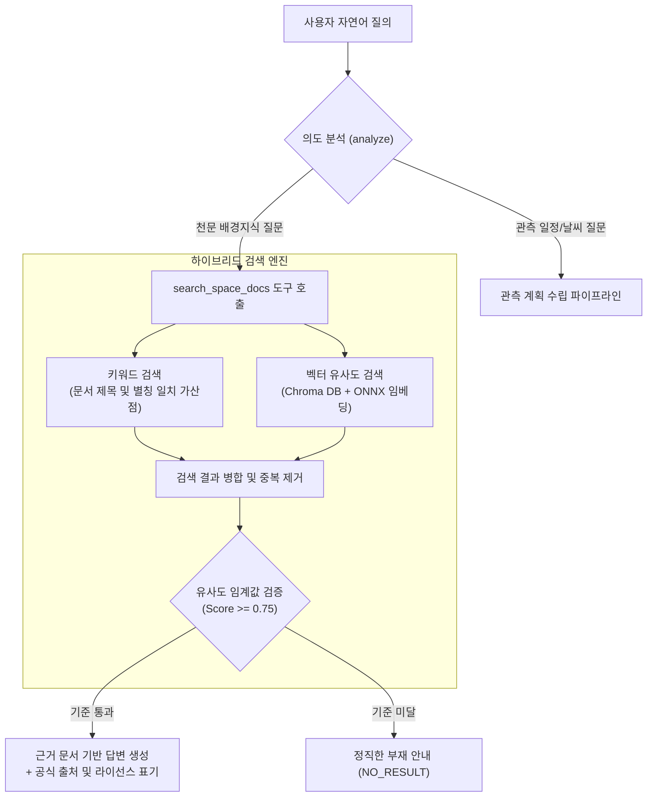

| 항목 | 상세 내용 |
|---|---|
| **문서 데이터셋** | 한국어 위키백과 문서 321건 (천체 294개, 핵심 천문 용어 27개). 본문 요약문 기반 구축 (CC BY-SA 4.0 준수, `data/space_docs.json`) |
| **벡터 색인 구성** | Chroma DB 기반, 경량 로컬 ONNX 임베딩(`all-MiniLM-L6-v2`)을 활용한 724개 청크 구성 |
| **검색 도구 명세** | `search_space_docs(query, k)`: 제목 및 별칭 일치 가중치 부여와 벡터 유사도 검색을 결합한 하이브리드 검색 지원, 문서별 중복 제거 |
| **의도 분류 라우팅** | 정의, 원리, 역사 등 외부 API로 확인하기 어려운 질문을 `knowledge` 의도로 자동 분류 |
| **답변 및 출처 표기** | 검색된 문서만을 엄격한 근거로 삼아 답변을 생성하며, 답변 말미에 공식 출처 목록(문서명, 웹 링크, 라이선스)을 반드시 명기 |

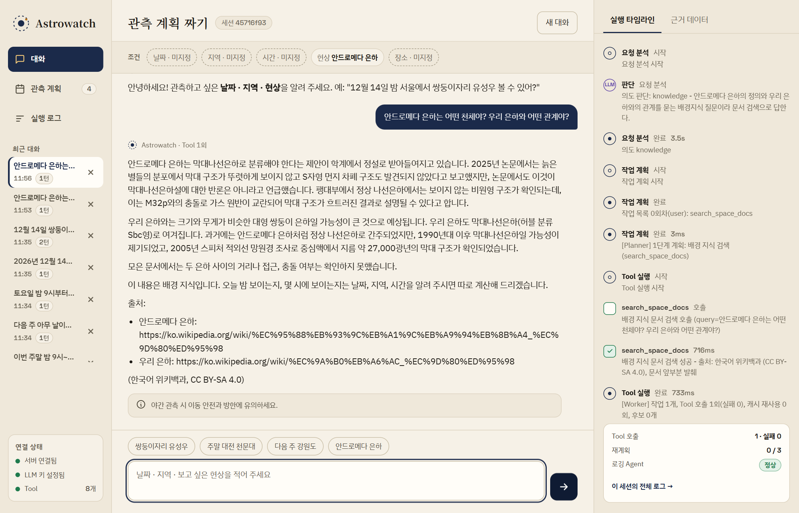

---

### 4-4. 일정 충돌 방지 캘린더 연동 (F3023)

사용자 개인 일정과의 충돌을 사전에 방지하고 확정된 관측 계획을 손쉽게 캘린더에 등록할 수 있도록 캘린더 연동 도구를 구현했습니다.

- **안전한 스키마 기반 전환**: 엄격한 입출력 스키마 계약을 먼저 정의하고 로컬 SQLite 캘린더와 Google Calendar 간 전환을 지원하도록 설계했습니다.
- **환각 원천 차단**: 등록 도구(`add_plan_to_calendar`)는 모델의 임의 조작을 방지하기 위해 저장된 관측 계획 ID만 인자로 전달받으며, 상세 일정명과 시간은 백엔드 저장소에서 직접 조회하여 등록합니다.
- **실제 계정 등록 확인**: 로컬 구현체와 교체 계약은 자동 테스트로, 실제 등록은 본인 Google 계정에서 계획 #10(안드로메다 은하, 대전, 11월 29일)을 등록해 캘린더 앱에 제목, 시각, 판단 근거 설명이 그대로 생성되는 것을 확인했습니다.

| Google 캘린더에 등록된 관측 일정 | 계획 화면의 등록 상태 |
|:---:|:---:|
| 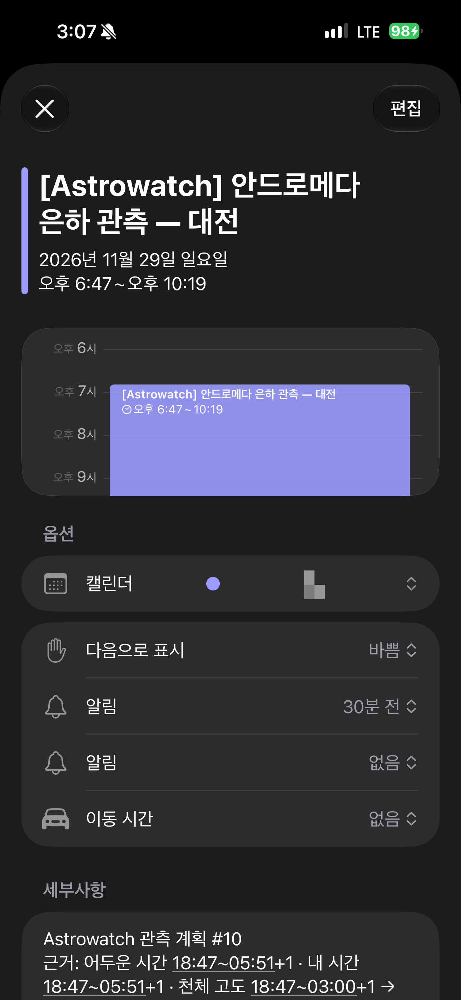 | 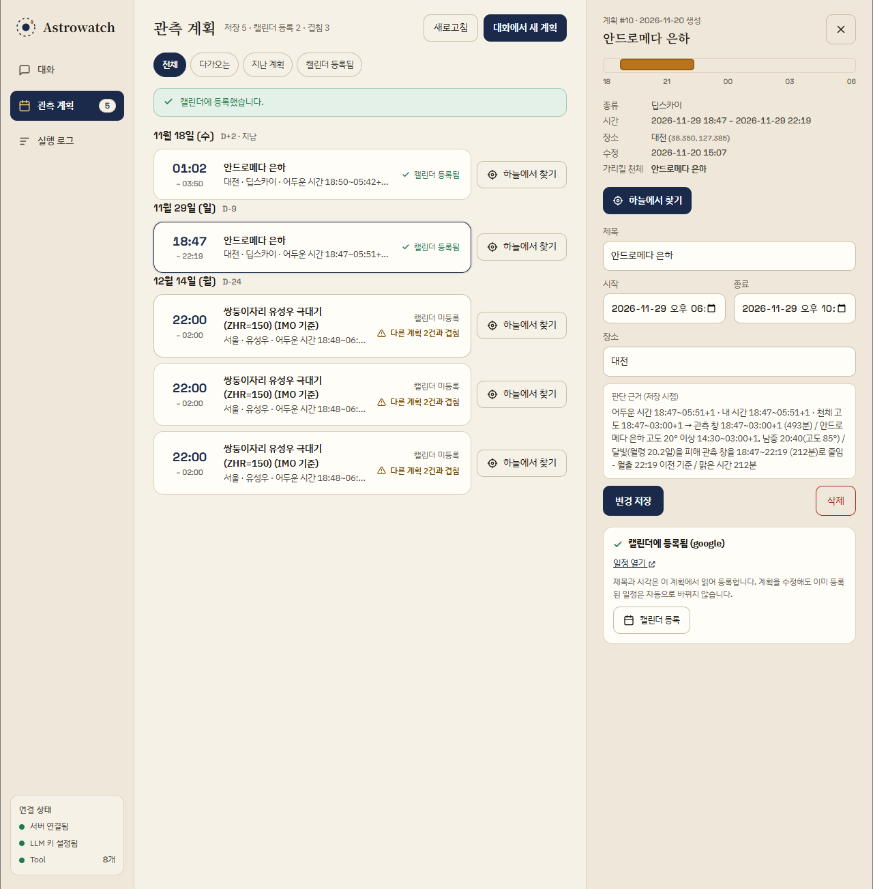 |

---

### 4-5. 모바일 기반 실시간 밤하늘 가리키기 (명세 외 추가)

추천받아 저장한 관측 계획 속 천체를 실제 밤하늘 현장에서 맨눈으로 쉽게 찾을 수 있도록 돕는 실시간 보조 도구입니다.

- **동작 원리**: 계획에 포함된 관측 대상(294개 천체 카탈로그, 태양계 행성과 달, 12개 주요 유성우 복사점)의 실시간 적경과 적위를 산출하는 백엔드 API(`/api/sky/target`)와 모바일 기기의 방향 센서(DeviceOrientation) 및 GPS 위치 정보를 결합하여 구현했습니다.
- **직관적인 상대 각도 유도**: 전용 웹 뷰(`pointer.html`)를 통해 "왼쪽으로 35도, 위로 12도"와 같이 목표 천체까지의 상대 방위각과 고도 편차를 실시간으로 안내합니다. 오차 범위 4도 이내로 조준되면 조준 완료 상태로 시각적 전환되며, 천체가 아직 지평선 아래에 머물러 있는 경우 당일 출몰 시각을 안내합니다.

| 데스크톱 시뮬레이션 모드 | 휴대폰 화면 |
|:---:|:---:|
|  | 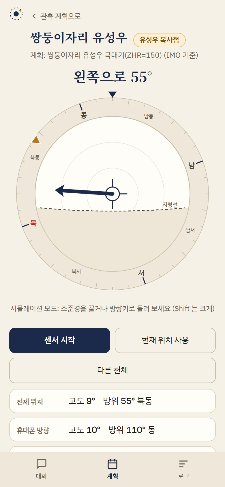 |

---

## 5. 종합 검증 결과

### 5-1. 12개 실전 시나리오 실측 검증 요약

실제 API 키와 LLM(`claude-haiku-5-5`) 환경에서 12개 시나리오를 실행하고 검증 결과를 `samples/run_*.json`에 기록했습니다.  
*(기상 악화 재계획 R2, R3은 실제 날씨 대신 모의 흐림 공급자로 검증)*

#### 핵심 시나리오 (R1 ~ R7)

| 시나리오 | 사용자 요청 | 핵심 검증 결과 |
|---|---|---|
| **R1. 단일 충족** | 12/14 서울 22~02시 쌍둥이자리 유성우 | 조건부 충족 판정 (관측 창 240분 확보, 월령 5.5일)<br>- "늦어도 01:30까지 도착" 역산 기준 제시 |
| **R2. 자율 재계획** | 주말 21~24시 대전 (흐리면 대안 탐색) | 날씨 악화 감지 -> 날짜, 현상, 인접지역 순으로 3회 재계획 성공<br>- 이전 회차 데이터 캐시 재사용 확인 (중복 호출 0회) |
| **R3. 상한 도달** | 다음 주 서울 보름달 피해 유성우 관측 | 보름달 간섭으로 3회 재계획 후 한도 도달<br>- 탐색 중단 사유 및 조건 확장 대안 제시 |
| **R4. 장애 격리** | 대전 천문대 검색 (카카오 키 누락) | 장소 검색만 `AUTH` 경고 처리, 관측 판정은 정상 완료 (우아한 기능 저하) |
| **R5. 도구 미사용** | "이 서비스는 어떻게 사용하는 건가요?" | Tool 호출 0회, 에이전트 안내 문구 즉각 반환 |
| **R6. 맥락 유지** | "같은 날 장소만 대전으로 바꿔줘" | 기존 날짜와 시간 유지, 지역만 대전으로 갱신<br>- 기조회된 천문현상 캐시 재사용 |
| **R7. 능동적 되묻기**| "밤 11시 전에는 들어와야 해" | 관측 일시와 지역 누락 감지 -> Tool 호출 전 필수 정보 되묻기 |

#### 보충 시나리오 (예외 처리 5종)

| 구분 | 질의 내용 | 처리 방식 및 검증 결과 |
|---|---|---|
| **딥스카이 탐색** | 안드로메다 은하 보기 좋은 날 | 날짜 미지정 시 10일 탐색 -> 고도 및 달빛 회피 계산으로 2건 추천 |
| **천문 사실 질의** | 화성이 제일 잘 보이는 시간대 | 사실 질문으로 분류 -> 당일 화성 남중 시각 기준 관측 시간 안내 |
| **유효하지 않은 날짜**| 2월 30일 관측 요청 | 역법상 없는 날짜 -> 외부 API 호출 없이 즉시 재입력 요청 |
| **미등재 천체** | 카탈로그에 없는 천체 질의 | 임의 생성(환각) 방지 -> 판단 유보 및 유사 천체 되묻기 |
| **배경지식 질의** | 안드로메다 은하는 어떤 천체이고 우리 은하와 어떤 관계인가 | `knowledge` 의도 분류 -> RAG 도구 1회 호출 -> 신뢰할 수 있는 문서 근거 및 출처 2건 명기 답변 |

| 장애 격리: 카카오 키 누락 시에도 판정 정상 수행 | 안드로메다 은하: 고도 및 월령 회피 종합 판정 |
|:---:|:---:|
|  |  |

---

### 5-2. 자동화 테스트 및 외부 교차 검증

- **자동화 테스트 440건 전원 통과**:  
  `samples/`의 실제 API 응답을 Fixture로 격리하여 외부 키나 네트워크 없이 100% 재현 가능한 독립 테스트 스위트를 구축했습니다 (POSIX 파일 권한 전용 2건 제외 440건 통과).
- **외부 모델(Codex) 교차 E2E 리뷰**:  
  독립 모델이 브라우저 및 HTTP 환경에서 20개 시나리오를 심층 실행하여 8건의 결함을 도출하였으며, 전량 개선 및 재검증을 완료했습니다 ([output/e2e-review/](output/e2e-review/)).
- **비기능 요구사항 충족**:  
  환경변수 기반 키 격리, UI 및 로그 민감정보 마스킹, 밀리초 단위 응답 시간 실측, 장애 격리 및 공공데이터 출처 표기를 완료했습니다 ([검증 결과 9절](docs/VERIFICATION.md#9-48-비기능-요구사항)).

- **상세 검증 종합 보고서**: [docs/VERIFICATION.md](docs/VERIFICATION.md)  
- **실행 감사 로그 샘플**: [docs/RUN_LOG_SAMPLE.md](docs/RUN_LOG_SAMPLE.md)

---

## 6. 결론 및 한계점

### 프로젝트 결론

외부 공공 API를 Tool로 감싸고 **핵심 비즈니스 판정을 코드 로직**에 둠으로써, LLM 고유의 환각(Hallucination) 현상 없이 신뢰도 높은 천문 관측 일정을 도출할 수 있었습니다. 

12개 실전 시나리오는 모두 설계된 제어 흐름(충족, 재계획, 상한 도달, 장애 격리, 맥락 유지, 되묻기 등)을 정확하게 완주했습니다. 특히 외부 교차 리뷰에서 발견된 결함들이 핵심 판정 로직이 아닌 자연어 해석 및 템플릿 영역에 국한되었다는 점은, **'판정 로직과 생성 로직의 분리'** 라는 아키텍처 설계가 주효했음을 방증합니다.

---

### 현재의 한계점 및 대응 방안

| 항목 | 현재 수준 및 한계점 | 시스템 대응 방안 |
|---|---|---|
| **지원 관측 지역** | 국내 28개 주요 기준 도시 좌표 지원 | 미지원 지역 입력 시 지원 도시 목록을 능동적으로 되묻기 |
| **기상 예보 가용 범위** | 당일 기준 최대 10일까지의 공공 예보 제공 | 10일 초과 시 '조건부 충족'으로 분류하고 D-3 재확인 권장 |
| **천체 카탈로그** | 294개 딥스카이 천체 및 태양계 7개 행성 지원 | 미등재 천체는 임의 추정 없이 판단을 유보하고 유사 천체 안내 |
| **RAG 검색 범위** | 위키백과 요약문 321건 기반 구축, 경량 임베딩의 한국어 문맥 한계 | 제목 일치 가산점 및 엄격한 유사도 임계값(0.75) 적용, 기준 미달 시 `NO_RESULT` 반환 |
| **하늘 가리키기** | 브라우저 API 특성상 기기별 나침반 센서 편차 보정 미완료 | 데스크톱 시뮬레이터로 검증 완료, 방위각 미지원 환경에서는 고도 안내만 선택 제공 |

---

### 향후 발전 과제

- **임베딩 모델 고도화**: 다국어 전문 임베딩 모델을 적용해 한국어 문맥 검색 품질을 향상하고 문서 범위를 전체 본문으로 확장
- **모바일 실기기 센서 보정**: 실시간 나침반 센서 오차 보정 알고리즘을 추가하고 다양한 기기 현장 테스트 진행
- **운영 통계 대시보드**: 사용자 세션별 Tool 실패율 및 단계별 응답 지연 시간(Latency) 통계 API 구축
- **데일리 밤하늘 브리핑**: 매일 저녁 "오늘 밤 내 지역 추천 관측 요약"을 제공하는 홈 피드 API 추가

---

## 부록 A. 요구사항 명세 대응표

| 요구사항 분류 | 요구사항 ID | 구현 모듈 및 핵심 근거 |
|---|:---:|---|
| **Tool 계층** | F3001 ~ F3004 | `tools/` 레지스트리 및 8개 도구 (후보 탐색, 박명과 월령, 기상, 관측지, 천체, 캘린더, 문서 검색) |
| **에이전트 제어** | F3005 ~ F3011 | `agent/nodes.py`, `planner.py`, `worker.py` 실행 루프, `judge.py` 판정식, `replan.py` 재계획 상한 제어 |
| **이벤트 및 로깅** | F3012 ~ F3014 | `events/bus.py` 9종 이벤트, `logging_agent/` 무손실 적재 (불변 로그) |
| **계획 관리** | F3015 ~ F3016 | `storage/plans.py`, 일정 충돌 감지 알림 및 실시간 수정과 삭제 |
| **API 및 UI** | F3017 ~ F3019 | 21개 REST API, 4종 웹 화면, 실행 타임라인 시각화, 누락 키 안내 |
| **심화 과제** | F3020 | `logging_agent/audit.py` 규칙 판정 3종과 판정 불가, `diagnosis.py` 이상 실행 한정 LLM 진단, 로그 화면 판정 패널 |
| **심화 과제** | F3021 | `agent/planner.py`, `worker.py`, `verify.py` 분리 구조, 작업 목록과 결과 이벤트, 구조 전후 비교 실측 |
| **심화 과제** | F3022 | `rag/` 수집과 색인, `tools/space_docs.py`, 출처가 표기되는 `knowledge` 답변, `NO_INDEX` 형식 |
| **심화 과제** | F3023 | 설정 하나로 로컬 DB와 Google Calendar 간 무중단 전환 |
| **추가 기능** | (명세 외) | `astro/targets.py`, `/api/sky`, `pointer.html` 휴대폰 하늘 가리키기 |
| **비기능 요건** | NF3001 ~ NF3007 | 환경변수 키 격리, 민감정보 마스킹, 3회 상한, 응답 시간 실측 로깅 |

- **요구사항별 세부 구현 근거**: [docs/REQUIREMENTS.md](docs/REQUIREMENTS.md) | [docs/VERIFICATION.md](docs/VERIFICATION.md)

---

## 부록 B. 외부 데이터 및 API 출처

| 서비스 명칭 | 제공 기관 | 연동 Tool | 호출 한도 | 라이선스 및 약관 |
|---|---|:---:|:---:|---|
| **천문현상 정보** | 한국천문연구원 ([15012691](https://www.data.go.kr/data/15012691/openapi.do)) | `search_sky_events` | 일 10,000회 | 이용허락범위 제한 없음 |
| **출몰시각 정보** | 한국천문연구원 ([15012688](https://www.data.go.kr/data/15012688/openapi.do)) | `get_night_window` | 일 10,000회 | 이용허락범위 제한 없음 |
| **월령 정보** | 한국천문연구원 ([15012689](https://www.data.go.kr/data/15012689/openapi.do)) | `get_night_window` | 일 10,000회 | 이용허락범위 제한 없음 |
| **단기예보 조회** | 기상청 ([15084084](https://www.data.go.kr/data/15084084/openapi.do)) | `get_sky_forecast` | 일 10,000회 | 공공누리 제1유형 (출처 표시) |
| **중기육상예보** | 기상청 (공공데이터포털) | `get_sky_forecast` | 일 10,000회 | 공공누리 제1유형 (출처 표시) |
| **로컬 키워드 검색**| 카카오 (Kakao Local API) | `search_observatory` | 일 100,000회 | 결과 영구 저장 금지 (`place_id`만 허용) |
| **SSAFY GMS** | SSAFY (`claude-haiku-5-5`) | `analyze`, `respond` | 30,000 크레딧 | 교육용 (~2026-11-20) |
| **OpenWeatherMap** | OpenWeather (5일 예보 백업) | `get_sky_forecast` | 분당 60회 | 무료 플랜 약관 |
| **Google Calendar**| Google Cloud Platform | `get_calendar` 등 | 기본 할당량 | OAuth 2.0 Test User |
| **한국어 위키백과** | 위키미디어 재단 (MediaWiki API) | `search_space_docs` (색인 수집) | 명시적 한도 없음 (요청 간격 1초 준수) | 본문 CC BY-SA 4.0 (출처 및 라이선스 표기) |

---

## 부록 C. 프로젝트 산출물 문서 목록

| 문서 | 핵심 내용 |
|---|---|
| [docs/ASTROWATCH_PLAN.md](docs/ASTROWATCH_PLAN.md) | 프로젝트 기획서 (도메인, API, 판단 로직, 일정) |
| [docs/REQUIREMENTS.md](docs/REQUIREMENTS.md) | 요구사항 정의서 (기능 및 비기능 세부 사양) |
| [docs/AGENT_DESIGN.md](docs/AGENT_DESIGN.md) | LangGraph 에이전트 상세 아키텍처 설계서 |
| [docs/TOOL_SPEC.md](docs/TOOL_SPEC.md) | 8개 도구 인터페이스 및 입출력 계약 명세서 |
| [docs/API_SPEC.md](docs/API_SPEC.md) | FastAPI RESTful API 엔드포인트 명세서 |
| [docs/VERIFICATION.md](docs/VERIFICATION.md) | 품질 검증 종합 보고서 (실전 테스트 12건, 심화 4종 확인 항목, 스크린샷 25장) |
| [docs/RUN_LOG_SAMPLE.md](docs/RUN_LOG_SAMPLE.md) | 에이전트 실행 감사 로그 원본 샘플 |
| [docs/SETUP.md](docs/SETUP.md) | 개발 환경 설치, API 키 발급, 환경변수 및 보안 가이드 |
| [docs/DESIGN_CHANGES.md](docs/DESIGN_CHANGES.md) | 3일간의 아키텍처 변경 및 개발 여정 기록 |
| [output/e2e-review/](output/e2e-review/) | 외부 모델(Codex)의 독립 E2E 리뷰 및 재검증 원문 |

```
backend/astrowatch/   에이전트(agent), 도구(tools), RAG(rag), 외부API(clients), 이벤트(events), 로깅(logging_agent), 저장소(storage), 천문계산(astro), 웹(app)
backend/tests/        pytest 440건 테스트 스위트 (외부 키/네트워크 없이 100% 독립 실행)
frontend/             Vanilla JS 반응형 4개 화면 (대화창, 계획 관리, 실행 로그, 하늘 가리키기)
samples/              외부 API 실제 응답, 12개 시나리오 실행 결과 로그, 판정 샘플, 구조 비교 결과
docs/                 프로젝트 종합 산출물 문서, 스크린샷 25장, 데모 영상, 디자인 에셋
data/                 천체 카탈로그, 위키백과 문서(space_docs.json), 색인과 DB
```
