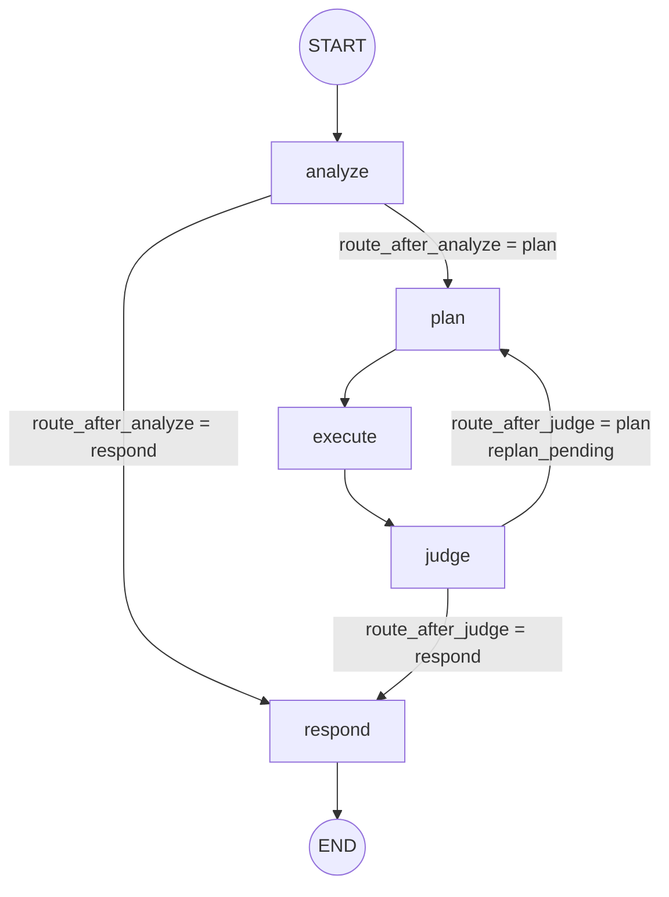
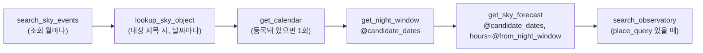
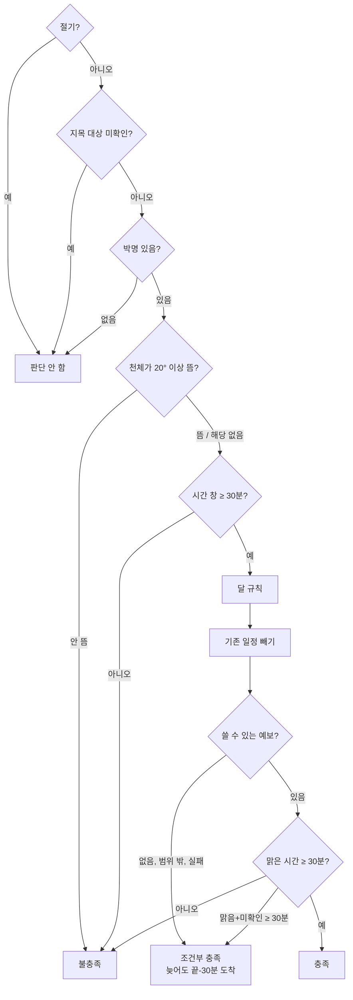
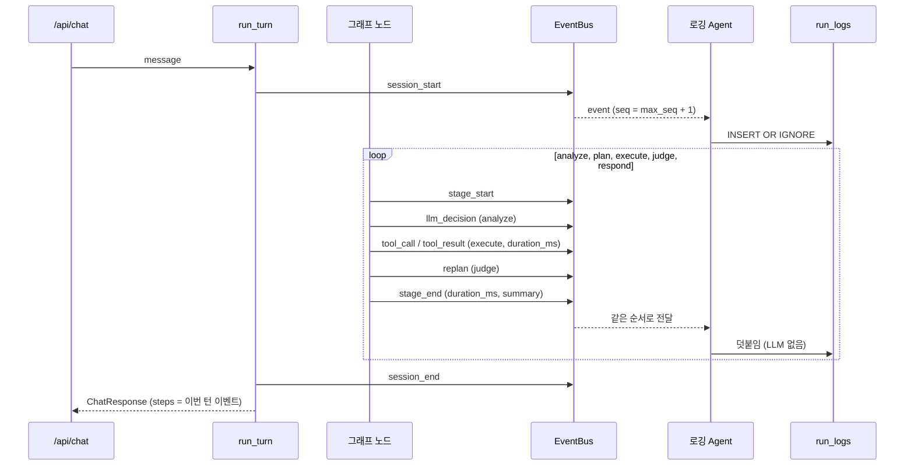

# Astrowatch Agent 설계

> 메인 Agent(LangGraph 5노드)의 단계, 계획, 재계획, 판정, 이벤트, 맥락을 코드 기준으로 정리한다.
> 갱신일 2026-11-20, 경로는 `backend/astrowatch/` 기준

---

## 1. 한눈에

| 항목 | 결정 |
|---|---|
| 프레임워크 | LangGraph `StateGraph` (`agent/graph.py`) |
| 노드 | analyze → plan → execute → judge → respond |
| LLM 호출 | **analyze, respond 두 곳만**. 계획, 실행, 판정, 재계획, 로깅은 코드 |
| 상태 | 단일 dict `RunState` (`agent/state.py` + `agent/nodes.py`) |
| 진입점 | `agent/service.py` `run_turn(session_id, message)`: 어떤 경우에도 `ChatResponse` 반환 |
| 로깅 | EventBus 발행 → 로깅 Agent 구독 (분리, LLM 없음) |

---

## 2. LangGraph 그래프

`graph.py` 의 엣지 그대로.

| 분기 | 조건 (`agent/nodes.py`) |
|---|---|
| analyze → plan | 의도가 `plan`, `fact` / `calendar` + 계획 번호 + 등록 Tool 있음 / `knowledge` + RAG Tool 있음 |
| analyze → respond | `chat`, `clarify`, `confirm`, 그 밖 (Tool 없음) |
| judge → plan | `replan_pending = true` (추천 0개, 상한 전, 다음 전략 있음) |
| judge → respond | 그 밖 전부 |

실행 시 `recursion_limit=60` (`service.py`).

---

## 3. 단계별 입출력

| 단계 | 읽는 상태 | 쓰는 상태 | 하는 일 | LLM |
|---|---|---|---|---|
| analyze | `message`, `history`, 이전 `conditions`, `memory_summary` | `intent`, `intent_reason`, `conditions`, `user_conditions`, `prev_conditions`, `missing`, `fact_kind`, `date_defaulted`, `assumptions`, `date_issue`, `calendar_plan_id` | 의도, 조건 추출 → 이전 조건과 병합 → 되묻기 판단 → 날짜 기본 범위 | ✅ |
| plan | `intent`, `conditions`, `fact_kind`, `calendar_plan_id` | `plan` (PlannedCall 목록), `plan_reason` | Tool 순서 결정 (규칙) | ❌ |
| execute | `plan`, `cache`, `conditions` | `calls`, `cache`, `candidates`, `object_windows`, `object_meta` | 후보 날짜별 펼침 호출, 캐시 재사용, 후보 생성 | ❌ |
| judge | `candidates`, `cache`, `object_*`, `replan_*` | `judged`, `replan_count`, `replan_strategy`, `replan_pending`, `replan_history`, `stop_reason`, `replan_limit_reached`, (재계획 시) `conditions` | 창 계산, 판정, 재계획 결정 | ❌ |
| respond | 위 전부 | `answer`, `warnings`, `memory_summary` | 문장 생성 (되묻기, 대상 미확인, 캘린더는 템플릿) | ✅ (일부) |

`PlannedCall = {tool, args, reason, fixed_args}`, `ExecutedCall = {tool, args, result, duration_ms, replan_round}`

---

## 4. 의도 7종

| 의도 | 경로 | 비고 |
|---|---|---|
| `plan` | 전체 5노드 | 관측 가능 여부, 추천 |
| `fact` | analyze → plan → execute → judge(생략) → respond | `fact_kind` 로 Tool 1~2개 |
| `clarify` | analyze → respond | 되묻기 (코드가 최종 결정) |
| `chat` | analyze → respond | 사용법, 인사, LLM 키 없음 |
| `calendar` | 계획 번호 있으면 `add_plan_to_calendar` 1회 | 없으면 안내 |
| `confirm` | respond | "화면의 계획 저장 버튼" 안내 |
| `knowledge` | respond | RAG Tool 미구현 → 미지원 안내 |

**FACT 의 `fact_kind` 5종**: LLM 이 고르고, 비면 규칙 폴백 (`resolve_fact_kind`)

| fact_kind | 질문 | Tool |
|---|---|---|
| `object_visibility` | "화성 제일 잘 보이는 시간" | `lookup_sky_object` + `get_night_window` |
| `events` | "이번 달 천문현상" | `search_sky_events` |
| `night_window` | "내일 서울 일몰 몇 시" | `get_night_window` |
| `forecast` | "토요일 구름 많아?" | `get_sky_forecast` |
| `places` | "대전 천문대 찾아줘" | `search_observatory` |

장소만 묻는 `plan` (현상, 시간, 관측 의사 없음)은 `fact/places` 로 내린다 (`places_only`).

---

## 5. 계획 수립 규칙 (`build_plan`)

| 규칙 | 내용 |
|---|---|
| 조회 월 | 날짜 범위 앞뒤 ±2일(+1)을 덮는 (연, 월) 전부 |
| 자리표시자 | `@candidate_dates` → 후보 날짜로 펼침, `@from_night_window` → 어두운 창 ∩ 내 창의 정시 |
| 날짜 상한 | 한 번에 10일 (`MAX_DATES`) |
| 고정 인자 | `fixed` 의 조건으로 채운 인자는 `fixed_args` 로 표시 (예: 지역 고정 → `lat, lon`) |
| 생략 | 판단 못 하는 후보(대상 미확인)는 박명, 예보도 안 부름. 박명이 없으면 예보도 안 부름 |
| 후보 생성 | 현상 매칭 → 유성우는 극대일 ±2일도 후보, 현상 미지정이면 빈 날은 "일반 관측" 후보, 목록에 없는 대상은 이름으로 날짜마다 후보 |
| 캐시 | 키 `tool\|json(args)`. 같은 인자는 재호출 안 함. `add_plan_to_calendar`(부작용)는 캐시 안 함 |

---

## 6. 판정식 (`agent/judge.py`, 순수 함수)

시각 표기: **저녁 기준 날짜 00:00 부터의 분**. 22:00 = 1320, 다음 날 02:00 = 1560.

### 6-1. 창 계산

| 창 | 계산 |
|---|---|
| 어두운 창 | [그날 `aste`, 다음 날 `astm` + 1440] |
| 내 창 | [시작, 종료] (비면 어두운 창 끝값). 정오 전 시각은 +1440 |
| 현상 창 | 유성우 극대 ±360분, 식 ±120분, 그 밖은 어두운 창 전체 |
| 천체 고도 창 | `lookup_sky_object` 의 고도 ≥ 20° 구간 중 가장 많이 겹치는 것 |
| **시간 창** | 어두운 ∩ 내 ∩ 현상 (∩ 천체 고도) |

### 6-2. 판정 순서

### 6-3. 세부 규칙

| 규칙 | 내용 |
|---|---|
| 달: 밝은 범위 | 유성우, 일반: 월령 **10~20** / 희미한 천체(DEEP_SKY): **7~23** |
| 달: 유성우 | 밝은 달이 시간 창에 떠 있고 `avoid_moon` → 불충족 |
| 달: 희미한 천체 | 달 뜬 구간을 빼고 **월몰 이후 / 월출 이전** 조각 중 맑은 시간이 긴 것으로 창을 자름. 30분 미만이면 불충족 |
| 달: 그 밖 | "참고" 사유만 |
| 달: 모름 | 월령 없음, 월출몰 없음 → `moon_interferes = null` (단정 안 함) |
| 기존 일정 | `get_calendar` 결과와 겹치는 구간을 빼고 남은 조각 중 최선으로 창을 자름. 30분 미만이면 불충족 |
| 맑은 시간 | 정시 단위. 맑음(옵션: 구름많음) ∧ 강수확률 ≤ 30% ∧ 강수형태 없음 |
| 강수 | 비, 눈, 비/눈, 소나기 시각은 SKY 와 무관하게 맑음 아님. 구간 요약을 사유에 |
| 미확인 시각 | 예보 없음, 강수확률 없음 → `unknown`. 맑음+미확인 ≥ 30분이면 조건부 |
| 예보 범위 밖 | `OUT_OF_RANGE` → 조건부 충족 + "D-3부터 확인 가능" |
| 역산 | `latest_arrival_minute`: 뒤에서부터 맑은(또는 미확인) 분을 모아 30분을 채우는 가장 늦은 도착 시각 |
| 순위 | 충족 → 맑은 시간 긴 순 → 달 영향 없음 → 창 긴 순 → 날짜 빠른 순 |

---

## 7. 재계획 (`agent/replan.py`)

| 조건 | 내용 |
|---|---|
| 한다 | 충족 + 조건부 충족 = 0개, `replan_count < MAX_REPLANS(3)`, 적용할 전략이 있음 |
| 안 한다 | 현상, 박명 Tool `AUTH` 실패 / 후보 전부 대상 미확인 / 모든 후보가 고도 20° 이상 안 뜸 |

**전략 순서** (앞 전략을 쓰면 다시 쓰지 않음)

| 순서 | 전략 | 바꾸는 값 | 생략 조건 |
|---|---|---|---|
| ① | 같은 현상 다른 날짜 | `date_from-2 ~ date_to+2` | `date_from` 고정, 날짜 기본 범위 사용. `date_to` 만 고정이면 앞쪽만 |
| ② | 같은 기간 다른 현상 | `event_query, event_kind` 해제 | 현상 고정, 풀 조건 없음, 특정 천체 후보 |
| ③ | 인접 지역 | 가장 가까운 지역 1곳 | `region` 고정, 지역 표에 없음 |

**종료 사유 `stop_reason`**: 추천 0개로 끝난 `plan` 에만 붙는다

| 값 | 뜻 | 응답 |
|---|---|---|
| `limit_reached` | 재계획이 상한에 실제 도달 | "날짜 범위나 지역을 넓혀 볼까요?" |
| `no_alternative` | 상한 전 전략 소진 | 〃 |
| `fixed_constraints` | 0회, 고정 조건만 풀면 쓸 전략이 있었음 | 〃 |
| `target_unobservable` | 대상이 그 지역에서 20° 이상 안 뜸 | 다른 날짜, 지역도 같다고 안내 |
| `fatal_error` | 키 누락, 인증 실패 | 경고 배너 |

받은 결과는 캐시로 재사용한다. 예: R2(mock) 재계획 1회차에서 현상 조회 1회 재사용 (`samples/run_R2_mock.json`).

---

## 8. 메인 Agent ↔ 로깅 Agent

| 항목 | 내용 |
|---|---|
| 버스 | `events/bus.py` 동기 콜백 리스트. 구독자 예외는 삼킴 |
| 발행 쪽 | 노드 데코레이터 `stage()`, execute, judge, service |
| 구독 쪽 | ① 로깅 Agent (`logging_agent/agent.py`) → `run_logs` ② `run_turn` 의 임시 구독자 → 화면 `steps` |
| seq | 세션별 증가. 재시작 뒤에도 이어지도록 로깅 Agent 가 `seq_seed = max_seq(session)` 훅을 꽂음 |
| 분리 확인 | 구독자 없이 실행해도 정상 (`test_runs_without_subscribers`), 잘못된 DB 경로도 예외 없음 |

**이벤트 9종**

| type | payload |
|---|---|
| `session_start` | `message` |
| `stage_start` | 없음 |
| `stage_end` | `duration_ms`, `summary` |
| `llm_decision` | `decision`, `reason`, `model` |
| `tool_call` | `args`, `reason` |
| `tool_result` | `ok`, `error?`, `note?`, `data`(2,000자 제한), `duration_ms` |
| `replan` | `round`, `strategy`, `reason`, `limit_reached` |
| `error` | `message` (키, 스택 없음) |
| `session_end` | `intent`, `replan_count`, `duration_ms` |

---

## 9. 대화 맥락 (F3010)

| 항목 | 내용 |
|---|---|
| 저장소 | `sessions` 테이블 (`storage/sessions.py`). 실패 시 프로세스 메모리 |
| 보관 | 조건 객체(`user_conditions`), 메모리 요약, 직전 추천, **최근 6턴** |
| 보관 안 함 | Tool 원본 응답 (DB) |
| 프로세스 캐시 | `search_sky_events` 성공 결과만 메모리에 최대 24개 (DB 미저장) |
| 갱신 | `Conditions.merged()`: 이번에 말한 값만 덮어씀, `fixed` 는 합집합. `reset_conditions` 면 새로 시작 |
| 재계획 조건 | 세션엔 사용자가 말한 조건을 저장 (재계획으로 바뀐 조건 아님) |
| 되묻기 반복 방지 | 직전 턴에 물은 시작 시각을 또 못 받으면 천문박명 종료부터 계산하고 밝힘 |
| LLM 에 넘기는 것 | 이전 조건 JSON, 메모리 요약, 최근 12메시지(6턴) |
| 후속 변경 설명 | analyze 가 이전 턴 조건(`prev_conditions`)을 state 에 남기고, respond 의 `plan_context.changes_from_previous`(예: "종료 시각 02:00+1 → 23:00")로 바뀐 항목을 답변 첫머리에 말함 (Codex 재검증 S15 수정) |
| 화면 복원 | LLM 맥락과 별개로 `turns` 표에 턴마다 사용자 메시지 + `ChatResponse` 저장 (`run_turn` 반환 직전, 실패는 경고 로그만) → `/api/sessions` 목록, 상세, 삭제. 대화 삭제 시 `sessions` 행도 지우고 `run_logs` 는 남김 |

---

## 10. 날짜 처리 규칙

| 상황 | 처리 |
|---|---|
| 날짜 없음 (`plan`) | **오늘 ~ +9일** 기본 범위. 사용자 조건엔 남기지 않고 응답에 "범위에서 찾았습니다" |
| 날짜 없음 (`fact`) | 오늘 |
| 존재하지 않는 날짜, 뒤집힌 범위 | `date_invalid` / 파싱 실패 → 외부 조회 없이 되묻기. 이전 날짜를 조용히 재사용하지 않음 |
| 날짜 하나, 유연성 언급 없음 | `date_from` 자동 고정 → 재계획 ① 생략 |
| 자정 넘김 한 밤 | LLM `single_night=true` 이고 `date_to = date_from+1` 일 때만 한 밤으로 접음 ("주말 밤 9~12시" 는 이틀 유지) |
| 시각 | 정오 이전은 다음 날 새벽(+1440) |
| 지역 없음, 끝 시각만 있음 | 되묻기 (`missing_for_plan`) |

---

## 11. LLM 호출 지점

| 지점 | LLM | 방식 | 실패 시 |
|---|---|---|---|
| analyze | ✅ | structured output: anthropic: `function_calling` → `json_mode`, openai: `json_schema` → `function_calling` (`llm.structured_methods()`) | `chat` 으로 진행 + 경고 |
| respond: plan, fact, chat, knowledge | ✅ | 판정 데이터 JSON 을 넘겨 문장 생성. 규칙: 바뀐 조건 먼저 말하기(0), 경고가 비면 경고 항목을 쓰지 않음(9), 내부 필드명, JSON 키 금지(14) | 템플릿 응답 + 경고 |
| respond: 되묻기, 대상 미확인, 캘린더, confirm | ❌ | 고정 템플릿 | 없음 |
| plan, execute, judge, 재계획 | ❌ | 규칙, 순수 함수 | 없음 |
| 로깅 Agent | ❌ | 이벤트 그대로 저장 | 저장 실패 삼킴 |
| LLM 키 없음 | ❌ | 사용법 안내만 | 없음 |

모델 설정: `agent/llm.py`. 공급자 `LLM_PROVIDER` 로 선택: `anthropic`(기본, `claude-haiku-5-5`, GMS Anthropic 호환 경로, `x-api-key` 헤더, structured output 은 function_calling → json_mode 순) / `openai`(`gpt-6-luna`, `reasoning_effort=none`, json_schema → function_calling 순). 공통: timeout 60초, 재시도 1회. 한 턴에 LLM 호출 2회(analyze, respond).
