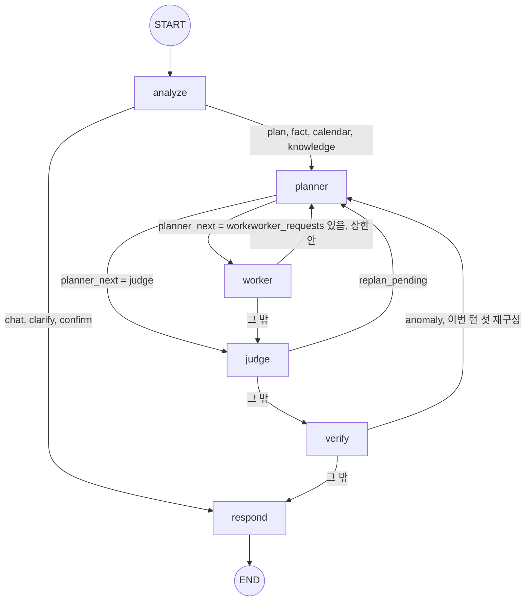
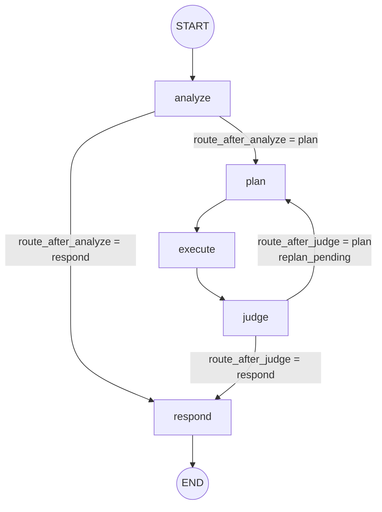
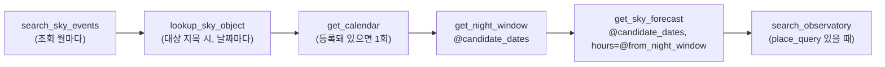
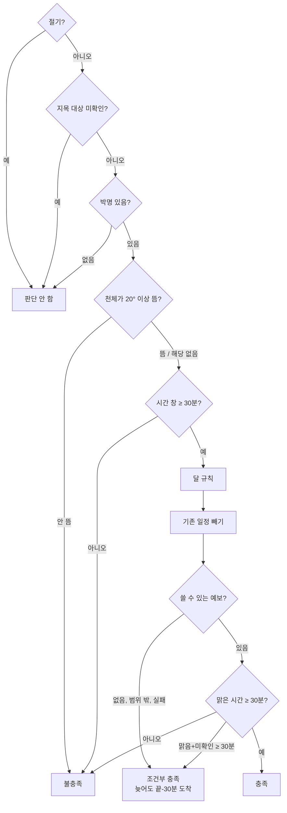
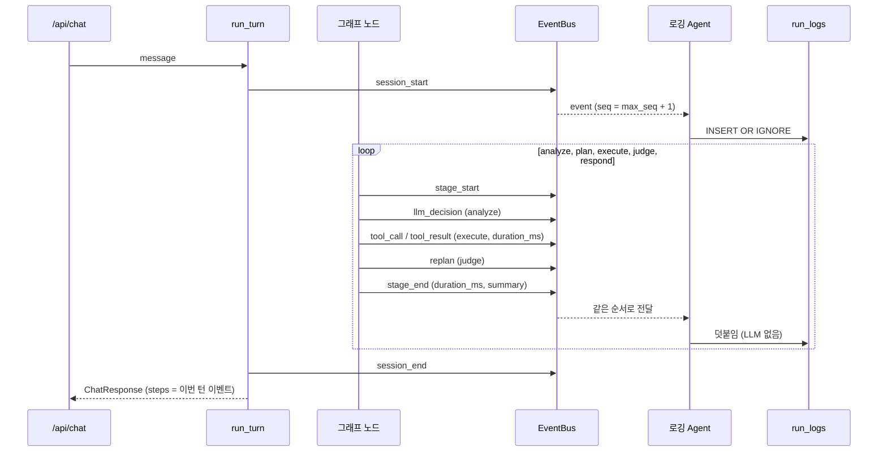
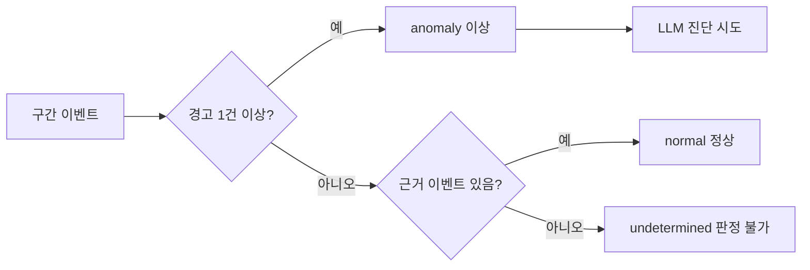
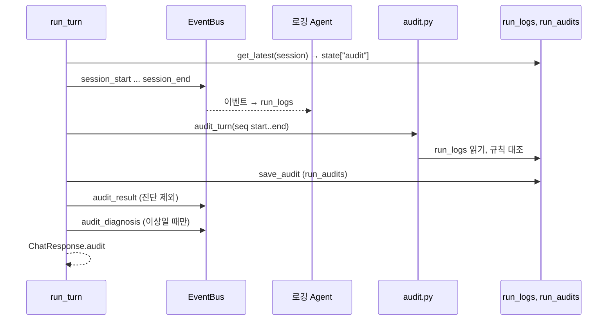
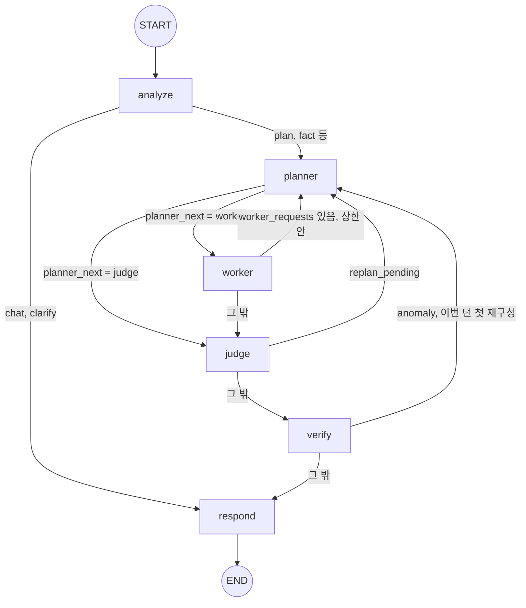

# Astrowatch Agent 설계

> 메인 Agent(LangGraph, 기본 Planner/Worker 구조, 비교용 classic 5노드)의 단계, 계획, 재계획, 판정, 이벤트, 로깅 Agent 판정, 맥락을 코드 기준으로 정리한다.
> 갱신일 2026-11-20 (오후: F3020, F3021, F3022 반영), 경로는 `backend/astrowatch/` 기준

---

## 1. 한눈에

| 항목 | 결정 |
|---|---|
| 프레임워크 | LangGraph `StateGraph` (`agent/graph.py`) |
| 노드 | classic: analyze → plan → execute → judge → respond / planner_worker(기본, F3021): analyze → planner → worker → judge → verify → respond (8-2장) |
| LLM 호출 | **기본은 analyze, respond 두 곳**. 조건부 추가: Planner(규칙 매핑 안 되는 Worker 요청), Worker(인자 수정 가능한 실패, `WORKER_LLM=1`), 로깅 Agent 진단(이상 판정만). 계획, 실행, 판정, 재계획, 로깅 판정은 코드 (11장) |
| 상태 | 단일 dict `RunState` (`agent/state.py` + `agent/nodes.py`) |
| 진입점 | `agent/service.py` `run_turn(session_id, message)`: 어떤 경우에도 `ChatResponse` 반환 |
| 로깅 | EventBus 발행 → 로깅 Agent 구독 (분리, 저장과 판정은 LLM 없음). 턴마다 규칙 판정(8-1장) |
| 배경 지식 | `knowledge` 의도 → `search_space_docs` 1회 (F3022 RAG) → 답변 끝에 출처 |

---

## 2. LangGraph 그래프

`graph.py` 의 엣지 그대로. `AGENT_STRUCTURE` 로 고른다.

| 구조 | 설정 | 용도 |
|---|---|---|
| planner_worker | 기본 (`AGENT_STRUCTURE` 비움 또는 `planner_worker`) | 실제 서비스. F3021 (8-2장) |
| classic | `AGENT_STRUCTURE=classic` | 구조 변경 전 기준선 (비교, 회귀 테스트) |

**기본: planner_worker** (노드 이름 `planner`, `worker` 는 이벤트에서 `plan`, `execute` 단계로 남는다)

**비교 기준선: classic 5노드**

| 분기 | 조건 (`agent/nodes.py`) |
|---|---|
| analyze → plan (planner) | 의도가 `plan`, `fact` / `calendar` + 계획 번호 + 등록 Tool 있음 / `knowledge` + RAG Tool 있음 |
| analyze → respond | `chat`, `clarify`, `confirm`, 그 밖 (Tool 없음) |
| judge → plan (planner) | `replan_pending = true` (추천 0개, 상한 전, 다음 전략 있음) |
| judge → respond (classic) / verify (planner_worker) | 그 밖 전부 |
| worker → planner | Worker 의 계획 변경 요청이 있고 재계획 상한 전 (planner_worker) |
| verify → planner | 이번 턴 규칙 판정이 anomaly 이고 이번 턴 첫 재구성 (planner_worker) |

실행 시 `recursion_limit=60` (`service.py`).

---

## 3. 단계별 입출력

| 단계 | 읽는 상태 | 쓰는 상태 | 하는 일 | LLM |
|---|---|---|---|---|
| analyze | `message`, `history`, 이전 `conditions`, `memory_summary` | `intent`, `conditions`, `user_conditions`, `prev_conditions`, `missing`, `fact_kind`, `date_defaulted`, `assumptions`, `date_issue`, `calendar_plan_id` | 의도, 조건 추출 → 이전 조건과 병합 → 되묻기 판단 → 날짜 기본 범위 | ✅ |
| plan | `intent`, `conditions`, `fact_kind`, `calendar_plan_id` | `plan` (PlannedCall 목록) | Tool 순서 결정 (규칙) | ❌ |
| execute | `plan`, `cache`, `conditions` | `calls`, `cache`, `candidates`, `object_windows`, `object_meta` | 후보 날짜별 펼침 호출, 캐시 재사용, 후보 생성 | ❌ |
| judge | `candidates`, `cache`, `object_*`, `replan_*` | `judged`, `replan_count`, `replan_strategy`, `replan_pending`, `replan_history`, `stop_reason`, `replan_limit_reached`, (재계획 시) `conditions` | 창 계산, 판정, 재계획 결정 | ❌ |
| respond | 위 전부 | `answer`, `warnings`, `memory_summary` | 문장 생성 (되묻기, 대상 미확인, 캘린더는 템플릿) | ✅ (일부) |

planner_worker 에서는 plan 자리를 **planner**(`TaskList` 발행, 규칙), execute 자리를 **worker**(작업 수행, 실패 판단), judge 뒤에 **verify**(이번 턴 규칙 판정, LLM 없음)가 맡는다. 형식은 8-2장.

`PlannedCall = {tool, args, reason, fixed_args}`, `ExecutedCall = {tool, args, result, duration_ms, replan_round}`

---

## 4. 의도 7종

| 의도 | 경로 | 비고 |
|---|---|---|
| `plan` | 전체 흐름 (classic 5노드 / planner_worker 6노드) | 관측 가능 여부, 추천 |
| `fact` | analyze → plan → execute → judge(생략) → respond | `fact_kind` 로 Tool 1~2개 |
| `clarify` | analyze → respond | 되묻기 (코드가 최종 결정) |
| `chat` | analyze → respond | 사용법, 인사, LLM 키 없음 |
| `calendar` | 계획 번호 있으면 `add_plan_to_calendar` 1회 | 없으면 안내 |
| `confirm` | respond | "화면의 계획 저장 버튼" 안내 |
| `knowledge` | analyze → planner → worker(`search_space_docs` 1회) → judge(생략) → verify → respond | F3022. 정의, 원리, 역사 질문. LLM 이 `fact`/`chat` 으로 골라도 규칙(`reconcile_knowledge`)이 knowledge 로 바꾼다. 관측/계산 말(관측, 가능, 볼 수, 언제, 날짜 등)이나 날짜/지역이 있으면 live 가 이겨 knowledge 로 두지 않는다. 답변 끝에 코드가 만든 `출처:` 목록. 색인 없음(`NO_INDEX`), 불일치, 결과 없음은 정해진 문장. RAG Tool 미등록이면 미지원 안내 |

**FACT 의 `fact_kind` 5종**: LLM 이 고르고, 비면 규칙 폴백 (`resolve_fact_kind`)

| fact_kind | 질문 | Tool |
|---|---|---|
| `object_visibility` | "화성 제일 잘 보이는 시간" | `lookup_sky_object` + `get_night_window` |
| `events` | "이번 달 천문현상" | `search_sky_events` |
| `night_window` | "내일 서울 일몰 몇 시" | `get_night_window` |
| `forecast` | "토요일 구름 많아?" | `get_sky_forecast` |
| `places` | "대전 천문대 찾아줘" | `search_observatory` |

장소만 묻는 `plan` (현상, 시간, 관측 의사 없음)은 `fact/places` 로 내린다 (`places_only`).

---

## 5. 계획 수립 규칙 (`build_plan`)

| 규칙 | 내용 |
|---|---|
| 조회 월 | 날짜 범위 앞뒤 ±2일(+1)을 덮는 (연, 월) 전부 |
| 자리표시자 | `@candidate_dates` → 후보 날짜로 펼침, `@from_night_window` → 어두운 창 ∩ 내 창의 정시 |
| 날짜 상한 | 한 번에 10일 (`MAX_DATES`) |
| 고정 인자 | `fixed` 의 조건으로 채운 인자는 `fixed_args` 로 표시 (예: 지역 고정 → `lat, lon`) |
| 생략 | 판단 못 하는 후보(대상 미확인)는 박명, 예보도 안 부름. 박명이 없으면 예보도 안 부름 |
| 후보 생성 | 현상 매칭 → 유성우는 극대일 ±2일도 후보, 현상 미지정이면 빈 날은 "일반 관측" 후보, 목록에 없는 대상은 이름으로 날짜마다 후보 |
| 캐시 | 키 `tool\|json(args)`. 같은 인자는 재호출 안 함. `add_plan_to_calendar`(부작용)는 캐시 안 함 |

---

## 6. 판정식 (`agent/judge.py`, 순수 함수)

시각 표기: **저녁 기준 날짜 00:00 부터의 분**. 22:00 = 1320, 다음 날 02:00 = 1560.

### 6-1. 창 계산

| 창 | 계산 |
|---|---|
| 어두운 창 | [그날 `aste`, 다음 날 `astm` + 1440] |
| 내 창 | [시작, 종료] (비면 어두운 창 끝값). 정오 전 시각은 +1440 |
| 현상 창 | 유성우 극대 ±360분, 식 ±120분, 그 밖은 어두운 창 전체 |
| 천체 고도 창 | `lookup_sky_object` 의 고도 ≥ 20° 구간 중 가장 많이 겹치는 것 |
| **시간 창** | 어두운 ∩ 내 ∩ 현상 (∩ 천체 고도) |

### 6-2. 판정 순서

### 6-3. 세부 규칙

| 규칙 | 내용 |
|---|---|
| 달: 밝은 범위 | 유성우, 일반: 월령 **10~20** / 희미한 천체(DEEP_SKY): **7~23** |
| 달: 유성우 | 밝은 달이 시간 창에 떠 있고 `avoid_moon` → 불충족 |
| 달: 희미한 천체 | 달 뜬 구간을 빼고 **월몰 이후 / 월출 이전** 조각 중 맑은 시간이 긴 것으로 창을 자름. 30분 미만이면 불충족 |
| 달: 그 밖 | "참고" 사유만 |
| 달: 모름 | 월령 없음, 월출몰 없음 → `moon_interferes = null` (단정 안 함) |
| 기존 일정 | `get_calendar` 결과와 겹치는 구간을 빼고 남은 조각 중 최선으로 창을 자름. 30분 미만이면 불충족 |
| 맑은 시간 | 정시 단위. 맑음(옵션: 구름많음) ∧ 강수확률 ≤ 30% ∧ 강수형태 없음 |
| 강수 | 비, 눈, 비/눈, 소나기 시각은 SKY 와 무관하게 맑음 아님. 구간 요약을 사유에 |
| 미확인 시각 | 예보 없음, 강수확률 없음 → `unknown`. 맑음+미확인 ≥ 30분이면 조건부 |
| 예보 범위 밖 | `OUT_OF_RANGE` → 조건부 충족 + "D-3부터 확인 가능" |
| 역산 | `latest_arrival_minute`: 뒤에서부터 맑은(또는 미확인) 분을 모아 30분을 채우는 가장 늦은 도착 시각 |
| 순위 | 충족 → 맑은 시간 긴 순 → 달 영향 없음 → 창 긴 순 → 날짜 빠른 순 |

---

## 7. 재계획 (`agent/replan.py`)

| 조건 | 내용 |
|---|---|
| 한다 | 충족 + 조건부 충족 = 0개, `replan_count < MAX_REPLANS(3)`, 적용할 전략이 있음 |
| 안 한다 | 현상, 박명 Tool `AUTH` 실패 / 후보 전부 대상 미확인 / 모든 후보가 고도 20° 이상 안 뜸 |

**전략 순서** (앞 전략을 쓰면 다시 쓰지 않음)

| 순서 | 전략 | 바꾸는 값 | 생략 조건 |
|---|---|---|---|
| ① | 같은 현상 다른 날짜 | `date_from-2 ~ date_to+2` | `date_from` 고정, 날짜 기본 범위 사용. `date_to` 만 고정이면 앞쪽만 |
| ② | 같은 기간 다른 현상 | `event_query, event_kind` 해제 | 현상 고정, 풀 조건 없음, 특정 천체 후보 |
| ③ | 인접 지역 | 가장 가까운 지역 1곳 | `region` 고정, 지역 표에 없음 |

**종료 사유 `stop_reason`**: 추천 0개로 끝난 `plan` 에만 붙는다

| 값 | 뜻 | 응답 |
|---|---|---|
| `limit_reached` | 재계획이 상한에 실제 도달 | "날짜 범위나 지역을 넓혀 볼까요?" |
| `no_alternative` | 상한 전 전략 소진 | 〃 |
| `fixed_constraints` | 0회, 고정 조건만 풀면 쓸 전략이 있었음 | 〃 |
| `target_unobservable` | 대상이 그 지역에서 20° 이상 안 뜸 | 다른 날짜, 지역도 같다고 안내 |
| `fatal_error` | 키 누락, 인증 실패 | 경고 배너 |

받은 결과는 캐시로 재사용한다. 예: R2(mock) 재계획 1회차에서 현상 조회 1회 재사용 (`samples/run_R2_mock.json`).

---

## 8. 메인 Agent ↔ 로깅 Agent

| 항목 | 내용 |
|---|---|
| 버스 | `events/bus.py` 동기 콜백 리스트. 구독자 예외는 삼킴 |
| 발행 쪽 | 노드 데코레이터 `stage()`, execute, judge, service |
| 구독 쪽 | ① 로깅 Agent (`logging_agent/agent.py`) → `run_logs` ② `run_turn` 의 임시 구독자 → 화면 `steps` |
| seq | 세션별 증가. 재시작 뒤에도 이어지도록 로깅 Agent 가 `seq_seed = max_seq(session)` 훅을 꽂음 |
| 분리 확인 | 구독자 없이 실행해도 정상 (`test_runs_without_subscribers`), 잘못된 DB 경로도 예외 없음 |

**이벤트 9종**

| type | payload |
|---|---|
| `session_start` | `message` |
| `stage_start` | 없음 |
| `stage_end` | `duration_ms`, `summary` |
| `llm_decision` | `decision`, `reason`, `model` |
| `tool_call` | `args`, `reason` |
| `tool_result` | `ok`, `error?`, `note?`, `data`(2,000자 제한), `duration_ms` |
| `replan` | `round`, `strategy`, `reason`, `limit_reached` |
| `error` | `message` (키, 스택 없음) |
| `session_end` | `intent`, `replan_count`, `duration_ms` |

**심화 이벤트 5종** (모두 `run_logs` 에 남는다)

| type | 발행 | payload |
|---|---|---|
| `planner_tasks` | Planner (F3021) | `TaskList`: `round`, `tasks[]`, `reason`, `trigger` |
| `worker_result` | Worker (F3021) | `WorkerResult`: `task_id`, `tool`, `args_used`, `ok`, `error_code`, `attempts`, `from_cache`, `decision`, `replan_request` |
| `worker_decision` | Worker (F3021) | 실패 뒤 판단: `decision`, `reason`, `source`(rule, llm), `model`, `new_args` 등 |
| `audit_result` | service, 턴 종료 뒤 (F3020) | `AuditResult` (진단 제외) |
| `audit_diagnosis` | service, 이상일 때만 (F3020) | `AuditDiagnosis`: `culprit`, `fix`, `text`, `failed` |

## 8-1. 로깅 Agent 판정 (F3020)

로깅 Agent 가 모은 실행 로그(`run_logs`)를 **규칙으로만** 대조해 이상 징후를 판정한다. LLM 은 판정에 쓰지 않는다.

| 파일 | 역할 |
|---|---|
| `logging_agent/audit.py` | 규칙 엔진 `audit_events()` (순수 함수), `audit_turn()`, `audit_session()` |
| `logging_agent/diagnosis.py` | 이상 판정에만 LLM 원인 진단 `diagnose()` |
| `storage/run_audits.py` | 판정 저장 (`run_audits` 표, 진단은 `diagnosis_json` 열로 분리) |
| `schemas/audit.py` | 계약: `AuditStatus`, `FindingKind`, `AuditFinding`, `AuditDiagnosis`, `AuditResult` |

### 규칙 3가지

규칙은 **턴 단위**(`session_start` 로 시작하는 구간)로 적용한다. 세션 전체 판정은 턴별 결과를 합친다.

| kind | 이상 조건 | 근거 seq |
|---|---|---|
| `repeated_call` | 한 턴에서 같은 Tool + 같은 입력(키 정렬 JSON)의 **실제** `tool_call` 2회 이상 | 해당 `tool_call` 들 |
| `excessive_replan` | 한 턴의 `replan` 수 >= `AUDIT_REPLAN_THRESHOLD`(기본 3), 또는 `limit_reached=true` 인 `replan` | `replan` 들 |
| `unplanned_call` | `tool_call` 의 Tool 이 그 시점까지 발행된 계획에 없음 | 해당 `tool_call` 들 |

| 세부 | 결정 |
|---|---|
| 캐시 재사용 | `execute` 는 캐시를 쓰면 `tool_call` 을 발행하지 않는다 → 자동으로 세지 않음. `from_cache`/`cached` 표시가 붙은 `tool_call` 도 제외 |
| 계획 출처 | `planner_tasks` 이벤트가 있으면 그 `tasks[].tool`(F3021 이후), 없으면 plan `stage_end` 의 `planned_tools` |
| 계획 근거 없음 | `tool_call` 은 있는데 계획 이벤트가 없으면 이 규칙은 경고를 내지 않는다 (`turn_notes()` 가 안내 문구를 만든다) |
| 재계획 | 재계획마다 plan `stage_end` 가 다시 나오므로 계획 집합이 늘어난다. 같은 Tool 을 새 입력으로 부르는 것은 정상 |
| 판정 대상 제외 | `audit_result`, `audit_diagnosis` (자기 출력) |

### 상태 3가지

| status | 조건 |
|---|---|
| `normal` | 근거 이벤트 있음, 경고 0건 |
| `anomaly` | 경고 1건 이상 (`warning_count = len(findings)`) |
| `undetermined` | 근거 이벤트(`tool_call`, `stage_end`, `replan`, `planner_tasks`, `worker_result`)가 하나도 없음. `session_start`/`session_end` 만 있거나 비어 있음. '이상 없음'이 아니다 |

### LLM 진단

| 조건 | LLM 호출 |
|---|---|
| `status == anomaly` 이고 `AUDIT_LLM=1`(기본) 이고 LLM 키 있음 | 호출 1회 |
| `normal`, `undetermined` | 호출 안 함 (`diagnose()` 가 None) |
| `AUDIT_LLM=0` 또는 키 없음 | 호출 안 함 (진단 없음) |

- 입력: 경고 목록 + 구간 이벤트 요약(최대 60줄). 출력: `culprit`(planner, worker, tool, unknown), `fix`(한 줄), `text`(세 문장 이내, 한국어).
- 진단은 `AuditResult.diagnosis` / `run_audits.diagnosis_json` 에 **판정과 따로** 저장한다. 경고 수에 섞지 않는다.
- 실패(예외, 빈 응답)는 `failed=true`, `text="진단 실패: ..."` 로 남긴다. 판정과 실행 로그는 그대로다.

### 실행 순서와 저장 위치

| 무엇 | 어디 |
|---|---|
| 판정 행 | `run_audits` (session_id, seq_from, seq_to 유일. 다시 판정하면 덮어씀) |
| 판정 이벤트 | `run_logs` 의 `audit_result`, `audit_diagnosis` (턴의 `session_end` 뒤) |
| 실패 처리 | 판정, 저장, 발행 중 오류는 경고 로그만 남기고 `audit=null`. 응답은 정상 |

### 메인 Agent 참조 경로

| 경로 | 내용 |
|---|---|
| `state["audit"]` | 턴 시작 시 `get_latest(session_id).model_dump()` (직전 판정). F3021 Planner 가 참조 |
| `ChatResponse.audit` | 이번 턴 요약 `AuditSummary`: `status`, `warning_count`, `findings[kind, message]`, `diagnosis_text` |
| API | `GET /api/logs/{id}/audits`, `GET /api/logs/{id}/audit`, `POST /api/logs/{id}/audit` |
| 화면 | 대화 실행 패널 요약의 "로깅 Agent" 줄, 실행 로그 화면 배지와 "로깅 Agent 판정" 패널 |

### 검증 (`backend/scripts/make_anomalies.py`, LLM 없음)

| 세션 | 판정 | 경고 | 근거 |
|---|---|---|---|
| demo-audit-normal | normal | 0 | - |
| demo-audit-repeated | anomaly | 1 | repeated_call seq 6, 8, 10 |
| demo-audit-replan | anomaly | 1 | excessive_replan seq 8, 13, 18 |
| demo-audit-unplanned | anomaly | 1 | unplanned_call seq 8 |
| demo-audit-empty | undetermined | 0 | - |

결과 원본: `samples/audit_samples.json`. 테스트: `backend/tests/test_audit.py` (실제 그래프 실행에서 정상 턴은 normal, 캐시 재사용 재계획은 normal, 재계획 상한 턴은 anomaly).

---

## 8-2. Planner/Worker 구조 (F3021)

`AGENT_STRUCTURE=planner_worker`(기본) 이면 메인 Agent 를 Planner 와 Worker 로 나눈다. `classic` 이면 위 2장의 5노드 그래프 그대로 (비교용).
화면 단계 이름은 두 구조 모두 `plan`, `execute` 로 같다 (타임라인, 기존 테스트 호환).

### 역할

| Agent | 파일 | 하는 일 | 쓰는 형식 |
|---|---|---|---|
| Planner | `agent/planner.py` | 분석된 조건을 작업 목록으로 분해 (`build_plan`, `fact_plan` 재사용). 재계획, Worker 요청, 이상 판정을 반영해 다시 구성 | `TaskList` 발행 (`planner_tasks`) |
| Worker | `agent/worker.py` | 작업을 순서대로 Tool 호출로 수행 (외부 API Tool 그대로, 캐시, 후보 생성은 classic execute 와 같은 흐름). 실패 뒤 재시도, 건너뜀, 계획 변경 요청 판단 | `WorkerResult` (`worker_result`), `WorkerDecision` (`worker_decision`) |
| judge | `agent/nodes.py` | 판정 + 기존 재계획 전략 (변경 없음) | `replan` |
| 로깅 Agent (verify) | `agent/verify.py` → `logging_agent/audit.py` | 이번 턴 이벤트를 규칙으로 검증. 이상이면 Planner 가 재구성 | `state["audit_inturn"]` |

### 그래프

### 메시지 형식 (`schemas/tasks.py`)

| 형식 | 필드 | 비고 |
|---|---|---|
| `Task` | `task_id`("r{회차}-t{순번}"), `tool`, `args`, `fixed_args`, `purpose`, `depends_on` | `args` 의 `@candidate_dates`, `@from_night_window` 는 Worker 가 후보 날짜별로 펼친다. `depends_on`: 박명 ← 현상, 예보 ← 박명. 로그용 메타데이터일 뿐 Worker 는 이 값으로 순서를 정하지 않는다 (목록 순서대로 실행) |
| `TaskList` | `round`, `tasks`, `reason`, `trigger` | trigger: `user`, `judge_replan`, `worker_request`, `audit_anomaly`. 만들 때마다 `planner_tasks` 이벤트 |
| `WorkerResult` | `task_id`, `tool`, `args_used`, `ok`, `error_code`, `attempts`, `from_cache`, `duration_ms`, `decision`, `replan_request` | 작업마다 `worker_result` 이벤트 |
| `WorkerDecision` | `kind`(retry, skip, replan_request), `reason`, `new_args`, `source`(rule, llm) | `worker_decision` 이벤트 payload: `task_id, tool, decision, reason, model, new_args, source, error_code, args, fixed_args, llm_attempted, retry` |

`tool_call`, `tool_result` 에도 `task_id` 가 붙고, 재시도 호출에는 `retry` 회차가 붙는다. 로깅 Agent 는 `planner_tasks` 의 Tool 목록으로 계획 외 호출을, `worker_decision` 으로 고쳐 부른 호출을 구분한다.

### LLM 호출 조건

| Agent | LLM 을 부르는 때 | 부르지 않는 때 (규칙) |
|---|---|---|
| analyze | 요청 해석 (기존) | LLM 키 없음 |
| Planner | Worker 요청 중 규칙으로 매핑할 수 없는 것이 왔고, 적용 가능한 전략이 있고, LLM 을 쓸 수 있을 때: 알려진 전략 하나 또는 stop 선택 (`llm_decision`, stage=plan) | 첫 계획, judge 재계획, 이상 재구성, 규칙 매핑 요청 (아래 표) |
| Worker | 실패 코드가 NO_RESULT, NOT_FOUND, BAD_INPUT(형식 오류) 이고, `WORKER_LLM=1`, 재시도 < `WORKER_MAX_RETRY`, 바꿀 수 있는 인자가 있을 때. 지목한 현상이 받은 목록에 없을 때도 NO_RESULT 로 본다 | 정상 경로(0회), 치명적 실패(AUTH, OUT_OF_RANGE), 일시 장애(UPSTREAM, TIMEOUT, INTERNAL), 필수 인자 누락(호출 전 검증, Tool 도 부르지 않음), 모호함(AMBIGUOUS: 후보가 여럿), `lookup_sky_object` 대상 없음(이름을 추측하지 않고 판정이 되묻는다), 인자가 모두 고정 |
| 로깅 Agent | 판정이 ANOMALY 일 때 턴 종료 뒤 진단 1회 (F3020) | 판정 자체, verify 검증, 정상, 판정 불가 |

Worker LLM 출력 `{decision, new_args_json, reason}` 검증: 재시도는 같은 Tool 만, `fixed_args` 값이 원래와 다르면 거부, 원래와 같은 인자 거부, 필수 인자 누락 거부. 거부하면 skip 으로 낮추고 사유를 남긴다.
재시도 결과가 성공이면 원래 인자 자리에도 결과를 둔다 (note 에 인자 수정 사실 표시) → 판정, 응답이 계획 인자로 찾는다.

`WORKER_LLM=0` 규칙: `search_sky_events` NO_RESULT → replan_request, 그 밖 → skip. 재시도 상한 도달 → replan_request.

### Worker 요청 → Planner (`trigger=worker_request`)

| 요청 | Planner 규칙 | 재계획 횟수 |
|---|---|---|
| `search_sky_events` NO_RESULT | ② 같은 기간 다른 현상 (`replan._release_event`) | +1, `replan` 이벤트(`trigger=worker_request`) |
| `search_observatory` NO_RESULT | 장소 작업만 빼고 계속 | 그대로 |
| `lookup_sky_object` NOT_FOUND | 기존 대상 미확인 경로 (판정이 되묻기) | 그대로 |
| 그 밖, 또는 규칙 전략이 고정 조건 때문에 불가 | LLM 이 적용 가능한 전략 중 하나 또는 stop. LLM 없으면 stop → judge | 선택 시 +1 |

상한은 judge 와 같은 `MAX_REPLANS`. 치명적 실패(키 문제)는 Worker 가 요청하지 않고 기존 `stop_reason=fatal_error` 경로를 탄다.

### verify 와 재구성

| 항목 | 내용 |
|---|---|
| 이벤트 출처 | `run_turn` 의 임시 구독자 목록(`verify.begin_turn` 으로 등록, 메모리) → 없으면 `run_logs` 의 마지막 `session_start` 이후 → 없으면 판정 불가(흐름을 막지 않음) |
| 판정 | `audit_events(session_id, events, seq_from=턴 시작)` 결과를 `state["audit_inturn"]` 에. 새 이벤트는 발행하지 않는다 (턴 뒤 `audit_result` 는 service 가 발행) |
| 재구성 | ANOMALY 면 Planner 가 같은 (Tool, 인자) 중복 작업과 계획 밖/미등록 Tool 작업을 빼고 `trigger=audit_anomaly` 로 다시 발행 → Worker 는 캐시로 재실행 → judge → verify |
| 횟수 | 턴마다 한 번 (`audit_recomposed`). 직전 턴 판정(`state["audit"]`)이 ANOMALY 여도 첫 계획 직후 한 번 재구성하고, 그 턴에는 다시 하지 않는다 |

### 그 밖

| 항목 | 내용 |
|---|---|
| `ChatResponse.llm_calls` | 이벤트로 남는 LLM 호출 수: `llm_decision` + `worker_decision`(LLM 시도) + 진단. 응답 문장 생성 1회는 세지 않는다 |
| 저장한 턴 | 턴 저장(`turns`) 뒤 판정이 붙으므로, 판정 뒤 `update_turn_response` 로 `audit`, `llm_calls` 를 반영 (복원 화면에도 판정 표시) |
| `/api/graph` | 활성 구조 이름과 그 그래프를 그린다 |
| 테스트 | `backend/tests/test_planner_worker.py` (형식, 정상 경로 LLM 0회, AUTH, 필수 인자 누락, 모호함, NO_RESULT 재시도와 고정 인자, 재시도 상한, Worker 요청 재계획, 이상 재구성, classic, 그래프) |

### 구조 변경 전후 비교

`backend/scripts/compare_structures.py` 로 같은 시나리오를 세 구성에서 실제 LLM(claude-haiku-5-5), 외부 API 로 1회씩 실행 (2026-11-20, `MAX_REPLANS=3`, `WORKER_MAX_RETRY=2`). 원본: `samples/structure_compare.json`.
측정은 실행 로그 이벤트 기준: Tool 호출 = `tool_call` 수(캐시 재사용 제외), LLM 호출 = `llm_decision` + `worker_decision`(LLM) + `audit_diagnosis` (응답 문장 생성 1회는 제외, 세 구성 공통).

| 구성 | 설정 | 실행 흐름 (재계획 1회 예: NR) |
|---|---|---|
| classic | `AGENT_STRUCTURE=classic` | analyze > plan > execute > judge > plan > execute > judge > respond |
| pw_rule | `planner_worker`, `WORKER_LLM=0` | analyze > plan > execute > (Worker 요청) plan > execute > judge > respond |
| pw_llm | `planner_worker`, `WORKER_LLM=1` | 위와 같음, Worker 판단만 LLM |

| 시나리오 | 구성 | 재계획 | Tool 호출 | LLM 호출 | Worker LLM | 작업 목록 trigger | 추천 | stop_reason | 응답 시간(s) |
|---|---|---|---|---|---|---|---|---|---|
| R1 | classic / pw_rule / pw_llm | 0 / 0 / 0 | 4 / 4 / 4 | 1 / 1 / 1 | 0 / 0 / 0 | - / user / user | 1 | - | 10.5 / 9.0 / 8.5 |
| R6 (R1 후속) | classic / pw_rule / pw_llm | 0 / 0 / 0 | 3 / 3 / 3 | 1 / 1 / 1 | 0 / 0 / 0 | - / user / user | 1 | - | 10.3 / 8.5 / 8.2 |
| R2 (mock) | classic / pw_rule / pw_llm | 3 / 3 / 3 | 28 / 28 / 28 | 2 / 2 / 2 | 0 / 0 / 0 | - / user, judge_replan x3, audit_anomaly (pw 공통) | 0 | limit_reached | 27.5 / 27.4 / 27.6 |
| R3 (mock) | classic / pw_rule / pw_llm | 3 / 3 / 3 | 46 / 46 / 46 | 2 / 2 / 2 | 0 / 0 / 0 | - / user, judge_replan x3, audit_anomaly (pw 공통) | 0 | limit_reached | 32.8 / 32.7 / 28.5 |
| R4 (카카오 키 없음) | classic / pw_rule / pw_llm | 0 / 0 / 0 | 5 / 5 / 5 | 1 / 1 / 1 | 0 / 0 / 0 | - / user / user | 1 | - | 11.6 / 11.3 / 13.1 |
| NR (없는 유성우) | classic / pw_rule / pw_llm | 1 / 1 / 1 | 5 / 5 / 5 | 1 / 1 / 2 | 0 / 0 / 1 | - / user, worker_request / user, worker_request | 1 | - | 9.7 / 6.9 / 10.7 |

| 구성 | 평균 재계획 | 평균 Tool 호출 | 요청당 LLM 호출 | 평균 응답 시간(s) |
|---|---|---|---|---|
| classic | 1.17 | 15.17 | 1.33 | 17.05 |
| pw_rule | 1.17 | 15.17 | 1.33 | 15.96 |
| pw_llm | 1.17 | 15.17 | 1.50 | 16.11 |

해석
- 정상 경로(R1, R6, R4)는 세 구성 모두 Tool 호출과 LLM 호출이 같다. Worker LLM 은 0회다. R4 의 카카오 AUTH 실패, 예보 범위 밖(OUT_OF_RANGE)은 규칙 판단으로만 남는다 (`worker_decision source=rule`).
- 재계획 횟수는 세 구성이 같다. 차이는 흐름이다. NR 에서 classic 은 후보 0개를 judge 가 본 뒤 재계획하지만, Planner/Worker 는 Worker 가 "지목한 현상이 목록에 없음(NO_RESULT)" 을 바로 Planner 에 넘겨 judge 한 번을 건너뛰고 같은 전략(같은 기간 다른 현상)으로 간다.
- pw_llm 은 NO_RESULT 한 건에만 LLM 을 1회 더 불렀고(요청당 1.33 → 1.50), 판단은 규칙과 같은 replan_request 였다. 응답 시간 차이(약 1초 안팎)는 외부 API 지연 편차 수준이다.
- R2, R3 는 재계획 상한 도달로 verify 가 ANOMALY(excessive_replan) 를 내고 Planner 가 한 번 재구성(`audit_anomaly`)했다. 재구성 뒤 Worker 는 캐시만 써서 Tool 호출 수가 늘지 않았다. LLM 호출 2회 중 1회는 턴 뒤 로깅 Agent 진단이다.
- 실제 실행에서 LLM 이 retry 를 고른 사례는 없었다. 같은 Tool 재호출과 고정 인자 유지는 `test_planner_worker.py` 의 fake LLM 테스트로 확인한다.

---

## 9. 대화 맥락 (F3010)

| 항목 | 내용 |
|---|---|
| 저장소 | `sessions` 테이블 (`storage/sessions.py`) 하나가 기준. 메모리 사본 없음. 읽기, 쓰기 실패는 경고 로그 후 빈 맥락으로 진행 (응답은 정상) |
| 보관 | 조건 객체(`user_conditions`), 메모리 요약, 직전 추천 제목(캘린더 "먼저 저장" 안내용, 옛 행의 후보 전체 JSON 도 읽음), **최근 6턴** |
| 보관 안 함 | Tool 원본 응답 (DB) |
| 프로세스 캐시 | `search_sky_events` 성공 결과만 메모리에 최대 24개 (DB 미저장). 후속 턴, 재계획이 재사용하고 대화 삭제 시 지운다 |
| 갱신 | `Conditions.merged()`: 이번에 말한 값만 덮어씀, `fixed` 는 합집합. `reset_conditions` 면 새로 시작 |
| 재계획 조건 | 세션엔 사용자가 말한 조건을 저장 (재계획으로 바뀐 조건 아님) |
| 되묻기 반복 방지 | 직전 턴에 물은 시작 시각을 또 못 받으면 천문박명 종료부터 계산하고 밝힘 |
| LLM 에 넘기는 것 | 이전 조건 JSON, 메모리 요약, 최근 12메시지(6턴) |
| 후속 변경 설명 | analyze 가 이전 턴 조건(`prev_conditions`)을 state 에 남기고, respond 의 `plan_context.changes_from_previous`(예: "종료 시각 02:00+1 → 23:00")로 바뀐 항목을 답변 첫머리에 말함 (Codex 재검증 S15 수정) |
| 화면 복원 | LLM 맥락과 별개로 `turns` 표에 턴마다 사용자 메시지 + `ChatResponse` 저장 (`run_turn` 반환 직전, 실패는 경고 로그만) → `/api/sessions` 목록, 상세, 삭제. 대화 삭제 시 `sessions` 행과 프로세스 캐시도 지우고 `run_logs` 는 남김 |

---

## 10. 날짜 처리 규칙

| 상황 | 처리 |
|---|---|
| 날짜 없음 (`plan`) | **오늘 ~ +9일** 기본 범위. 사용자 조건엔 남기지 않고 응답에 "범위에서 찾았습니다" |
| 날짜 없음 (`fact`) | 오늘 |
| 존재하지 않는 날짜, 뒤집힌 범위 | `date_invalid` / 파싱 실패 → 외부 조회 없이 되묻기. 이전 날짜를 조용히 재사용하지 않음 |
| 날짜 하나, 유연성 언급 없음 | `date_from` 자동 고정 → 재계획 ① 생략 |
| 자정 넘김 한 밤 | LLM `single_night=true` 이고 `date_to = date_from+1` 일 때만 한 밤으로 접음 ("주말 밤 9~12시" 는 이틀 유지) |
| 시각 | 정오 이전은 다음 날 새벽(+1440) |
| 지역 없음, 끝 시각만 있음 | 되묻기 (`missing_for_plan`) |

---

## 11. LLM 호출 지점

| 지점 | LLM | 방식 | 실패 시 |
|---|---|---|---|
| analyze | ✅ | structured output: anthropic: `function_calling` → `json_mode`, openai: `json_schema` → `function_calling` (`llm.structured_methods()`) | `chat` 으로 진행 + 경고 |
| respond: plan, fact, chat, knowledge | ✅ | 판정 데이터 JSON 을 넘겨 문장 생성. 규칙: 바뀐 조건 먼저 말하기(0), 경고가 비면 경고 항목을 쓰지 않음(9), 내부 필드명, JSON 키 금지(14) | 템플릿 응답 + 경고 |
| respond: 되묻기, 대상 미확인, 캘린더, confirm | ❌ | 고정 템플릿 | 없음 |
| plan, execute, judge, 재계획 | ❌ | 규칙, 순수 함수 | 없음 |
| Planner (F3021) | 규칙으로 매핑할 수 없는 Worker 요청일 때만 ✅ | 알려진 전략 중 선택 (structured output) | stop → judge |
| Worker (F3021) | 인자를 고쳐 다시 부를 수 있는 실패(NO_RESULT, NOT_FOUND, 형식 오류 BAD_INPUT) + `WORKER_LLM=1` + 재시도 < `WORKER_MAX_RETRY` 일 때만 ✅. 정상 경로, 치명적 실패, 필수 인자 누락은 0회 | retry, skip, replan_request (structured output, 검증 후 적용) | 규칙 판단 |
| 로깅 Agent (저장) | ❌ | 이벤트 그대로 저장 | 저장 실패 삼킴 |
| verify (F3021, 턴 안 판정) | ❌ | 규칙 판정만 | 판정 불가로 진행 |
| 로깅 Agent 판정 (F3020) | 판정 ❌, 진단은 이상(ANOMALY)일 때만 ✅ (`AUDIT_LLM=1`) | 규칙 판정 → 이상이면 structured output 진단 | 진단 실패로 기록, 판정 유지 |
| LLM 키 없음 | ❌ | 사용법 안내만 | 없음 |

모델 설정: `agent/llm.py`. 공급자 `LLM_PROVIDER` 로 선택: `anthropic`(기본, `claude-haiku-5-5`, GMS Anthropic 호환 경로, `x-api-key` 헤더, structured output 은 function_calling → json_mode 순) / `openai`(`gpt-6-luna`, `reasoning_effort=none`, json_schema → function_calling 순). 공통: timeout 60초, 재시도 1회. 한 턴 기본 LLM 호출 2회(analyze, respond). Planner, Worker, 진단은 위 조건일 때만 더해진다 (실측 평균은 8-2장 비교 표, `llm_calls` 는 respond 를 세지 않음).
