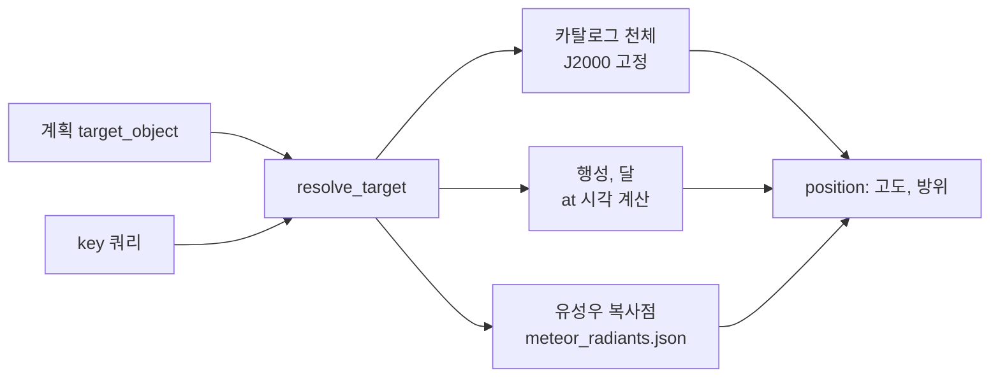

# Astrowatch API 명세서

> FastAPI 백엔드의 경로, 요청, 응답, 상태 코드. 실행 중이면 http://127.0.0.1:8000/docs 에서 같은 내용을 볼 수 있다.
> 갱신일 2026-11-20, 모델은 `backend/astrowatch/schemas/`, 라우터는 `backend/astrowatch/app/api/`

---

## 1. 경로 목록

API 경로 **21개** (`app/api/` 의 `@router.` 데코레이터 기준: chat 1, plans 5, calendar 2, logs 6, sessions 3, sky 2, meta 2) + 정적 화면 4개.

| 메서드 | 경로 | 요청 | 응답 | 상태 코드 | 요구사항 |
|---|---|---|---|---|---|
| POST | `/api/chat` | `ChatRequest` | `ChatResponse` | 200, 422, 429 | F3005~F3011, F3019 |
| GET | `/api/plans` | `limit`, `offset` | `PlanOut[]` (시작 시각 순) | 200, 422 | F3015 |
| POST | `/api/plans` | `PlanCreate` | `PlanSaveResult` | 201, 422 | F3015 |
| GET | `/api/plans/{id}` | 없음 | `PlanOut` | 200, 404 | F3015 |
| PATCH | `/api/plans/{id}` | `PlanUpdate` | `PlanOut` | 200, 404, 422 | F3016 |
| DELETE | `/api/plans/{id}` | 없음 | 본문 없음 | 204, 404 | F3016 |
| POST | `/api/plans/{id}/calendar` | 없음 | `ToolResult[CalendarAddOutput]` | 200, 404, 422, 502, 503 | F3023 |
| GET | `/api/calendar?date_from=&date_to=` | 쿼리 | `ToolResult[CalendarQueryOutput]` | 200, 422, 502, 503 | F3023 |
| GET | `/api/logs` | `limit`, `offset` | `LogSessionOut[]` (최근 순) | 200, 422 | F3014 |
| GET | `/api/logs/{session_id}` | `limit`, `offset` | `LogEventOut[]` (**seq 순**) | 200, 404, 422 | F3014 |
| DELETE | `/api/logs/{session_id}` | 없음 | 본문 없음 (판정 기록도 삭제) | 204, 404 | F3014 |
| GET | `/api/logs/{session_id}/audits` | 없음 | `AuditResult[]` (최신 먼저) | 200, 422 | F3020 |
| GET | `/api/logs/{session_id}/audit` | 없음 | `AuditResult` (최신) | 200, 404, 422 | F3020 |
| POST | `/api/logs/{session_id}/audit` | 없음 (본문 없음) | `AuditResult` (세션 전체 재판정) | 200, 403, 404, 422 | F3020 |
| GET | `/api/sessions` | `limit`, `offset` | `SessionSummaryOut[]` (최근 순) | 200, 422 | F3010 화면 복원 |
| GET | `/api/sessions/{session_id}` | 없음 | `SessionDetailOut` (턴 **seq 순**) | 200, 404 | F3010 화면 복원 |
| DELETE | `/api/sessions/{session_id}` | 없음 | 본문 없음 (run_logs 유지) | 204, 404 | F3010 화면 복원 |
| GET | `/api/sky/target` | `key` 또는 `plan_id`, `lat`, `lon`, `at` | `SkyTargetOut` | 200, 404, 422 | 하늘 가리키기 |
| GET | `/api/sky/targets` | `q` | `SkySuggestion[]` (최대 8) | 200, 422 | 하늘 가리키기 |
| GET | `/api/tools` | 없음 | Tool 명세 목록 | 200 | F3001 |
| GET | `/api/graph` | 없음 | `{"ascii": "..."}` | 200, 503 | 검증 4.2 |
| GET | `/api/health` | 없음 | `{status, llm_configured, tools}` | 200 | 없음 |
| GET | `/`, `/plans.html`, `/logs.html`, `/pointer.html` | 없음 | 정적 화면 | 200 | F3018 |

- **실행 로그 수정 API 는 없다** (`PATCH /api/logs/{id}` → 405). DB 에도 UPDATE 차단 트리거 (F3014).
- 공통 오류: 미처리 예외 → `500 {"detail": "서버 내부 오류가 발생했습니다"}` (상세는 서버 로그에만, NF3002). 검증 오류(422)는 입력값을 되돌려 주지 않는다.
- 목록 3종(`/api/plans`, `/api/logs`, `/api/sessions`)과 `/api/logs/{session_id}` 는 `?limit=`(1~1000, 기본 200), `?offset=`(0 이상)을 받는다. 응답 모양은 배열 그대로.
- 경로 검증: `session_id` 는 `^[A-Za-z0-9_-]{6,64}$`, 계획 `id` 는 1 이상 → 어기면 422.

### 1-1. 보안, 공통 상태 코드 (`app/security.py`, `app/main.py`)

| 상태 | 경우 | 대상 |
|---|---|---|
| 400 | 허용되지 않은 `Host` (TrustedHost, `APP_ALLOWED_HOSTS` 로 추가), 잘못된 `Content-Length` | 전체 |
| 401 | `APP_ACCESS_TOKEN` 설정 시 `X-Astrowatch-Token` 헤더 불일치 `"접근 토큰이 필요합니다"` | `/api/*` (`/api/health` 제외) |
| 403 | `Origin` 이 허용 목록, 같은 출처가 아님, `Sec-Fetch-Site: cross-site`, `X-Requested-With: Astrowatch` 없음 | POST, PATCH, DELETE |
| 413 | 요청 본문 256KB 초과 (chunked 포함) | POST, PATCH, DELETE |
| 415 | 본문이 JSON 이 아님 | POST, PATCH |
| 429 | `/api/chat` IP 당 분당 `CHAT_RATE_PER_MIN`(기본 12) 초과 `"요청이 너무 많습니다"` + `Retry-After` | POST `/api/chat` |
| 429 | 지금 판정 IP 당 분당 `AUDIT_RATE_PER_MIN`(기본 6) 초과, 같은 응답 | POST `/api/logs/{id}/audit` |

- CORS: `APP_ALLOWED_ORIGINS`(기본은 앱 자신의 출처)만 허용, 메서드 GET, POST, PATCH, DELETE, 헤더 `Content-Type`, `X-Requested-With`, `X-Astrowatch-Token`, credentials 없음.
- 응답 헤더: 모든 응답에 `X-Content-Type-Options: nosniff`, `X-Frame-Options: DENY`, `Referrer-Policy`, `Permissions-Policy`, `/api/*` 는 `Cache-Control: no-store`, HTML 은 CSP(`script-src 'self'`, `/docs` 만 완화).
- 화면(`frontend/js/api.js`)은 상태 변경 요청에 `X-Requested-With: Astrowatch` 를 붙인다. 직접 호출할 때도 같은 헤더가 필요하다.

---

## 2. 대화 `/api/chat`

### 2-1. `ChatRequest`

| 필드 | 타입 | 필수 | 설명 |
|---|---|---|---|
| `session_id` | str \| null | | 비우면 새 세션 (`^[A-Za-z0-9_-]{6,64}$`) |
| `message` | str 1~2000 | ✅ | 앞뒤 공백 제거 후 비면 422 |

### 2-2. `ChatResponse`

| 필드 | 타입 | 설명 |
|---|---|---|
| `session_id` | str | 이어서 보낼 세션 |
| `intent` | str | `plan, fact, confirm, calendar, knowledge, chat, clarify` |
| `answer` | str | 최종 응답 문장 (F3011) |
| `conditions` | Conditions | 사용자 조건 (재계획으로 바뀐 값 아님) |
| `needs_clarification` | str[] | 되물은 조건 (`region, start_minute, date_from`) |
| `recommended` | JudgedCandidate[] | 충족, 조건부 충족 (순위순) |
| `excluded` | JudgedCandidate[] | 불충족, 판단 안 함 + `reasons` |
| `places` | Place[] | 관측지 (최종 지역 기준) |
| `replan_count` | int | 실제 재계획 횟수 |
| `replan_limit` | int | 설정 상한 (`MAX_REPLANS`) |
| `replan_limit_reached` | bool | 상한에 **실제 도달**했을 때만 true |
| `stop_reason` | str \| null | 추천 0개로 끝난 이유: `limit_reached, no_alternative, target_unobservable, fixed_constraints, fatal_error` |
| `steps` | StepOut[] | 실행 타임라인 (아래) |
| `warnings` | str[] | 키 누락, Tool 실패 안내 (상세 오류 없음) |
| `safety_note` | str | 야간 안전 문구 (눈 예보면 "눈/결빙 주의" 추가) |
| `audit` | `AuditSummary` 또는 null | F3020 이번 턴 로깅 Agent 판정: `status`(normal, anomaly, undetermined), `warning_count`, `findings[{kind, message}]`, `diagnosis_text`(이상일 때만, 경고 수와 별개). 판정 실패면 null |
| `llm_calls` | int 또는 null | F3021 이번 턴의 LLM 판단 호출 수: `llm_decision` + Worker 의 LLM 시도 + 로깅 Agent 진단. 응답 문장 생성(respond) 1회는 이벤트가 없어 세지 않는다 |

**`StepOut`** (F3019)

| 필드 | 설명 |
|---|---|
| `seq` | 세션 내 발생 순서 |
| `type` | `stage_start, stage_end, tool_call, tool_result, llm_decision, replan, error` + F3021 `planner_tasks, worker_decision` (`worker_result`, `audit_result` 는 실행 로그에만) |
| `stage`, `tool` | 단계, Tool 이름 |
| `ok` | `tool_result` 일 때 성공 여부 |
| `summary` | 사람이 읽는 한 줄 |
| `duration_ms` | 단계, Tool 소요 시간 |
| `replan_round` | 재계획 안의 단계면 몇 회차 |

**`JudgedCandidate`** 주요 필드

| 필드 | 설명 |
|---|---|
| `candidate` | `event_id, title, kind, date, region, lat, lon, event_minute` |
| `verdict` | `fit, conditional, unfit, unjudged` |
| `dark_window`, `user_window`, `event_window`, `time_window` | `{start, end}` 분 (저녁 기준 날짜 00:00 = 0) |
| `clear_minutes`, `worst_sky`, `max_pop` | 예보 판단 결과 (없으면 null) |
| `moon_interferes`, `lun_age` | 달 영향 (모르면 null) |
| `latest_arrival_minute` | 역산: 늦어도 이 시각 도착 |
| `forecast_source` | `kma_short, kma_mid, owm, mock` |
| `reasons` | 판정 근거, 제외 사유 |
| `target_alt`, `target_az` | 천체 남중 고도, 방위 |

### 2-3. 예시 (`samples/run_R1.json` 축약, 2026-11-20 캡처, `claude-haiku-5-5`)

요청: 샘플의 `turns[0].message` 원문.

```http
POST /api/chat
Content-Type: application/json
X-Requested-With: Astrowatch

{"session_id": null, "message": "12월 14일 쌍둥이자리 유성우, 서울에서 밤 10시부터 새벽 2시 사이에 볼 수 있어?"}
```

응답 (200, 일부 필드 생략)

```json
{
  "session_id": "b98028bec110",
  "intent": "plan",
  "answer": "**요청 조건**: 2026-12-14, 서울, 22:00~02:00(다음날) 사이 쌍둥이자리 유성우 관측 가능 여부\n…\n  - 등급: **조건부 충족** (날씨 예보 미확인)\n  - 관측 창: **22:00~02:00(+1일)**, 총 240분\n  …\n  - 늦어도 **01:30(+1일)** 까지 도착하면 최소 30분 관측 가능\n…",
  "conditions": {
    "date_from": "2026-12-14", "date_to": "2026-12-14",
    "start_minute": 1320, "end_minute": 1560,
    "region": "서울", "event_kind": "meteor", "event_query": "쌍둥이자리 유성우",
    "avoid_moon": true, "fixed": ["date_from"]
  },
  "recommended": [{
    "candidate": {"event_id": "20261214-1", "title": "쌍둥이자리 유성우 극대기(ZHR=150) (IMO 기준)",
                  "kind": "meteor", "date": "2026-12-14", "region": "서울", "event_minute": 1380},
    "verdict": "conditional",
    "dark_window": {"start": 1128, "end": 1805},
    "time_window": {"start": 1320, "end": 1560},
    "clear_minutes": null, "moon_interferes": false, "lun_age": 5.5,
    "latest_arrival_minute": 1530,
    "reasons": [
      "어두운 시간 18:48~06:05+1, 내 시간 22:00~02:00+1 → 관측 창 22:00~02:00+1 (240분)",
      "월령 5.5일 - 달빛 영향 적음",
      "예보 범위 밖(D-3부터 확인 가능) - 날씨 미판단"
    ]
  }],
  "excluded": [], "places": [],
  "replan_count": 0, "replan_limit": 3, "replan_limit_reached": false, "stop_reason": null,
  "steps": [
    {"seq": 3, "type": "llm_decision", "stage": "analyze", "summary": "의도 판단: plan - 서울에서 특정 날짜/시간대의 쌍둥이자리 유성우 관측 가능 여부를 묻는 관측 계획 요청이다."},
    {"seq": 9, "type": "tool_result", "stage": "execute", "tool": "search_sky_events", "ok": true, "duration_ms": 241, "summary": "천문현상 조회 성공"},
    {"seq": 15, "type": "tool_result", "stage": "execute", "tool": "get_sky_forecast", "ok": false, "duration_ms": 0,
     "summary": "날씨 예보 조회 실패(OUT_OF_RANGE): 예보 범위 밖: 가장 늦은 예보일 2026-11-30"}
  ],
  "warnings": [],
  "safety_note": "야간 관측 시 이동 안전과 방한에 유의하세요."
}
```

> 전체 단계, 이벤트는 [RUN_LOG_SAMPLE.md](RUN_LOG_SAMPLE.md). 실제 응답의 `JudgedCandidate` 에는 화면 타임바용 `moon_up`, `moon_unknown`, `hourly_sky`, `object_window` 도 함께 온다.

---

## 3. 계획 `/api/plans`

### `PlanCreate` (POST)

| 필드 | 타입 | 필수 | 설명 |
|---|---|---|---|
| `event_title` | str | ✅ | 현상, 대상 이름 |
| `event_kind` | EventKind | | 기본 `other` |
| `start_dt`, `end_dt` | datetime | ✅ | 현지 naive. `end_dt > start_dt` (자정 넘김은 다음 날) |
| `location_label` | str | ✅ | 지역 |
| `lat`, `lon` | float | | |
| `place_id`, `place_url` | str | | 카카오 ID, 링크만 (이름, 주소 저장 안 함) |
| `target_alt`, `target_az` | float | | 천체 남중 고도, 방위 |
| `target_object` | str (최대 100) | | 하늘 가리키기 대상 키. 보낸 이름은 키로 정규화, 비우거나 모르는 이름이면 제목에서 추론, 그래도 없으면 `null` |
| `basis` | str | | 판정 등급, 맑은 시간, 달 영향 요약 |
| `session_id` | str | | 어느 대화에서 만든 계획인지 |

### `PlanSaveResult` (201)

| 필드 | 설명 |
|---|---|
| `plan` | `PlanOut` = 위 필드 + `id, calendar_event_id, created_at, updated_at` |
| `overlaps` | 시간이 겹치는 기존 계획 전체 (`start < other.end AND end > other.start`). **저장은 막지 않는다** |

### `PlanUpdate` (PATCH, 보낸 필드만)

| 필드 | 비고 |
|---|---|
| `event_title`, `start_dt`, `end_dt`, `location_label` | null 로 비울 수 없음 → 422 |
| `basis` | null 로 비울 수 있음 |
| `target_object` | 이름, 키 → 키로 정규화 (모르면 422 `"가리킬 수 있는 천체가 아닙니다"`). null 로 비울 수 있음 |

| 상태 | 경우 |
|---|---|
| 422 | 시각 역전 `"종료 시각은 시작 시각보다 뒤여야 합니다"`, 필드 형식 오류 |
| 404 | `"계획을 찾을 수 없습니다"` |

---

## 4. 캘린더 (F3023)

| 경로 | 동작 |
|---|---|
| `POST /api/plans/{id}/calendar` | `add_plan_to_calendar({"plan_id": id})`: 이미 등록이면 `already_registered: true` |
| `GET /api/calendar?date_from=YYYY-MM-DD&date_to=YYYY-MM-DD` | `get_calendar`: 최대 92일 |

성공은 Tool 봉투 그대로 (`{"ok": true, "data": {...}, "note": ...}`). 실패는 코드별 상태 + 고정 메시지:

| ErrorCode | HTTP | message |
|---|---|---|
| `AUTH` | 503 | "캘린더 인증 정보가 없습니다. 관리자에게 Google 토큰 발급을 요청하세요." |
| `NOT_FOUND` | 404 | "계획을 찾을 수 없습니다" |
| `BAD_INPUT` | 422 | "입력값을 확인해 주세요" |
| `TIMEOUT`, 그 밖 | 502 | "캘린더 응답이 늦습니다…" / "캘린더 요청을 처리하지 못했습니다…" |

실패 본문: `{"ok": false, "error": {"code", "message"}, "detail": message}`

---

## 5. 실행 로그 `/api/logs` (F3014)

### `LogSessionOut`

| 필드 | 설명 |
|---|---|
| `session_id` | 세션 |
| `started_at`, `last_at` | 첫, 마지막 이벤트 시각 |
| `event_count`, `tool_calls`, `replans` | 집계 |
| `first_message` | 첫 `session_start` 의 메시지 |
| `audit_status`, `audit_warnings` | F3020 최신 판정 상태와 경고 수. 판정 없으면 null |

### `LogEventOut`

| 필드 | 설명 |
|---|---|
| `session_id`, `seq`, `ts` | 세션, 순서, 시각(UTC) |
| `type` | 이벤트 14종: 기본 9종 (`session_start, stage_start, stage_end, llm_decision, tool_call, tool_result, replan, error, session_end`) + F3021 `planner_tasks, worker_result, worker_decision` + F3020 `audit_result, audit_diagnosis` |
| `stage`, `tool` | |
| `payload` | JSON (이벤트별 필드는 [AGENT_DESIGN 8절](AGENT_DESIGN.md#8-메인-agent--로깅-agent)) |

| 상태 | 경우 |
|---|---|
| 404 | 없는 세션 `"실행 로그를 찾을 수 없습니다"` |
| 405 | PATCH, PUT (경로 없음) |

### 로깅 Agent 판정 (F3020)

| 경로 | 동작 |
|---|---|
| `GET /api/logs/{id}/audits` | 저장된 판정 목록. 최신(구간 끝 seq 큰 것, 같으면 넓은 구간) 먼저. 없으면 `[]` |
| `GET /api/logs/{id}/audit` | 최신 판정 하나. 없으면 404 `"판정 기록이 없습니다"` |
| `POST /api/logs/{id}/audit` | 세션 전체를 지금 규칙으로 판정해 저장하고 돌려준다. 이상이면 LLM 진단 시도(실패해도 판정은 반환). 상태 변경 요청이라 `X-Requested-With: Astrowatch` 필요(없으면 403). 로그 없는 세션 404. 같은 구간, 같은 판정에 실패하지 않은 진단이 저장돼 있으면 LLM 을 다시 부르지 않고 그 진단을 돌려준다 (`?force=1` 이면 다시 진단). IP 당 분당 `AUDIT_RATE_PER_MIN` 회 |

`AuditResult`

| 필드 | 설명 |
|---|---|
| `session_id`, `seq_from`, `seq_to` | 판정 구간 |
| `status` | `normal`, `anomaly`, `undetermined`(근거 이벤트 없음, 판정 불가) |
| `findings[]` | `kind`(`repeated_call`, `excessive_replan`, `unplanned_call`), `message`, `evidence_seqs`, `count` |
| `evidence_count` | 대조한 이벤트 수 |
| `rule_version`, `audited_at` | 규칙 버전, 판정 시각 |
| `diagnosis` | 이상 판정에만: `culprit`, `fix`, `text`(세 문장 이내), `model`, `failed`. 경고 수에 포함하지 않음 |

규칙 정의는 [AGENT_DESIGN 8-1절](AGENT_DESIGN.md#8-1-로깅-agent-판정-f3020).

---

## 6. 대화 세션 `/api/sessions` (화면 복원)

`run_turn` 이 응답을 돌려주기 직전에 턴(사용자 메시지 + 당시 `ChatResponse`)을 `turns` 표에 저장한다. 저장 실패는 경고 로그만 남기고 응답에는 영향이 없다. LLM 맥락(`sessions.history_json`)/실행 로그(`run_logs`)와는 별개다.

### `GET /api/sessions` → `SessionSummaryOut[]` (`last_at` 내림차순)

| 필드 | 설명 |
|---|---|
| `session_id` | 세션 |
| `title` | 첫 사용자 메시지 앞 60자 |
| `started_at`, `last_at` | 첫, 마지막 턴 시각 (현지 시각) |
| `turn_count` | 턴 수 |
| `last_intent` | 마지막 턴 응답의 `intent` (읽지 못하면 `null`) |

### `GET /api/sessions/{session_id}` → `SessionDetailOut`

`{session_id, title, started_at, last_at, turns: TurnOut[]}`: `TurnOut = {session_id, seq, ts, user_message, response: ChatResponse}`, seq 순. 옛 형식이라 `ChatResponse` 로 읽지 못하는 턴은 건너뛴다(서버 경고 로그).

### `DELETE /api/sessions/{session_id}` → 204

해당 세션의 `turns` 행과 `sessions` 행(LLM 맥락)만 지운다. **실행 로그(`run_logs`)는 남는다**: 지우려면 `DELETE /api/logs/{id}`.

| 상태 | 경우 |
|---|---|
| 404 | 턴도 세션 행도 없음 `"대화를 찾을 수 없습니다"` (GET 은 턴이 없을 때) |

---

## 7. 메타

| 경로 | 응답 |
|---|---|
| `GET /api/tools` | `[{name, kind, description, input_schema, fixed_args}]`: LLM 에 넘기는 것과 같은 스키마 |
| `GET /api/graph` | `{"ascii": "<그래프 그림>"}`: grandalf 없으면 mermaid 텍스트. 그래프 모듈 import 실패 시 503 |
| `GET /api/health` | `{"status": "ok", "llm_configured": bool, "tools": [이름…]}` |

---

## 8. 하늘 가리키기 `/api/sky`

계획의 천체 쪽으로 휴대폰을 안내하는 화면(`pointer.html`)이 쓴다. 대상 해석은 `astro/targets.py`.



### 대상 키

| kind | 키 예 | 좌표 |
|---|---|---|
| `object` | `안드로메다 은하`, `시리우스`, `쌍둥이자리`(별자리) | 카탈로그 J2000 |
| `planet` | `mars`, `jupiter` | `at` 시각의 지구 중심 좌표, `refresh_s: 60` |
| `moon` | `moon` | 같음 (일주시차 약 1° 무시) |
| `radiant` | `geminids`, `perseids` | 극대일 근처 복사점 대략값 (IMO 12개 유성우) |

`key` 는 키 말고도 한국어, 영어 이름, 별칭(`M31`, `화성`, `쌍둥이자리 유성우`, `GEM`)을 받는다.

### `GET /api/sky/target`

| 쿼리 | 타입 | 설명 |
|---|---|---|
| `key` | str 1~100 | 대상. 없으면 `plan_id` 계획의 `target_object` |
| `plan_id` | int 1 이상 | 계획. `key` 와 함께 주면 대상은 `key`, 위치는 계획 |
| `lat`, `lon` | float (-90~90, -180~180) | 둘 다 주거나 둘 다 생략. 생략 시 계획 좌표 → 계획 지역(`location_label`) → 서울 |
| `at` | ISO datetime | 기본 지금. 시간대가 없으면 KST. 1900-01-01 ~ 2100-12-31 (받은 시간대 기준 날짜) |

`SkyTargetOut` (200):

| 필드 | 설명 |
|---|---|
| `key`, `name`, `kind`, `subkind` | 대상. `subkind` 는 카탈로그 종류(`galaxy` 등) 또는 IMO 코드 |
| `ra`, `dec` | 도. 화면은 이 값으로 1초마다 고도, 방위를 다시 계산한다 |
| `alt`, `az`, `above_horizon`, `compass` | `at` 시각 관측지 기준. 방위는 북 0° → 동 90°, `compass` 는 8방위 한국어 |
| `at` | 계산 시각 (UTC) |
| `lat`, `lon`, `location_source`, `location_label` | 관측지와 출처 `query`, `plan`, `region`, `default` |
| `rises_at` | 지금 지평선 아래면 24시간 안에 떠오르는 대략의 시각 (UTC, 10분 단위, 행성, 달은 걸음마다 좌표 재계산). 아니면 `null` |
| `refresh_s` | 행성, 달은 `60`, 고정 천체는 `null` |
| `plan_id`, `plan_title` | `plan_id` 로 불렀을 때 |

예: `?key=안드로메다 은하&lat=37.5665&lon=126.978&at=2026-11-20T21:00:00+09:00`

```json
{"key": "안드로메다 은하", "name": "안드로메다 은하", "kind": "object", "subkind": "galaxy",
 "ra": 10.6847, "dec": 41.2687, "alt": 85.08, "az": 39.84, "above_horizon": true, "compass": "북동",
 "at": "2026-11-20T12:00:00Z", "lat": 37.5665, "lon": 126.978, "location_source": "query",
 "location_label": null, "rises_at": null, "refresh_s": null, "plan_id": null, "plan_title": null}
```

| 상태 | 경우 |
|---|---|
| 404 | `"계획을 찾을 수 없습니다"`, `"이 계획에는 가리킬 천체가 없습니다"`, `"가리킬 천체를 찾을 수 없습니다"` |
| 422 | `key`, `plan_id` 둘 다 없음, `lat`/`lon` 범위 밖 또는 한쪽만, `key` 101자 이상, `at` 형식 오류, `at` 범위 밖 `"at 은 1900-01-01 부터 2100-12-31 사이 시각이어야 합니다"` |

### `GET /api/sky/targets?q=`

`q`(최대 50자) 이름 일부로 찾는다. 비우면 추천 8개(달, 목성, 토성 ...). 응답 `[{key, name, kind}]`, 정확 > 앞부분 > 포함 순, 같으면 달, 행성 > 유성우 > 메시에 > 별 > 별자리.
