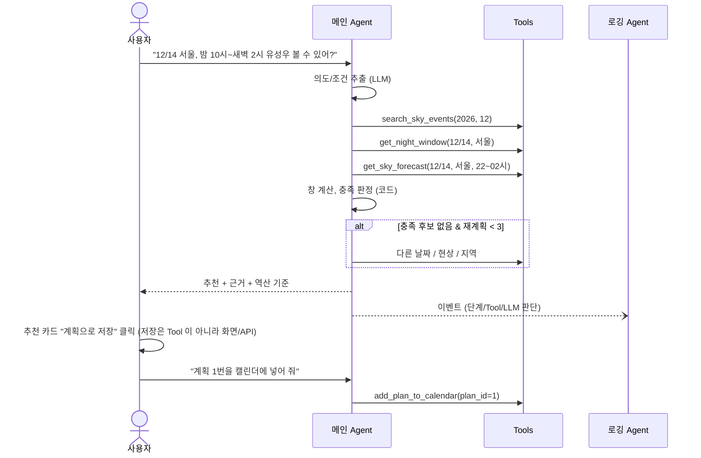
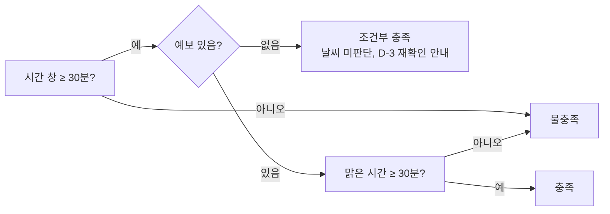
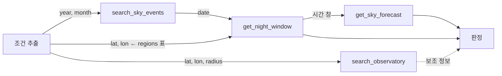
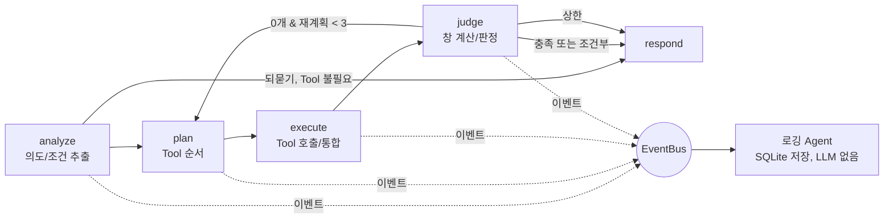

# Astrowatch, Agent 기반 천문 관측 플래너 기획안

> **Astrowatch** = astro + (over)watch.
> 보고 싶은 천문 현상과 내 시간을 말하면, 하늘이 어둡고 달이 방해하지 않고 구름이 적은 **시간/장소**를 골라 관측 계획을 만들고 캘린더에 넣어 준다.

| 항목 | 내용 |
|---|---|
| 과정 | AI 코어 프로젝트 3회차, 개인 |
| 기간 | 2026-11-18(수) ~ 11-20(금), 2일차는 맥북에서 제한 시간 참여 |
| 구현 방식 | Fable 오케스트레이션 → Opus 구현 → Codex 리뷰 |
| 이전 프로젝트 | [VastHorizon](https://github.com/bnbong/VastHorizon) (우주 RAG 지식 서비스) 코드/색인 재사용 |
| 심화 선택 | F3023 캘린더 > F3022 RAG > (덤) 자이로 가리키기 |

---

## 1. 도메인 판단

| 조건 | 결론 | 근거 |
|---|---|---|
| 외부 API 3종 이상 | ✅ | 천문연(현상/출몰/월령), 기상청(단기/중기예보), 카카오 로컬 |
| 판단이 필요한 요청 | ✅ | 박명/월령/구름/내 시간을 **겹쳐 봐야** 답이 나온다 |
| 재계획이 의미 있음 | ✅ | 흐리거나 달이 밝으면 다른 날짜/현상/지역으로 다시 찾는다 |
| 저장할 결과물 | ✅ | 관측 계획(현상, 날짜, 시작/종료, 장소). 시간 겹침 판단이 자연스럽다 |
| 위험 도메인 | ❌ | 면책 불필요. 야간 외출 안전 한 줄만 고정 |

**LLM만으로 답하면 틀리는 이유**

| 요청 | LLM만으로는 |
|---|---|
| "토요일 밤 서울 구름 많아?" | 예보를 모른다 |
| "12/14 유성우, 몇 시부터 어두워져?" | 그날 서울의 천문박명/월출 시각을 지어낸다 |
| "대전 근처 천문대 20km 안" | 실재 장소와 거리를 모른다 |

**Movie Planner 대응**

| Movie Planner | Astrowatch |
|---|---|
| 박스오피스 (후보) | 천문현상 목록 |
| 영화 상세, 러닝타임 | 출몰, 박명, 월령 (관측 창) |
| 영화관 검색 (보조) | 날씨 예보 + 관측 장소 검색 |
| 러닝타임 + 광고 ≤ 제약 시각 | 어두운 창 ∩ 내 창 ∩ 현상 창 ∩ 맑은 시간 ≥ 30분 |
| 관람 계획 | 관측 계획 |

---

## 2. 서비스 흐름



---

## 3. 외부 API (NF3007)

2026-11-18 이 PC에서 **직접 호출/포털 확인**한 결과다. 활용신청 5건 완료.

| # | API | 정보 | Tool | 키 | 형식 | 이용허락 |
|---|---|---|---|---|---|---|
| 1 | 천문연 **천문현상 정보** [15012691](https://www.data.go.kr/data/15012691/openapi.do), `AstroEventInfoService` | 월별 현상: `locdate, seq, astroTitle, astroTime, astroEvent` | 후보 조회 | data.go.kr | XML | 제한 없음 |
| 2 | 천문연 **출몰시각 정보** [15012688](https://www.data.go.kr/data/15012688/openapi.do), `RiseSetInfoService/getLCRiseSetInfo` | 일출몰, 월출몰, 시민/항해/**천문박명**(`astm, aste`) | 상세 조회 | 〃 | XML | 제한 없음 |
| 3 | 천문연 **월령 정보** [15012689](https://www.data.go.kr/data/15012689/openapi.do), `LunPhInfoService` | `lunAge` | 상세 조회 | 〃 | XML | 제한 없음 |
| 4 | 기상청 **단기예보** [15084084](https://www.data.go.kr/data/15084084/openapi.do), `VilageFcstInfoService_2.0/getVilageFcst` | 시간별 `SKY`, `POP` (글피까지) | 보조 | 〃 | JSON | 공공누리 1유형 |
| 5 | 기상청 **중기육상예보**, `MidFcstInfoService/getMidLandFcst` | 3~10일 오전/오후 하늘상태/강수확률 | 보조(백업) | 〃 | JSON | 공공누리 1유형 |
| 6 | 카카오 **로컬 키워드 검색** | 장소 이름/주소/링크/거리, `radius` **최대 20km** | 보조 | 카카오 REST | JSON | 결과 저장 금지 → ID/링크만 저장 |
| 7 | Google Calendar (심화) | 일정 조회/등록 | 캘린더 | OAuth | JSON | 본인 계정 |

> ⚠️ Open-Meteo는 **이 네트워크에서 차단**(타임아웃)되어 백업에서 뺐다.
**호출 한도 (2026-11-18 사용자 확인값)**

| 출처 | 한도 | 비고 |
|---|---|---|
| data.go.kr 5개 서비스 | 엔드포인트당 **일 10,000회** | 개발계정 |
| 카카오 키워드 장소 검색 | **일 100,000회** | 11/18 기준 3회 사용 |
| SSAFY GMS (`claude-haiku-5-5`, Anthropic 호환 경로) | **총 30,000 크레딧**, 1회 호출 1크레딧 | **11/20(금)까지만 사용 가능** → 검증 캡처/로그 샘플은 금요일 안에. 11/20 OpenAI 경로(`gpt-6-luna`) 사용 불가로 전환 (`LLM_PROVIDER=anthropic` 기본) |
| OpenWeatherMap 무료 | 분당 60회, 월 100만 회 | 공개값 |

---

## 4. 대표 요청 (4.7 검증 5종 포함)

| # | 요청 | 유형 | Tool 순서 | 기대 동작 |
|---|---|---|---|---|
| R1 | "12월 14일 쌍둥이자리 유성우, 서울에서 밤 10시~새벽 2시에 볼 수 있어?" | 한 번에 충족 | 현상 → 출몰/월령 → 날씨(범위 밖) | **조건부 충족**: 어두운 창/달 영향 제시, 날씨는 "D-3부터 확인" |
| R2 | "이번 주말 밤 9시~12시 대전에서 볼 만한 거. 구름 많으면 다른 날로" | 재계획 | 현상 → 출몰 → 날씨(흐림) → **재계획** | 현상/출몰 결과 재사용, 날씨만 추가 호출 |
| R3 | "다음 주 서울에서 보름달 피해서 유성 보고 싶어" (11/24 보름) | 상한 도달 | 재계획 3회 → 멈춤 | 사유 + "날짜 범위나 지역을 넓힐까요?" |
| R4 | "토요일 밤 대전 근처 천문대, 20km 이내" + 카카오 키 누락 | Tool 실패 | 장소 검색 `AUTH` → 나머지 진행 | 시간/날씨 판단은 그대로, 장소는 "확인 못 함" |
| R5 | "안녕, 이거 어떻게 써?" | Tool 불필요 | 계획 생략 | 사용법 안내 |
| R6 | "같은 날 장소만 강원도로" | 맥락 유지 | 출몰/날씨만 재호출 | 날짜/시간 유지, 지역만 갱신 |
| R7 | "밤 11시 전엔 들어와야 해" | 되묻기 | Tool 호출 전 | "몇 시부터, 어느 지역인가요?" |

> R2/R3는 실제 날씨에 의존한다. 검증 캡처는 `WEATHER_PROVIDER=mock`(흐림 고정)으로 재현한다.

---

## 5. 조건과 판단식

### 5-1. 조건 분류 (F3005)

| 기준 | 선호 | 제약 |
|---|---|---|
| 날짜(범위), 시작 가능 시각 | 지역, 현상 종류, 관측지 유형 | 종료 시각, 최대 거리, 구름 허용치, 달빛 회피 |

못 뽑은 값은 비워 둔다. **지역/시작 시각이 없으면 되묻는다.**

### 5-2. 관측 창 계산 (F3008, 전부 코드)

```
어두운 창 = [오늘 aste, 다음 날 astm]            ← 출몰 Tool (두 날짜 호출)
내 창     = [시작 가능, 종료]                     ← 사용자
현상 창   = 현상 시각 ± 종류별 폭                 ← 현상 Tool + 로컬 표
시간 창   = 어두운 창 ∩ 내 창 ∩ 현상 창
달 방해   = lunAge 10~20 이고 시간 창에 달이 떠 있음 (유성우/은하수만 감점)
맑은 시간 = 시간 창 중 SKY=맑음 ∧ POP ≤ 30%      ← 날씨 Tool
```

### 5-3. 판정 3단계



- 확인 못 하는 값은 지어내지 않는다. 대신 **"늦어도 ○시 도착 → 맑은 구간 ○분"** 처럼 역산한 기준을 준다.
- 12월 14일처럼 예보 밖 날짜가 **조건부 충족**이 되는 건 설계 의도다.

### 5-4. 재계획 (F3009)

| 한다 | 안 한다 |
|---|---|
| 충족 + 조건부 충족 = 0개 | API 키 누락/인증 실패 → 바로 안내 |
| ① 같은 현상 다른 날짜(±2일) → ② 같은 기간 다른 현상 → ③ 인접 지역 | 사용자가 날짜를 못박으면 ① 생략, 현상을 못박으면 ② 생략 |

상한 `MAX_REPLANS=3`. 받은 결과는 `(tool, 날짜, 지역)` 키로 상태에 보관해 다시 부르지 않는다.

**종료 사유 `stop_reason`**: 추천 0개로 끝났을 때만 응답에 싣는다 (`agent/replan.py`)

| 값 | 뜻 |
|---|---|
| `limit_reached` | 재계획이 상한(3회)에 실제 도달 |
| `no_alternative` | 상한 전에 적용할 전략 소진 |
| `fixed_constraints` | 사용자가 고정한 조건 때문에 적용할 전략 없음 |
| `target_unobservable` | 대상이 그 지역에서 고도 20° 이상 안 뜸 (날짜/지역을 바꿔도 같음) |
| `fatal_error` | 키 누락/인증 실패 (재시도해도 같음) |

### 5-5. 대화 맥락 (F3010)

보관: 조건 객체, 직전 추천 요약, 확정 후보 ID. **Tool 원본 응답은 보관하지 않는다.**

### 5-6. 날짜 검증

| 상황 | 처리 |
|---|---|
| 날짜 없음 | 오늘~+9일 기본 범위로 찾고 응답에 밝힌다 |
| 존재하지 않는 날짜(2월 30일)/뒤집힌 범위 | 외부 조회 없이 되묻는다. 이전 날짜를 조용히 쓰지 않는다 |
| 자정 넘김 한 밤 | LLM 이 한 밤(`single_night`)이라고 했을 때만 저녁 날짜 하나로 접는다 |

---

## 6. Tool 정의 (F3001~F3004, 심화)

공통 응답 `{ok: true, data, note?}` / `{ok: false, error: {code, message}}`. 예외는 밖으로 던지지 않는다.

| Tool | 구분 | 언제 쓰나 | 입력 | 출력 핵심 | 실패 코드 |
|---|---|---|---|---|---|
| `search_sky_events` | 외부 | 볼 현상을 정하지 않았거나 기간 안의 현상을 찾을 때 | `year, month, kind?` (연/월 필수. 날짜가 없으면 실행 흐름이 오늘~+9일 기본 범위를 넣고 응답에 밝힘) | `event_id, date, time?, title, kind` | `NO_RESULT, AUTH, UPSTREAM, TIMEOUT` |
| `get_night_window` | 외부 | 특정 날짜/지역의 어두운 시간과 달 영향 | `date, lat, lon` | 일몰, 천문박명 종료/시작, 월출/몰(당일/다음 날), `lunAge` | `NO_WINDOW, AUTH, UPSTREAM, TIMEOUT` |
| `get_sky_forecast` | 외부 | 후보 시간대의 구름/비 | `date, lat, lon, hours` | 시간별 `sky, pop, precip`, `source`, `base_time` | `OUT_OF_RANGE, AUTH, UPSTREAM, TIMEOUT` |
| `search_observatory` | 외부 | 관측 장소를 찾을 때 | `query, lat, lon, radius_km ≤ 20` | 이름/주소/링크/거리/`place_id` | `NO_RESULT, BAD_INPUT, AUTH, UPSTREAM, TIMEOUT` |
| `lookup_sky_object` | 로컬 | 사용자가 특정 천체(은하/성운/성단/별/별자리/행성)를 말해 그날 밤 언제 떠 있는지 알아야 할 때 | `name, date, lat, lon, min_alt=20` | 천체 정보, 고도 20° 이상 구간, 남중 시각/고도, `never_rises` | `NOT_FOUND`(유사 이름 3개 동봉) |
| `search_space_docs` | 로컬 (F3022, **미구현**) | 현상/천체 배경 지식 | `query` | 근거 문단 + 출처 | `NO_INDEX` |
| `get_calendar` / `add_plan_to_calendar` | 로컬→Google (F3023) | 내 일정 겹침 / 계획 등록 | `date_from, date_to` / **`plan_id`만** | 일정 목록 / 등록 결과 | `AUTH, NOT_FOUND` |

**Tool 사이 데이터 흐름**



**Tool이 아닌 것(실행 흐름이 직접)**: 지역명 → 위경도/기상청 격자 변환(로컬 `regions` 표), 단기예보 `base_time` 계산, 창 계산, 계획 저장.

**천체 카탈로그 (`data/sky_objects.json`, 294개)**: VastHorizon 항목 데이터에서 변환(메시에 110, 밝은 별 94, 별자리 88, 우리 은하 2). 행성은 `astro/planets.py`(ephemeris.js 이식)로 그날 좌표를 계산한다: JPL Horizons 대조 결과 적경/적위 0.03° 이내. 천문현상 API에 없는 대상("안드로메다 은하", "목성")은 이 카탈로그로 후보를 만들고 **고도 20° 이상인 시간만 관측 창**으로 쓴다. 카탈로그에 없으면 고도를 추정하지 않고 그 사실을 밝힌다.

**설계 규칙**

- F3002 추정 표시: 예보 범위 밖은 `note`에 "예보 없음" 명시.
- F3003 값 없으면 판단 안 함: 박명이 비면 `NO_WINDOW`로 그 날짜 제외. 월령만 실패하면 부분 성공 + note.
- F3004 임의 결합 금지: 장소 검색은 그 장소의 하늘을 알려 주지 않는다. 날씨는 지역 격자 기준임을 표시.
- 지역 표를 로컬에 두는 이유: 카카오로 지오코딩하면 카카오 키 누락 시 날씨/박명까지 함께 실패한다.

---

## 7. 저장 구조 (F3013~F3016)

**관측 계획 `plans`**

| 필드 | 예 |
|---|---|
| `id, created_at, updated_at` | |
| `event_title, event_kind` | 쌍둥이자리 유성우 극대 / `meteor` |
| `start_dt, end_dt` | 2026-12-14 22:10 / 2026-12-15 01:30 (자정 넘김 비교 단순화) |
| `location_label, lat, lon` | 서울 |
| `place_id, place_url` | 카카오 결과는 ID/링크만 |
| `target_alt, target_az` | nullable, 가리키기용 |
| `basis` | 판정 등급, 맑은 시간, 달 영향 요약 |
| `calendar_event_id` | 심화 |

같은 날짜에 시간이 겹치면 **저장은 하고** `overlaps: [겹치는 계획…]`(계획 전체)을 함께 돌려준다. 겹침 조회와 삽입은 한 트랜잭션에서 한다.

**실행 로그 `run_logs`**, 수정 API 없음

| 필드 | 값 |
|---|---|
| `session_id, seq, ts` | 세션 단위, 발생 순서 |
| `type` | `session_start / session_end / stage_start / stage_end / tool_call / tool_result / llm_decision / replan / error` (9종) |
| `payload` | JSON. `tool_result`에는 `duration_ms`, `llm_decision`에는 판단과 이유 |

---

## 8. Agent 구조 (F3005~F3014)



| 항목 | 결정 |
|---|---|
| LLM 호출 지점 | `analyze`(의도/조건), `respond`(문장 생성) 두 곳. 계획/판정/재계획은 코드 |
| EventBus | 동기 콜백 리스트. 구독자 예외는 삼키고 메인 흐름 계속 |
| 로깅 Agent 분리 기준 | 구독자 없이 실행해도 메인 Agent 정상 (테스트 1건) |
| LLM 연결 | `langchain-openai` + GMS base_url. VastHorizon `config.toml`과 같은 방식 |

---

## 9. 모듈 구조 (NF3006)

```
astrowatch/
├─ backend/
│  ├─ app/main.py            FastAPI 진입
│  ├─ app/api/               chat, plans, logs 라우터 (Pydantic 모델)
│  ├─ agent/graph.py         LangGraph 5노드
│  ├─ agent/state.py         State, 조건 객체
│  ├─ agent/judge.py         창 계산, 판정, 재계획 (순수 함수)
│  ├─ agent/memory.py        세션 맥락
│  ├─ tools/registry.py      공통 응답, 등록
│  ├─ tools/{sky_events,night_window,sky_forecast,observatory}.py
│  ├─ tools/{sky_object,calendar}.py   로컬 Tool (천체 카탈로그, 캘린더 F3023): space_docs(F3022)는 미구현
│  ├─ clients/               data.go.kr, 카카오, Google 얇은 클라이언트
│  ├─ events/bus.py          EventBus
│  ├─ logging_agent/         구독, SQLite 저장
│  ├─ storage/               plans, run_logs
│  ├─ data/regions.py        지역 표 (이름, 별칭, lat/lon, nx/ny)
│  └─ tests/                 samples/ fixture 기반, 키 없이 실행
├─ frontend/                 대화, 계획 관리, 실행 타임라인 (HTML/JS)
├─ samples/                  API 원본 응답 (키 제거)
└─ docs/                     기획안, Agent 설계, Tool 정의서, API 명세, 검증 결과
```

---

## 10. VastHorizon 재사용 (GitHub에서 확인)

| 가져올 것 | 위치 | 쓰임 | 손볼 것 |
|---|---|---|---|
| LLM 연결 방식 | `config.toml` `[llm]`, `vasthorizon/llm.py` | GMS base_url, `gpt-6-luna`, `text-embedding-3-small` | 설정값만 복사 → 11/20 Anthropic 호환 경로(`claude-haiku-5-5`)로 전환 |
| 박명 교차 검증 | `web/js/tonight.js` `sunAltDeg`, `crossing` | 출몰 API 결과 검증용 | 참고만 |
| 고도/방위 공식 | `web/js/astro.js` `altAz`, `localSiderealDeg` | 천체 고도 구간/남중 (`astro/altaz.py`) | ✅ 이식 완료 |
| 행성 위치 | `web/js/ephemeris.js` | 행성 적경/적위 (`astro/planets.py`) | ✅ 이식 완료, Horizons 대조 |
| 천체 카탈로그 | `data/items.json` | `scripts/build_sky_objects.py` → `data/sky_objects.json` | ✅ 변환 완료 |
| 하늘 가리키기 | `web/js/pointer.js` (테스트 있음), `pointerview.js` | 자이로 → 목표 안내 (덤) | 목표를 계획의 alt/az로 축소 |
| 행성/달 위치 | `web/js/ephemeris.js` | 행성 현상 방향 (덤) | 프론트에서만 |
| 문서 RAG | `vasthorizon/store/chroma.py`, `rag/`, Chroma 색인 | 심화 F3022 | 컬렉션 재사용, 검색 함수만 Tool로 감쌈 |
| 출처 표 형식 | `README.md` | NF3007 | 그대로 |

> 방향 센서는 **HTTPS에서만** 동작한다. 발표 시 `cloudflared tunnel` 또는 VastHorizon 배포 서버.

---

## 11. 일정

원칙: **사람 손이 필요한 일은 1일차에 전부. 에이전트 작업은 fixture 기반으로 키 없이 재현.**

### 1일차, 11/18(수), 윈도우 PC, ✅ 완료

| 시간 | 사람 | 에이전트 (병렬) |
|---|---|---|
| ~13:00 | ✅ 활용신청 5건, 카카오 REST 키, GMS 키 → `.env` | 저장소 뼈대, `requirements.txt`, **계약 파일**(공통 응답, 스키마, State, 이벤트, DB) |
| 13:00~14:30 | 각 API 1회 호출 → `samples/` 저장, 빈 응답 사례 확인 | Tool 4개 + `regions` 표 (samples fixture 테스트) |
| 14:30~16:00 | **도메인 확정 제출** (1/3/4/14절), LLM Tool 선택 확인 | LangGraph 5노드, 판정, 재계획 |
| 16:00~18:00 | Google OAuth 데스크톱 클라이언트 + 테스트 사용자 + 1회 로그인(토큰) | EventBus, 로깅 Agent, FastAPI, 화면 1차 |
| 저녁 | Codex 리뷰 확인, **GitLab push** | R1~R7 실행 스크립트, 문서 초안 |

**목표: 1일차 종료 시 F3001~F3019가 실제 키로 한 번씩 돈다.**

### 2일차, 11/19(목), 맥북, ✅ 완료 (1일차 밤에 앞당겨 수행)

맥북 작업 시간이 없어 계획 항목을 1일차 저녁, 밤(11/18)에 끝냈다.

| 계획 | 실제 |
|---|---|
| ① Codex 리뷰 반영 | ✅ 모듈별 리뷰 + 실제 E2E 20 시나리오 리뷰(R1~R8) 반영 |
| ② 테스트 보강 | ✅ 129 → 295건 |
| ③ Tool 정의서, API 명세, Agent 설계 초안 | ✅ 문서 7종 + SETUP 작성 |
| ④ F3022 로컬 Tool | ❌ 자를 순서에 따라 제외 |
| (추가) | ✅ F3023 캘린더(로컬 → Google), 화면 개편(Almanac), 세션 복원, 보안 강화, 타임바 행 분리 |

### 3일차, 11/20(금), 윈도우 PC, ✅ 완료

| 계획 | 실제 |
|---|---|
| 통합 점검, R1~R7 실행/캡처 (R2/R3는 mock) | ✅ `run_scenarios.py` 로 샘플 11종 재캡처 (09:44, 체크 20건 OK) |
| (추가) LLM 전환 | ✅ GMS OpenAI 경로(`gpt-6-luna`) 사용 불가 → Anthropic 호환 경로 `claude-haiku-5-5` |
| F3023 로컬 구현체 → Google 교체 | ✅ 1일차에 앞당겨 완료 |
| 문서 7종 마무리, FastAPI `/docs` 캡처, 로그 샘플 | ✅ 스크린샷 21장, 데모 영상, 로그 샘플, 문서 최종 갱신 |
| (추가) Codex HTTP 재검증 | ✅ 11건 FIXED 9, PARTIAL 2 → 답변 문장 2건 수정 |
| 셀프 체크리스트, NF3001~3007 점검, push | ⏳ 체크리스트 제공 대기 |
| 남으면 F3022 → 자이로 | ❌ 미구현 |

**자를 순서**: 자이로 → 화면 꾸미기 → F3022 → Google 연동(로컬 구현체만). F3020/F3021 미선택.

---

## 12. 위험과 대응

| 위험 | 대응 |
|---|---|
| data.go.kr 키 동기화 지연(발급 후 ~1시간) | 발급 즉시 호출. 늦으면 신청 화면 캡처로 16시 검증 |
| 키 Encoding/Decoding 혼동 → 401 | `.env`엔 Decoding 값. 주석으로 명시 |
| 천문현상 응답이 자유 문장 | 제목 키워드로 `kind` 규칙 사전. 미분류는 `other` |
| 예보 범위(단기 3일, 중기 10일) | 범위 밖은 **조건부 충족** + "D-3 재확인" |
| 단기예보 `base_time` 함정 | 02/05/08/11/14/17/20/23시 발표, +10분 뒤 조회. 직전 발표 계산 함수 |
| 카카오 저장 금지, 반경 20km | ID/링크만 저장, 표시 시 재호출. 반경 20km 고정 |
| 재계획/상한 재현 불가 | `WEATHER_PROVIDER=mock` |
| 2일차 환경 이동 | `.env`/`secrets/` 수동 복사. 경로는 상대 경로만. 테스트는 키 없이 통과 |
| Google 토큰 재발급 | 맥에서 쓰려면 `secrets/google_token.json` 복사 (리다이렉트 localhost 동일) |

---

## 13. 오늘 남은 체크리스트

- [x] data.go.kr 활용신청 5건
- [x] `.env` 채우기, 카카오 REST 키, GMS 키
- [x] API 1회 호출 → `samples/` 저장 (천문현상/출몰/월령/단기예보/OWM/GMS 성공)
- [x] 카카오맵 활성화, 중기예보 활용신청 → 호출 확인
- [ ] 16:00 도메인 확정 제출
- [ ] Google OAuth 클라이언트 생성, 토큰 1회 발급 → `secrets/`
- [ ] GitLab push (맥북 이어받기용)

---

## 14. 기획 검증 기록 (2.7)

| 확인 | 결과 | 일시 |
|---|---|---|
| apis.data.go.kr 5개 서비스 라우팅 | 응답(키 없음 401) | 11-18 11:30 |
| 포털 상세 페이지, 이용허락범위 | 천문연 3종 "제한 없음", 기상청 공공누리 1유형 | 11-18 11:35 |
| 카카오 `radius` 상한 | 20,000m (공식 문서) | 11-18 11:35 |
| Open-Meteo | **차단** (http/https 타임아웃) | 11-18 11:30 |
| OpenWeatherMap, 중기예보 | 응답 | 11-18 11:30 |
| Google OAuth, Calendar discovery | 응답 | 11-18 11:30 |
| GMS 엔드포인트 | 응답(키 없음 401) | 11-18 11:30 |
| VastHorizon 재사용 경로 | 10절 파일 전부 존재 확인 | 11-18 11:45 |
| 천문현상 2026-12 실제 호출 | ✅ 16건. 12/14 23:00 쌍둥이자리 유성우 극대(ZHR 150), 12/9 합삭, 12/24 망 | 11-18 12:10 |
| 출몰 서울 12/14 (위경도 버전) | ✅ 일몰 17:14, 천문박명 종료 18:48, 시작 06:05, 월몰 21:52 | 11-18 12:10 |
| 월령 12/14 | ✅ `lunAge` 5.5 → R1은 달 방해 없음 | 11-18 12:10 |
| 단기예보 서울 (base 11:00) | ✅ SKY 69건, 11/18 12시 ~ 11/22 00시 | 11-18 12:10 |
| 중기육상예보 (서울/경기 `11B00000`) | ✅ 3~10일 오전/오후 하늘상태/강수확률 | 11-18 12:30 |
| 카카오 키워드 검색 (대전 20km "천문대") | ✅ 5건. 대전시민천문대 4.4km, 대덕전파천문대 5.3km | 11-18 12:30 |
| OpenWeatherMap | ✅ 5일/3시간 40슬롯 | 11-18 12:10 |
| GMS `gpt-6-luna` 채팅 | ✅ (11-20 사용 불가 → `claude-haiku-5-5` 로 전환) | 11-18 12:10 |
| GMS Tool 선택 | ✅ `search_sky_events(2026, 12)` 선택. 단 `reasoning_effort="none"` 필수 (`gpt-6-luna` 한정) | 11-18 12:15 |
| GMS Anthropic 호환 경로 `claude-haiku-5-5` | ✅ `x-api-key` 헤더, structured output function_calling, 샘플 11종 재캡처로 확인 | 11-20 09:44 |
| Tool 출력 대조, 설계 시험(R1 trace) | ✅ [RUN_LOG_SAMPLE.md](RUN_LOG_SAMPLE.md) | 11-20 |

**응답에서 확인한 데이터 특성**

| 항목 | 사실 | 반영 |
|---|---|---|
| 천문현상 `astroTitle` | 대부분 비어 있고 이름은 `astroEvent`에 있음 | `title = astroTitle or astroEvent` |
| 천문현상 월 요약 행 | `locdate`가 6자리(`202612`) | 8자리만 후보로 사용 |
| 출몰 시각 형식 | `HHMM` 문자열 (`1848`) | 파싱 시 분 단위로 변환 |
| 중기예보 필드 | 06시 발표는 `wf4Am/Pm`~`wf10`, 18시 발표는 `wf3`부터. 8~10일은 하루 1값 | 밤 판단은 `Pm` 값 사용, 3일째는 단기예보로 채움 |
| 키 형식 | `.env`에 Encoding 키가 들어 있어도 동작하도록 `%` 포함 시 unquote | 클라이언트 공통 처리 |
| GMS 함수 호출 | chat/completions에서 tools 쓰려면 `reasoning_effort="none"` | `ChatOpenAI(..., reasoning_effort="none")` |
| GMS 토큰 파라미터 | `max_tokens` 거부, `max_completion_tokens`만 허용 | langchain-openai 최신은 자동 처리, 직접 호출 시 주의 |
