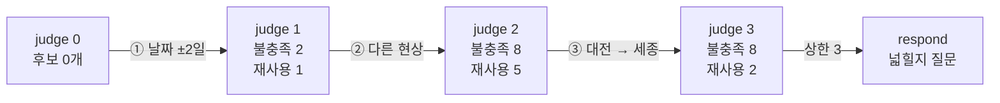

# Astrowatch 실행 로그 샘플

> 대표 요청 R1 의 전체 실행 로그(기본 Planner/Worker 구조, 로깅 Agent 판정 포함)와, 재계획이 일어난 R2(mock) 구간을 옮긴다.
> 갱신일 2026-11-20. R1 캡처 2026-11-20 11:35 (LLM `claude-haiku-5-5`, `AGENT_STRUCTURE=planner_worker` 기본), 원본: `samples/run_R1.json`, `samples/logs_R1.json`. R2 캡처 10:10 (구조 변경 전 classic 흐름, 심화 이벤트 없음), 원본: `samples/run_R2_mock.json`, `samples/logs_R2_mock.json`
> 재캡처: `.venv\Scripts\python -X utf8 backend\scripts\run_scenarios.py --only R1,R2`

| 읽는 법 | |
|---|---|
| seq | 세션 안 발생 순서. R1 표는 `logs_R1.json`(실행 로그 전체). `session_start`, `worker_result`, `session_end`, `audit_result` 는 실행 로그에만 있고 화면 `steps` 에는 없다 |
| 시각 표기 | `02:00+1` = 다음 날 02:00 |
| 캡처 시점 | E2E 리뷰 수정, 보안 강화, LLM 전환, 심화 F3020/F3021/F3022 **이후** 코드, `run_turn` 직접 호출(서버 없음), 캘린더는 `CALENDAR_PROVIDER=local` (개인 일정이 샘플에 남지 않게) |
| 전체 이벤트 | `samples/logs_*.json` (payload 포함). 실행 중이면 `GET /api/logs/{session_id}` |
| 화면 | 같은 흐름의 타임라인 캡처: [04](screenshots/04_execution_timeline.png), 로그 화면 [16](screenshots/16_log_events_table.png), 판정 패널 [24](screenshots/24_logs_audit_panel.png) |

---

## 1. R1: 한 번에 충족 (실측, 실제 키)

| 항목 | 값 |
|---|---|
| 요청 | "12월 14일 쌍둥이자리 유성우, 서울에서 밤 10시부터 새벽 2시 사이에 볼 수 있어?" |
| session_id | `29beffb3a8b7` |
| 결과 | `plan`, **조건부 충족** 1건, 재계획 0, 경고 0, `stop_reason=null`, Tool 4회(실패 1), 10.4초 (`session_end` 10339ms), `llm_calls=1`, `audit.status=normal` |
| 판정 근거 | 어두운 18:48~06:05+1 ∩ 내 22:00~02:00+1 → 창 240분, 월령 5.5 (달 영향 적음), 예보 범위 밖, 늦어도 01:30+1 도착 |
| LLM | seq 3 `llm_decision` payload `model: "claude-haiku-5-5"`. Worker LLM 0회 (예보 실패는 규칙 판단) |
| 이전 캡처와 차이 | 09:44 캡처(`b98028bec110`, classic 흐름, 이벤트 21개) → 11:35 재캡처: `planner_tasks`, `worker_result`, `worker_decision`, `audit_result` 가 더해져 28개 |

| seq | type | stage | tool | ok | ms | summary |
|---|---|---|---|---|---|---|
| 1 | session_start | | | | | 요청 원문 (`logs_R1.json` 에만) |
| 2 | stage_start | analyze | | | | 요청 분석 시작 |
| 3 | llm_decision | analyze | | | | 의도 판단: plan, "서울에서 특정 날짜/시간대의 쌍둥이자리 유성우 관측 가능 여부를 묻는 관측 계획 질문이다." |
| 4 | stage_end | analyze | | | 3442 | 의도 plan |
| 5 | stage_start | plan | | | | 작업 계획 시작 |
| **6** | **planner_tasks** | **plan** | | | | **작업 목록 0회차(trigger user): r0-t1 search_sky_events → r0-t2 get_calendar → r0-t3 get_night_window(`@candidate_dates`, r0-t1 뒤) → r0-t4 get_sky_forecast(r0-t3 뒤)** |
| 7 | stage_end | plan | | | 3 | [Planner] 4단계 계획: 현상 → 내 일정 → 출몰/월령 → 날씨 |
| 8 | stage_start | execute | | | | Tool 실행 시작 |
| 9 | tool_call | execute | search_sky_events | | | r0-t1 천문현상 조회 (year=2026, month=12, kind=meteor) |
| 10 | tool_result | execute | search_sky_events | ✅ | 174 | 12/14 23:00 쌍둥이자리 유성우 극대(ZHR 150) 외 1건 |
| 11 | worker_result | execute | search_sky_events | ✅ | 183 | r0-t1 성공, 시도 1, 캐시 아님 |
| 12 | tool_call | execute | get_calendar | | | r0-t2 일정 조회 (2026-12-14~12-15) |
| 13 | tool_result | execute | get_calendar | ✅ | 0 | local, 일정 없음 |
| 14 | worker_result | execute | get_calendar | ✅ | 7 | r0-t2 성공 |
| 15 | tool_call | execute | get_night_window | | | r0-t3 박명/출몰 조회 (date=2026-12-14, 서울) |
| 16 | tool_result | execute | get_night_window | ✅ | 995 | 천문박명 18:48~06:05+1, 월몰 21:52, 월령 5.5 |
| 17 | worker_result | execute | get_night_window | ✅ | 1006 | r0-t3 성공 |
| 18 | tool_call | execute | get_sky_forecast | | | r0-t4 날씨 예보 조회 (date=2026-12-14, hours=22~25시) |
| 19 | tool_result | execute | get_sky_forecast | ❌ | 0 | 실패(OUT_OF_RANGE): 예보 범위 밖, 가장 늦은 예보일 2026-11-30 |
| **20** | **worker_decision** | **execute** | **get_sky_forecast** | | | **skip, source=rule: 치명적 실패(OUT_OF_RANGE) → LLM 미호출 → 건너뜀** |
| 21 | worker_result | execute | get_sky_forecast | ❌ | 10 | r0-t4 실패 OUT_OF_RANGE, 판단 skip(규칙), 계획 변경 요청 없음 |
| 22 | stage_end | execute | | | 1223 | [Worker] 작업 4개, Tool 호출 4회(실패 1), 캐시 재사용 0회, 후보 1개 |
| 23 | stage_start | judge | | | | 판정 시작 |
| 24 | stage_end | judge | | | 1 | 조건부 충족 1 |
| 25 | stage_start | respond | | | | 응답 작성 시작 |
| 26 | stage_end | respond | | | 5590 | plan 응답 675자 |
| 27 | session_end | | | | 10339 | `intent=plan`, `replan_count=0` (`logs_R1.json` 에만) |
| **28** | **audit_result** | **audit** | | | | **로깅 Agent 판정 normal: 구간 seq 1~27, 근거 이벤트 27, 경고 0, 진단 없음 (LLM 미호출)** |

```mermaid
flowchart LR
  A["analyze 3.4s<br/>LLM: plan"] --> P["Planner<br/>작업 4개 (user)"]
  P --> E1["r0-t1 search_sky_events ✅ 174ms<br/>12/14 23:00 극대"]
  E1 --> C["r0-t2 get_calendar ✅ 0ms<br/>local, 일정 없음"]
  C -->|date| E2["r0-t3 get_night_window ✅ 995ms<br/>18:48~06:05+1, 월령 5.5"]
  E2 -->|hours 22~25| E3["r0-t4 get_sky_forecast ❌<br/>OUT_OF_RANGE → skip(규칙)"]
  E3 --> J["judge 1ms<br/>조건부 충족 240분"]
  J --> R["respond 5.6s<br/>늦어도 01:30+1 도착"]
  R --> AU["로깅 Agent 판정<br/>normal"]
```

읽을 점

- Planner 가 작업 목록(`planner_tasks`)을 정해진 형식(`task_id`, `args`, `fixed_args`, `purpose`, `depends_on`, `trigger`)으로 내고, Worker 가 작업마다 `worker_result` 를 돌려준다 (F3021).
- 예보 Tool 실패(`OUT_OF_RANGE`)는 치명적 실패라 Worker 가 LLM 을 부르지 않고 규칙으로 건너뛰었다 (`worker_decision source=rule`, `llm_attempted=false`). 흐름은 진행했고 판정은 **조건부 충족** (F3007, F3008).
- 현상 Tool 의 `date` 가 박명 Tool 입력이 되고, 박명 결과의 어두운 창이 예보 `hours` 가 됐다. 사이에 내 일정(`get_calendar`)을 조회한다 (심화 F3023).
- LLM 은 analyze, respond 두 번만 (3.4초 + 5.6초). `llm_calls=1` 은 respond 를 세지 않는 값이다. 판정은 1ms (코드).
- 턴이 끝나면 로깅 Agent 가 이 턴(seq 1~27)을 규칙으로 판정해 `audit_result` 를 남긴다. 정상이라 LLM 진단은 없다 (F3020).
- 같은 세션 2턴(R6 "같은 날 장소만 대전으로 바꿔 줘")은 `run_R6.json`, `logs_R6.json`: seq 29~54. 현상 조회를 캐시로 재사용(seq 37 `worker_result from_cache=true`, Tool 호출 없음)하고 캘린더, 박명, 예보 3회만 다시 부른다. 조건부 충족 1 (대전, 창 240분), 8.9초, 판정 normal.

---

## 2. R2: 재계획 발생 구간 (mock)

> ⚠️ **mock**: 날씨만 `WEATHER_PROVIDER=mock` (모든 시간 흐림, 강수확률 80). LLM, 천문연은 실제 호출.
> 그래서 재계획해도 충족이 나올 수 없고 상한(3회)까지 간다.

| 항목 | 값 |
|---|---|
| 요청 | "이번 주말 밤 9시~12시에 대전에서 사자자리 유성우 보고 싶어. 구름 많으면 다른 날로" |
| session_id | `46dd1417efb8` |
| 조건 | 2026-11-21~22, 대전, 21:00~00:00+1, 사자자리 유성우, 고정 없음 |
| 결과 | 재계획 3회 (날짜 ±2일 → 다른 현상 → 세종), 추천 0, 제외 8, `stop_reason=limit_reached`, `replan_limit=3`, steps 88개, Tool 28회(실패 0), 30.9초 (`session_end` 30885ms) |

**첫 판정 → 재계획 1회차 → 재계획 2회차 진입 (seq 7~35)**

| seq | type | stage | tool | ok | ms | 회차 | summary |
|---|---|---|---|---|---|---|---|
| 7 | stage_start | execute |  |  |  |  | Tool 실행 시작 |
| 8 | tool_call | execute | search_sky_events |  |  |  | 천문현상 조회 호출 (year=2026, month=11, kind=meteor) |
| 9 | tool_result | execute | search_sky_events | ✅ | 194 |  | 천문현상 조회 성공 |
| 10 | tool_call | execute | get_calendar |  |  |  | get_calendar 호출 () |
| 11 | tool_result | execute | get_calendar | ✅ | 2 |  | get_calendar 성공 |
| 12 | stage_end | execute |  |  | 212 |  | Tool 호출 2회(실패 0), 캐시 재사용 0회, 후보 0개 |
| 13 | stage_start | judge |  |  |  |  | 판정 시작 |
| **14** | **replan** | **judge** |  |  |  | **1** | **재계획 1회차: 충족/조건부 충족 후보 0개 → 같은 현상 다른 날짜(±2일): 날짜 범위를 2026-11-19~2026-11-24 로 넓힘** |
| 15 | stage_end | judge |  |  | 3 | 1 | 후보 0개, 재계획 1회차(같은 현상 다른 날짜(±2일)) |
| 16 | stage_start | plan |  |  |  | 1 | 작업 계획 시작 |
| 17 | stage_end | plan |  |  | 0 | 1 | [재계획 1회차] 4단계 계획: 현상 → 내 일정 → 출몰/월령 → 날씨 (search_sky_events → get_calendar → get_night_window → get_sky_forecast) |
| 18 | stage_start | execute |  |  |  | 1 | Tool 실행 시작 |
| 19 | tool_call | execute | get_calendar |  |  | 1 | get_calendar 호출 () |
| 20 | tool_result | execute | get_calendar | ✅ | 0 | 1 | get_calendar 성공 |
| 21 | tool_call | execute | get_night_window |  |  | 1 | 박명/출몰 조회 호출 (date=2026-11-19) |
| 22 | tool_result | execute | get_night_window | ✅ | 1091 | 1 | 박명/출몰 조회 성공 |
| 23 | tool_call | execute | get_night_window |  |  | 1 | 박명/출몰 조회 호출 (date=2026-11-20) |
| 24 | tool_result | execute | get_night_window | ✅ | 1020 | 1 | 박명/출몰 조회 성공 |
| 25 | tool_call | execute | get_sky_forecast |  |  | 1 | 날씨 예보 조회 호출 (date=2026-11-19, hours=21~23시) |
| 26 | tool_result | execute | get_sky_forecast | ✅ | 0 | 1 | 날씨 예보 조회 성공 - mock 공급자: 실제 예보가 아니다 |
| 27 | tool_call | execute | get_sky_forecast |  |  | 1 | 날씨 예보 조회 호출 (date=2026-11-20, hours=21~23시) |
| 28 | tool_result | execute | get_sky_forecast | ✅ | 0 | 1 | 날씨 예보 조회 성공 - mock 공급자: 실제 예보가 아니다 |
| 29 | stage_end | execute |  |  | 2156 | 1 | Tool 호출 5회(실패 0), 캐시 재사용 1회, 후보 2개 |
| 30 | stage_start | judge |  |  |  | 1 | 판정 시작 |
| **31** | **replan** | **judge** |  |  |  | **2** | **재계획 2회차: 충족/조건부 충족 후보 0개 (관측 창 0분이 최소 30분보다 짧음) → 같은 기간 다른 현상: '사자자리 유성우' 지정을 풀고 같은 기간의 다른 현상 탐색** |
| 32 | stage_end | judge |  |  | 5 | 2 | 불충족 2, 재계획 2회차(같은 기간 다른 현상) |
| 33 | stage_start | plan |  |  |  | 2 | 작업 계획 시작 |
| 34 | stage_end | plan |  |  | 0 | 2 | [재계획 2회차] 4단계 계획: 현상 → 내 일정 → 출몰/월령 → 날씨 (search_sky_events → get_calendar → get_night_window → get_sky_forecast) |
| 35 | stage_start | execute |  |  |  | 2 | Tool 실행 시작 |

**이후 요약**

| seq | 내용 |
|---|---|
| 54 | execute(회차 2): Tool 호출 9회, 캐시 재사용 5회, 후보 8개 |
| 56 | replan 3회차: 인접 지역: 대전 → 세종 |
| 57 | judge: 불충족 8, 재계획 3회차(인접 지역) |
| 85 | execute(회차 3): Tool 호출 12회, 캐시 재사용 2회, 후보 8개 |
| 87 | judge: 불충족 8, 재계획 상한(3회) 도달 (`stop_reason=limit_reached`) |
| 89 | respond 13.4초: "재계획을 3회 시도했고 상한(3회)에 도달해 더 찾지 않았습니다 … 날짜 범위나 지역을 넓혀 볼까요?", "(검증용 모의 예보)" |
| 90 | session_end (30885ms, `logs_R2_mock.json` 에만) |

읽을 점

- 회차 1에서 11월 현상 조회 결과를 다시 부르지 않았다 (seq 29 "캐시 재사용 1회", F3009). 날짜 범위가 바뀐 캘린더와 새 날짜의 박명, 예보만 불렀다.
- 재계획 이후 단계에는 `replan_round` 가 붙어 화면에서 구분된다 (F3019, 실제 예보 기준 화면은 [07](screenshots/07_replan_and_stop_reason.png), [08](screenshots/08_timeline_replan_marker.png)).
- 현상, 날짜 조건이 고정되지 않아 ① → ② → ③ 이 모두 적용됐고, 추천 0으로 끝난 이유가 `stop_reason=limit_reached` 로 응답에 남는다.
