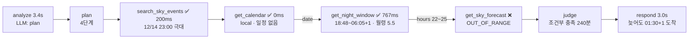
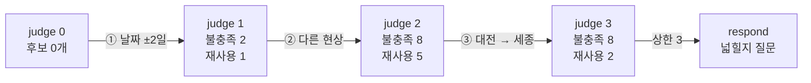

# Astrowatch 실행 로그 샘플

> 대표 요청 R1 의 전체 실행 단계와, 재계획이 일어난 R2(mock) 구간을 `ChatResponse.steps` 그대로 옮긴다.
> 갱신일 2026-11-18 16:51 · 원본: `samples/run_R1.json` · `samples/logs_R1.json`, `samples/run_R2_mock.json` · `samples/logs_R2_mock.json`
> 재캡처: `.venv\Scripts\python -X utf8 backend\scripts\run_scenarios.py --only R1,R2`

| 읽는 법 | |
|---|---|
| seq | 세션 안 발생 순서. seq 1 `session_start` · 마지막 `session_end` 는 `run_logs`(`logs_*.json`)에만 있고 `steps` 에는 없다 |
| 시각 표기 | `02:00+1` = 다음 날 02:00 |
| 캡처 시점 | E2E 리뷰 수정 **이후** 코드 · `run_turn` 직접 호출(서버 없음) · 캘린더는 `CALENDAR_PROVIDER=local` (개인 일정이 샘플에 남지 않게) |
| 전체 이벤트 | `samples/logs_*.json` (payload 포함). 실행 중이면 `GET /api/logs/{session_id}` |

---

## 1. R1 — 한 번에 충족 (실측 · 실제 키)

| 항목 | 값 |
|---|---|
| 요청 | "12월 14일 쌍둥이자리 유성우, 서울에서 밤 10시부터 새벽 2시 사이에 볼 수 있어?" |
| session_id | `d9d0aabb5526` |
| 결과 | `plan` · **조건부 충족** 1건 · 재계획 0 · 경고 0 · `stop_reason=null` · 7.4초 (`session_end` 7413ms) |
| 판정 근거 | 어두운 18:48~06:05+1 ∩ 내 22:00~02:00+1 → 창 240분 · 월령 5.5 · 예보 범위 밖 |

| seq | type | stage | tool | ok | ms | summary |
|---|---|---|---|---|---|---|
| 2 | stage_start | analyze | | | | 요청 분석 시작 |
| 3 | llm_decision | analyze | | | | 의도 판단: plan - 특정 유성우를 서울에서 정해진 밤 시간대에 관측할 수 있는지 물었습니다. |
| 4 | stage_end | analyze | | | 3362 | 의도 plan |
| 5 | stage_start | plan | | | | 작업 계획 시작 |
| 6 | stage_end | plan | | | 0 | 4단계 계획: 현상 → 내 일정 → 출몰·월령 → 날씨 (search_sky_events → get_calendar → get_night_window → get_sky_forecast) |
| 7 | stage_start | execute | | | | Tool 실행 시작 |
| 8 | tool_call | execute | search_sky_events | | | 천문현상 조회 호출 (year=2026, month=12, kind=meteor) |
| 9 | tool_result | execute | search_sky_events | ✅ | 200 | 천문현상 조회 성공 |
| 10 | tool_call | execute | get_calendar | | | get_calendar 호출 () |
| 11 | tool_result | execute | get_calendar | ✅ | 0 | get_calendar 성공 |
| 12 | tool_call | execute | get_night_window | | | 박명·출몰 조회 호출 (date=2026-12-14) |
| 13 | tool_result | execute | get_night_window | ✅ | 767 | 박명·출몰 조회 성공 |
| 14 | tool_call | execute | get_sky_forecast | | | 날씨 예보 조회 호출 (date=2026-12-14, hours=22~25시) |
| 15 | tool_result | execute | get_sky_forecast | ❌ | 0 | 날씨 예보 조회 실패(OUT_OF_RANGE): 예보 범위 밖: 가장 늦은 예보일 2026-11-28 |
| 16 | stage_end | execute | | | 999 | Tool 호출 4회(실패 1) · 캐시 재사용 0회 · 후보 1개 |
| 17 | stage_start | judge | | | | 판정 시작 |
| 18 | stage_end | judge | | | 1 | 조건부 충족 1 |
| 19 | stage_start | respond | | | | 응답 작성 시작 |
| 20 | stage_end | respond | | | 2986 | plan 응답 516자 |

읽을 점

- 예보 Tool 실패(`OUT_OF_RANGE`)에도 흐름은 진행했고, 판정은 **조건부 충족**으로 떨어졌다 (F3007 · F3008).
- 현상 Tool 의 `date` 가 박명 Tool 입력이 되고, 박명 결과의 어두운 창이 예보 `hours` 가 됐다. 사이에 내 일정(`get_calendar`)을 조회한다 (심화 F3023).
- LLM 은 analyze · respond 두 번만. 판정은 1ms (코드).
- 같은 세션 2턴(R6 "같은 날 장소만 대전으로 바꿔 줘")은 `run_R6.json` · `logs_R6.json` — seq 22~ 에서 현상 조회를 캐시로 재사용하고 캘린더 · 박명 · 예보만 다시 부른다.

---

## 2. R2 — 재계획 발생 구간 (mock)

> ⚠️ **mock**: 날씨만 `WEATHER_PROVIDER=mock` (모든 시간 흐림 · 강수확률 80). LLM · 천문연은 실제 호출.
> 그래서 재계획해도 충족이 나올 수 없고 상한(3회)까지 간다.

| 항목 | 값 |
|---|---|
| 요청 | "이번 주말 밤 9시~12시에 대전에서 사자자리 유성우 보고 싶어. 구름 많으면 다른 날로" |
| session_id | `11e414214f87` |
| 조건 | 2026-11-21~22 · 대전 · 21:00~00:00+1 · 사자자리 유성우 · 고정 없음 |
| 결과 | 재계획 3회 (날짜 ±2일 → 다른 현상 → 세종) · 추천 0 · 제외 8 · `stop_reason=limit_reached` · `replan_limit=3` · steps 88개 · Tool 28회 · 17.1초 |

**첫 판정 → 재계획 1회차 → 재계획 2회차 진입 (seq 7~35)**

| seq | type | stage | tool | ok | ms | 회차 | summary |
|---|---|---|---|---|---|---|---|
| 7 | stage_start | execute | | | | | Tool 실행 시작 |
| 8 | tool_call | execute | search_sky_events | | | | 천문현상 조회 호출 (year=2026, month=11, kind=meteor) |
| 9 | tool_result | execute | search_sky_events | ✅ | 262 | | 천문현상 조회 성공 |
| 10 | tool_call | execute | get_calendar | | | | get_calendar 호출 () |
| 11 | tool_result | execute | get_calendar | ✅ | 1 | | get_calendar 성공 |
| 12 | stage_end | execute | | | 286 | | Tool 호출 2회(실패 0) · 캐시 재사용 0회 · 후보 0개 |
| 13 | stage_start | judge | | | | | 판정 시작 |
| **14** | **replan** | judge | | | | **1** | **재계획 1회차: 충족·조건부 충족 후보 0개 → 같은 현상 다른 날짜(±2일): 날짜 범위를 2026-11-19~2026-11-24 로 넓힘** |
| 15 | stage_end | judge | | | 5 | 1 | 후보 0개 · 재계획 1회차(같은 현상 다른 날짜(±2일)) |
| 16 | stage_start | plan | | | | 1 | 작업 계획 시작 |
| 17 | stage_end | plan | | | 0 | 1 | [재계획 1회차] 4단계 계획: 현상 → 내 일정 → 출몰·월령 → 날씨 (search_sky_events → get_calendar → get_night_window → get_sky_forecast) |
| 18 | stage_start | execute | | | | 1 | Tool 실행 시작 |
| 19 | tool_call | execute | get_calendar | | | 1 | get_calendar 호출 () |
| 20 | tool_result | execute | get_calendar | ✅ | 1 | 1 | get_calendar 성공 |
| 21 | tool_call | execute | get_night_window | | | 1 | 박명·출몰 조회 호출 (date=2026-11-19) |
| 22 | tool_result | execute | get_night_window | ✅ | 897 | 1 | 박명·출몰 조회 성공 |
| 23 | tool_call | execute | get_night_window | | | 1 | 박명·출몰 조회 호출 (date=2026-11-20) |
| 24 | tool_result | execute | get_night_window | ✅ | 952 | 1 | 박명·출몰 조회 성공 |
| 25 | tool_call | execute | get_sky_forecast | | | 1 | 날씨 예보 조회 호출 (date=2026-11-19, hours=21~23시) |
| 26 | tool_result | execute | get_sky_forecast | ✅ | 0 | 1 | 날씨 예보 조회 성공 - mock 공급자 — 실제 예보가 아니다 |
| 27 | tool_call | execute | get_sky_forecast | | | 1 | 날씨 예보 조회 호출 (date=2026-11-20, hours=21~23시) |
| 28 | tool_result | execute | get_sky_forecast | ✅ | 0 | 1 | 날씨 예보 조회 성공 - mock 공급자 — 실제 예보가 아니다 |
| 29 | stage_end | execute | | | 1898 | 1 | Tool 호출 5회(실패 0) · **캐시 재사용 1회** · 후보 2개 |
| 30 | stage_start | judge | | | | 1 | 판정 시작 |
| **31** | **replan** | judge | | | | **2** | **재계획 2회차: 충족·조건부 충족 후보 0개 (관측 창 0분이 최소 30분보다 짧음) → 같은 기간 다른 현상: '사자자리 유성우' 지정을 풀고 같은 기간의 다른 현상 탐색** |
| 32 | stage_end | judge | | | 4 | 2 | 불충족 2 · 재계획 2회차(같은 기간 다른 현상) |
| 33 | stage_start | plan | | | | 2 | 작업 계획 시작 |
| 34 | stage_end | plan | | | 0 | 2 | [재계획 2회차] 4단계 계획: 현상 → 내 일정 → 출몰·월령 → 날씨 (search_sky_events → get_calendar → get_night_window → get_sky_forecast) |
| 35 | stage_start | execute | | | | 2 | Tool 실행 시작 |

**이후 요약**

| seq | 내용 |
|---|---|
| 54 | execute: Tool 호출 9회 · 캐시 재사용 5회 · 후보 8개 |
| 56 | replan 3회차: 인접 지역 — 대전 → 세종 |
| 85 | execute: Tool 호출 12회 · 캐시 재사용 2회 · 후보 8개 |
| 87 | judge: 불충족 8 · 재계획 상한(3회) 도달 (`stop_reason=limit_reached`) |
| 89 | respond: "재계획 상한(3회)에 도달해 더 찾지 않았습니다. 날짜 범위나 지역을 넓혀 볼까요?" · "(검증용 모의 예보)" |
| 90 | session_end (17790ms, `logs_R2_mock.json` 에만) |

읽을 점

- 회차 1에서 11월 현상 조회 결과를 다시 부르지 않았다 (seq 29 "캐시 재사용 1회", F3009). 날짜 범위가 바뀐 캘린더만 다시 조회했다.
- 재계획 이후 단계에는 `replan_round` 가 붙어 화면에서 구분된다 (F3019).
- 현상 · 날짜 조건이 고정되지 않아 ① → ② → ③ 이 모두 적용됐고, 추천 0으로 끝난 이유가 `stop_reason=limit_reached` 로 응답에 남는다.
