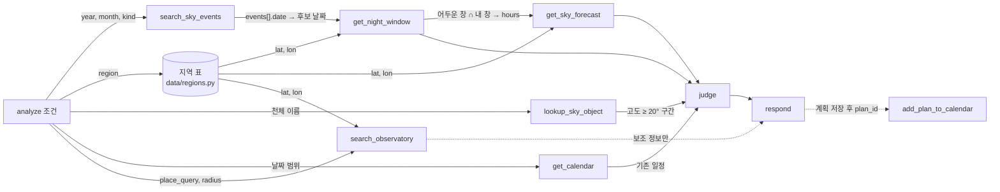
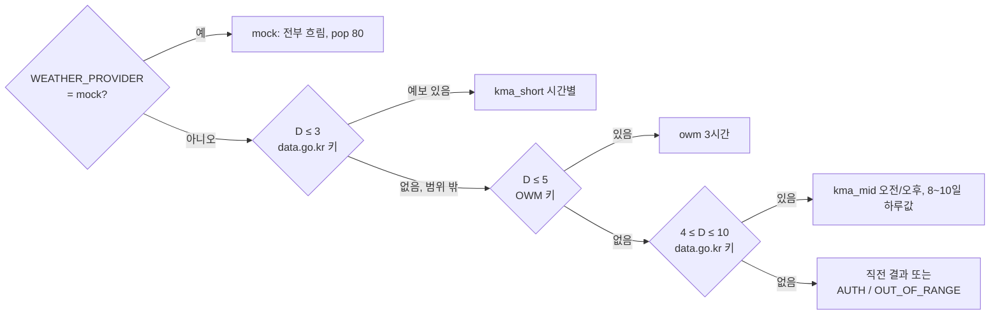
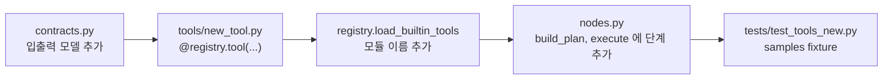

# Astrowatch Tool 정의서

> Tool 7종의 이름, 언제 쓰나, 입력, 출력, 실패 코드, 등록과 확장 방법.
> 갱신일 2026-11-20, 경로는 `backend/astrowatch/` 기준, 입출력 모델은 `tools/contracts.py`

---

## 1. 목록

| Tool | 구분 | 요구사항 | 언제 쓰나 (description 요약) | 파일 |
|---|---|---|---|---|
| `search_sky_events` | 외부 | F3002 | 볼 현상을 정하지 않았거나 특정 연, 월의 현상을 찾을 때 | `tools/sky_events.py` |
| `get_night_window` | 외부 | F3003 | 날짜, 위치의 완전히 어두운 시간과 월출몰, 월령이 필요할 때 | `tools/night_window.py` |
| `get_sky_forecast` | 외부 | F3004 | 후보 날짜의 시간대별 하늘, 강수확률, 강수형태가 필요할 때 | `tools/sky_forecast.py` |
| `search_observatory` | 외부 | F3004 | 위치 주변 관측 장소(천문대 등)를 찾을 때 (≤ 20km) | `tools/observatory.py` |
| `lookup_sky_object` | 로컬 | 심화(보충) | 특정 천체가 그날 밤 언제 고도 20° 이상인지 알아야 할 때 | `tools/sky_object.py` |
| `get_calendar` | 로컬 | F3023 | 기존 일정과 겹치는지 확인할 때 | `tools/calendar.py` |
| `add_plan_to_calendar` | 로컬 | F3023 | 저장된 계획을 캘린더에 등록할 때 (`plan_id` 만) | `tools/calendar.py` |

등록된 목록은 `GET /api/tools` 로 확인한다 (이름, 구분, 설명, 입력 스키마, 고정 인자).
`search_space_docs`(F3022)는 `load_builtin_tools` 에 이름만 있고 모듈이 없어 건너뛴다.

---

## 2. 공통 응답 봉투 (`tools/base.py`)

```json
성공  {"ok": true,  "data": { ... }, "note": "추정, 범위 밖 등 밝혀야 할 사실 (선택)"}
실패  {"ok": false, "error": {"code": "AUTH", "message": "사용자에게 보여도 되는 짧은 설명"}}
```

| 규칙 | 내용 |
|---|---|
| 예외 | 밖으로 던지지 않는다. 입력 검증 실패 → `BAD_INPUT`, 핸들러 예외 → `INTERNAL` (`ToolSpec.invoke`) |
| 메시지 | 키, URL, 스택 금지 |
| 이벤트 | `as_event_payload()` 로 data 를 2,000자까지만 로그에 |

### ErrorCode

| 코드 | 뜻 | retriable | fatal | 흐름의 처리 |
|---|---|---|---|---|
| `AUTH` | 키 누락, 인증 실패 | | ✅ | 경고. 현상, 박명이면 재계획 안 함(`fatal_error`), 장소면 장소만 "확인 못 함" |
| `BAD_INPUT` | 인자 누락, 형식 오류 | ✅ | | 그 단계 실패로 기록하고 진행 |
| `NO_RESULT` | 결과 없음 | ✅ | | 후보 0 → 재계획 근거 |
| `NO_WINDOW` | 박명 값 비어 창 계산 불가 | ✅ | | 그 날짜 `UNJUDGED` |
| `OUT_OF_RANGE` | 예보 범위 밖, 지난 날짜 | | ✅ | 판정 **조건부 충족** |
| `NOT_FOUND` | 대상 없음 (천체, 계획) | | | 천체면 `UNJUDGED` + 비슷한 이름 되묻기 |
| `NO_INDEX` | RAG 색인 없음 (F3022) | | ✅ | 미사용 |
| `UPSTREAM` | 외부 API 오류 응답 | | | "일시적으로 실패" 경고 |
| `TIMEOUT` | 외부 API 시간 초과 (15초) | | | 〃 |
| `INTERNAL` | Tool 내부 예외 | | | 〃 |

`retriable`, `fatal` 은 `ErrorCode` 속성으로 정의돼 있다. 현재 흐름은 이 속성 대신 `AUTH` 직접 비교, 일시 오류 집합(`TIMEOUT, UPSTREAM, INTERNAL`)으로 분기한다.

---

## 3. Tool 사이 데이터 흐름



Tool 이 아닌 것 (실행 흐름이 직접): 지역명 → 위경도, 기상청 격자, 중기 구역코드, 단기예보 `base_time` 계산, 창 계산, 계획 저장.

---

## 4. Tool 상세

### 4-1. `search_sky_events` (외부, 천문연 천문현상)

| 입력 | 타입 | 필수 | 설명 |
|---|---|---|---|
| `year` | int 2000~2100 | ✅ | 조회 연도 |
| `month` | int 1~12 | ✅ | 조회 월 |
| `kind` | EventKind | | `meteor, planet, moon, eclipse, occultation, season, deep_sky, other` |

| 출력 | 설명 |
|---|---|
| `year, month` | 조회한 연, 월 |
| `requested_defaulted` | 기본값 사용 여부 (현재 항상 `false`: 6절 참고) |
| `events[]` | `event_id`(`YYYYMMDD-seq`), `date`, `time?`(HH:MM), `title`, `kind`, `description?` |

| 실패 | 조건 |
|---|---|
| `AUTH` | 키 없음, 인증 실패 (200 응답 안의 게이트웨이 오류 포함) |
| `NO_RESULT` | 그 달(/종류) 현상 없음 |
| `UPSTREAM`, `TIMEOUT` | 오류 응답, 시간 초과 |

규칙: `title = astroTitle or astroEvent`, `locdate` 8자리만, 제목 키워드로 `kind` 분류(`tools/event_kind.py`).
**기본값**: 계약상 연, 월은 필수. 날짜를 말하지 않으면 실행 흐름이 **오늘 ~ +9일**을 넣고 그 범위의 월을 조회한다.

### 4-2. `get_night_window` (외부, 천문연 출몰 + 월령)

| 입력 | 타입 | 설명 |
|---|---|---|
| `date` | date | 관측하는 **저녁** 날짜 |
| `lat`, `lon` | float | 위경도 |

| 출력 | 설명 |
|---|---|
| `sunset`, `sunrise_next` | HH:MM |
| `astro_dusk_end` / `astro_dawn_start` | 그날 `aste` / 다음 날 `astm` |
| `moonrise`, `moonset`, `moonrise_next`, `moonset_next` | 없으면 null |
| `lun_age` | 월령. 실패 시 null + note |
| `dark_minutes` | 어두운 시간(분) |

| 실패 | 조건 |
|---|---|
| `AUTH`, `UPSTREAM`, `TIMEOUT` | 키, 응답 문제 |
| `NO_WINDOW` | 출몰 응답이 비거나 박명 값이 비거나 어두운 시간이 없음 |

출몰 API 를 **두 날짜**(그날, 다음 날)로 부른다. 월령만 실패하면 부분 성공 + note.

### 4-3. `get_sky_forecast` (외부, 기상청 / OWM / mock)

| 입력 | 타입 | 설명 |
|---|---|---|
| `date` | date | 관측 저녁 날짜 |
| `lat`, `lon` | float | 위경도 (기상청 격자로 변환) |
| `hours` | int[] 0~29 | 24~29 는 다음 날 0~5시. 비우면 18~29 |

| 출력 | 설명 |
|---|---|
| `source` | `kma_short, kma_mid, owm, mock` |
| `base_time`, `grid` | 발표 시각, 격자 (지역 격자 기준임을 표시) |
| `hourly[]` | `hour`, `sky`(`clear, partly, cloudy, unknown`), `pop`, `cloud_pct`, `precip` |
| `coverage` | `full, partial, none` |

| 실패 | 조건 |
|---|---|
| `BAD_INPUT` | hours 범위 밖 |
| `OUT_OF_RANGE` | 지난 날짜, 가장 늦은 예보일 이후 |
| `AUTH` | 예보 키가 하나도 없음, 이 날짜에 data.go.kr 키 필요 |
| `UPSTREAM`, `TIMEOUT` | 응답 문제 |

**공급자 선택 순서** (D = 오늘부터 며칠 뒤)



요청 시각을 하나라도 덮는 첫 결과를 쓴다. 예보 없는 시각은 `unknown` 으로 두고 지어내지 않는다.

### 4-4. `search_observatory` (외부, 카카오 로컬)

| 입력 | 타입 | 기본 | 설명 |
|---|---|---|---|
| `query` | str | `천문대` | 검색어 |
| `lat`, `lon` | float | | 중심 |
| `radius_km` | float 0~20 | 20 | 카카오 상한 20km |

| 출력 | 설명 |
|---|---|
| `places[]` | `place_id`, `name`, `address`, `url`, `distance_m`, `category?` |
| `note` | "장소 검색은 그 장소의 하늘 상태를 알려 주지 않는다. 날씨는 지역 격자 기준이다." |

| 실패 | 조건 |
|---|---|
| `AUTH` | 키 없음, 거부 |
| `NO_RESULT` | 반경 안 결과 없음 |
| `BAD_INPUT` | 반경 > 20 |
| `UPSTREAM`, `TIMEOUT` | 응답 문제 |

거리가 없는 항목은 0 으로 지어내지 않고 뺀다. 계획엔 `place_id`, `place_url` 만 저장한다.

### 4-5. `lookup_sky_object` (로컬, 카탈로그 + 고도 계산)

| 입력 | 타입 | 기본 | 설명 |
|---|---|---|---|
| `name` | str | | 한국어, 영어, 메시에 번호 (`안드로메다 은하`, `M31`, `목성`) |
| `date`, `lat`, `lon` | | | 저녁 날짜, 위치 |
| `min_alt` | float 0~80 | 20 | 이 고도 이상만 "떠 있다" |

| 출력 | 설명 |
|---|---|
| `object` | `id, name_ko, name_en, kind, ra_deg, dec_deg, mag, naked_eye, constellation_ko` |
| `visible_windows[]` | 고도 ≥ `min_alt` 구간(분, 12:00~다음 날 12:00, 10분 표본) |
| `transit_minute`, `transit_alt`, `transit_az` | 남중 |
| `never_rises` | 그날 기준 고도 이상 안 오름 |

| 실패 | 조건 |
|---|---|
| `NOT_FOUND` | 카탈로그에 없음 → "비슷한 이름: A, B, C" / 모호 → "후보: …" |

고정 인자: `lat, lon`. 입력 원문은 오류 메시지에 넣지 않는다.

### 4-6. `get_calendar` (로컬, F3023)

| 입력 | 설명 |
|---|---|
| `date_from`, `date_to` | 포함 범위, 최대 92일 (추가 필드 금지) |

| 출력 | 설명 |
|---|---|
| `provider` | `local, google` |
| `events[]` | `event_id`, `title`, `start_dt`, `end_dt`(현지 naive), `source`, `plan_id?`, `html_link?` |

| 실패 | 조건 |
|---|---|
| `BAD_INPUT` | 범위 역전, 92일 초과 |
| `AUTH` | Google 토큰 없음, 만료 |
| `UPSTREAM`, `TIMEOUT` | 응답 문제 |

`plan` 실행 중 등록돼 있으면 1회 호출 → 판정에서 겹치는 구간을 뺀다. 실패하면 "캘린더를 확인하지 못했습니다." 경고만 남기고 판정은 계속.

### 4-7. `add_plan_to_calendar` (로컬, F3023)

| 입력 | 설명 |
|---|---|
| `plan_id` | 저장된 계획 번호 **하나만** (추가 필드 금지) |

| 출력 | 설명 |
|---|---|
| `provider`, `plan_id`, `event_id`, `title`, `start_dt`, `end_dt`, `html_link?` | 등록 결과 |
| `already_registered` | 이미 등록돼 새로 만들지 않았으면 true |

| 실패 | 조건 |
|---|---|
| `NOT_FOUND` | 계획 없음 |
| `AUTH`, `UPSTREAM`, `TIMEOUT` | 공급자 문제 |

제목, 시각은 저장소에서 읽는다 (모델이 지어내지 못하게). 제목 `[Astrowatch] {현상} 관측: {지역}`. 부작용 Tool 이라 캐시하지 않는다.

**멱등성**: 계획별 잠금으로 같은 계획을 동시에 두 번 등록해도 일정은 1건, 두 번째는 `already_registered: true`. Google 409(같은 이벤트 ID)도 `already_registered` 로 처리 (`test_concurrent_add_creates_one_event`, `test_google_409_is_already_registered`).

---

## 5. 데이터, 공급자

| 항목 | 내용 | 파일 |
|---|---|---|
| 천체 카탈로그 | 294개: 메시에 110, 밝은 별 94, 별자리 88, 은하수 2 (VastHorizon `items.json` 변환). 같은 점수면 메시에 > 은하수 > 별 > 별자리 | `data/sky_objects.json`, `astro/catalog.py`, `scripts/build_sky_objects.py` |
| 행성 계산 | 수성~해왕성 7개. JPL 근사 케플러 궤도 요소(수 분각). 달은 조회 대상에서 제외(박명 Tool 에 있음) | `astro/planets.py` |
| 고도, 방위 | 지방 항성시 → 고도, 방위, 가시 구간, 남중 | `astro/altaz.py` |
| 지역 표 | 28곳, 별칭, 위경도, 기상청 격자(LCC), 중기 구역코드. 조사("에서", "근처") 제거, 시 우선 | `data/regions.py` |
| 인접 지역 | 하버사인 거리순 | `data/regions.py` `nearby_regions` |
| 캘린더 공급자 | `CALENDAR_PROVIDER` → `local`(SQLite `local_calendar`) / `google`. 모르는 값은 local | `clients/calendar_provider.py` |
| HTTP | 타임아웃 15초, 401/403 → `AuthError`, 응답 본문 **2MB 상한**(넘으면 `UPSTREAM` "응답 과대"), 예외 체인 차단(키, URL 이 메시지에 안 남음) | `clients/http.py` |
| Google 토큰 | `secrets/google_token.json` 0600 원자 저장, 심볼릭 링크 거부, 갱신 직렬화 | `clients/calendar_provider.py` |

---

## 6. 등록, 확장 방법



1. **계약**: `tools/contracts.py` 에 `XxxInput`, `XxxOutput` Pydantic 모델 추가 (Field description 이 LLM 스키마가 된다).
2. **구현**: 데코레이터로 등록. 핸들러는 `ok(...)` / `fail(code, msg)` 만 반환.

```python
@registry.tool(
    name="search_space_docs",
    description="외부 API 로 확인할 수 없는 배경 지식이 필요할 때 쓴다.",   # '언제' 를 적는다
    kind=ToolKind.LOCAL,
    input_model=DocsInput,
    output_model=DocsOutput,
    fixed_arg_names=(),          # 사용자 조건으로 고정되는 인자
)
def search_space_docs(args: DocsInput) -> ToolResult[DocsOutput]:
    ...
    return ok(DocsOutput(...), note=None)
```

3. **로드**: `tools/registry.py` `load_builtin_tools()` 의 모듈 목록에 추가 (심화 모듈은 없으면 건너뜀). 이름 중복은 `ValueError`.
4. **흐름 연결**: `agent/nodes.py` 의 `build_plan`, `execute`, `summarize_result` 에 단계 추가.
5. **테스트 패턴**: 네트워크 없이:
   - `conftest.py` 가 키를 지우고 임시 DB, `WEATHER_PROVIDER=mock` 으로 격리
   - 클라이언트 함수를 `monkeypatch.setattr(kasi, "request", fake)` 로 바꾸고 `samples/` 원본 응답을 돌려줌
   - `fresh_registry` fixture 로 가짜 Tool 을 등록해 흐름 시험
   - 정상, 키 없음(`AUTH`), 빈 응답, 타임아웃을 각각 확인

---

## 7. 테스트 대응

| Tool | 테스트 파일 | 수 |
|---|---|---|
| 공통 봉투, 레지스트리 | `tests/test_contracts.py` | 14 |
| `search_sky_events` | `tests/test_tools_sky_events.py` | 24 |
| `get_night_window` | `tests/test_tools_night_window.py` | 6 |
| `get_sky_forecast` | `tests/test_tools_sky_forecast.py` | 21 |
| `search_observatory` | `tests/test_tools_observatory.py` | 5 |
| `lookup_sky_object` | `tests/test_tools_sky_object.py`, `tests/test_astro.py` | 10 + 7 |
| 캘린더 2종 | `tests/test_tools_calendar.py`, `tests/test_api_calendar.py` | 13 + 5 |
| HTTP 상한, 토큰 저장, 캘린더 멱등 | `tests/test_security.py` (일부) | 없음 |

수는 `pytest --collect-only` 기준(2026-11-20). 전체 22개 파일 300건 수집, 298 통과, 2 건너뜀.
