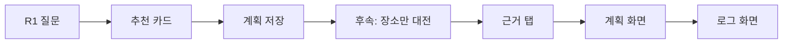

# Astrowatch 검증 결과

> 명세 4장 확인 항목, 대표 시나리오 R1~R7, 실제 E2E 리뷰 발견과 수정을 근거 파일과 함께 정리한다.
> 갱신일 2026-11-20 (제출일), 테스트 경로는 `backend/tests/`, LLM `claude-haiku-5-5` (GMS Anthropic 호환 경로)

---

## 0. 근거의 종류

| 표시 | 뜻 | 근거 위치 |
|---|---|---|
| **E2E** | 실행 중인 서버에 실제 HTTP 요청, 실제 LLM, 실제 외부 API (Codex 리뷰, 2026-11-18 15시경, 당시 LLM `gpt-6-luna`) | `output/e2e-review/Sxx.json`, `Sxx-logs.json`, `browser-*.png` |
| **실측 샘플** | `backend/scripts/run_scenarios.py` 로 실제 키, 실제 LLM 실행 (`run_turn` 직접 호출, **2026-11-20 09:44~09:46, `claude-haiku-5-5`**, 캘린더는 `CALENDAR_PROVIDER=local`). 요청 원문, 응답, 경과초는 `run_*.json`(`captured_at`), 실행 로그는 `logs_*.json` | `samples/run_R1.json`(R1+R6), `run_R6.json`, `run_R4_nokakao.json`(카카오 키 제거), `run_R5.json`, `run_R7.json`, `run_andromeda.json`, `run_fact_mars.json`, `run_invalid_date.json`, `run_unknown_object.json` |
| **mock 샘플** | 위와 같은 스크립트, 날씨만 `WEATHER_PROVIDER=mock`(전부 흐림) | `samples/run_R2_mock.json`, `run_R3_mock.json` |
| **화면** | 실제 서버(실제 키, 실제 예보)를 Playwright + Edge 로 캡처 (2026-11-20, `backend/scripts/capture_screens.py`). 카카오 키 없는 서버, LLM 키 없는 서버, mock 예보 서버를 따로 띄워 18, 19, 07, 08 캡처 | `docs/screenshots/01~21_*.png`, `docs/demo/astrowatch_demo.webm`, `.gif` (11절) |
| **그래프** | `GET /api/graph` 결과 | [`docs/graph_structure.txt`](graph_structure.txt) |
| **자동 테스트** | 키, 네트워크 없이 `samples/` fixture, 가짜 LLM | `backend/tests/*.py` |
| **미검증** | 아직 실행 증거 없음 | 없음 |

> ⚠️ E2E 리뷰(`output/e2e-review/`)는 **8절의 수정 이전** 코드, `gpt-6-luna` 로 실행했다. `samples/run_*.json` 과 화면은 수정, 보안 강화, LLM 전환 **이후** 코드로 다시 캡처했다. 수정 후 브라우저 E2E 재실행은 8절 참고.

**자동 테스트**: 22개 파일, **298 통과, 2 건너뜀**(POSIX 전용 권한, 심볼릭 링크 검사, Windows 에서 skip) (`cd backend && ..\.venv\Scripts\python.exe -X utf8 -m pytest -q -o addopts=""`, 2026-11-20). 리뷰 시점은 181개였다(`output/e2e-review/pytest.txt`).

---

## 1. 4.1 Tool 확인 (F3001~F3004)

| 확인 항목 | 방법 | 근거 | 결과 |
|---|---|---|---|
| Tool 이름, 설명, 입력 스키마 목록 | `GET /api/tools` | E2E `meta-tools.json` (당시 5종), `test_tools_is_list`, `test_openai_tool_schema_has_only_name_desc_params`, 화면 [17](screenshots/17_fastapi_swagger.png) (Swagger), 연결 상태 "Tool 7개" 화면 [01](screenshots/01_chat_empty.png) | ✅ (`/api/tools` 7종 응답 원문 캡처는 미첨부) |
| 정상, 실패 호출이 봉투로 반환 | Tool 별 정상 / 키 없음 / 잘못된 입력 / 타임아웃 | `test_exception_becomes_envelope_not_raise`, `test_bad_input_and_unknown_tool`, `test_*_no_key_is_auth*`, `test_timeout_mapping`, `test_radius_over_limit_is_bad_input`, 실측 `run_R4_nokakao.json` (`search_observatory` `AUTH`) | ✅ |
| 기준 날짜 미지정 시 기본값 | 날짜 없이 요청 | 실측 `run_andromeda.json` 2턴 ("2026-11-20~2026-11-29 범위에서 찾았습니다"), `test_deep_sky_without_date_uses_default_range`, 화면 [10](screenshots/10_andromeda_deep_sky.png) | ✅ |
| 요청 기준 ≠ 조회 기준을 밝힘 | 예보 밖 날짜, 중기예보, mock | 실측 `run_R1.json` 사유 "예보 범위 밖(D-3부터 확인 가능)", `run_andromeda.json` "중기예보 '맑음'(시간별 예보 아님)", mock note, 화면 [03](screenshots/03_card_timebar.png) ("날씨: 예보 범위 밖") | ✅ |
| 후보 식별자 → 상세 조회로 이어짐 | 현상 date → 박명 date | `run_R1.json` seq 8→12 (사이 seq 10 `get_calendar`), `test_r1_flow` (Tool 순서 고정), 화면 [04](screenshots/04_execution_timeline.png) | ✅ |
| 판단 속성이 비면 판단 안 함 | 박명 빈 값, 미등록 천체 | `test_blank_twilight_is_no_window`, `test_no_night_window_unjudged`, `test_object_not_found_is_unjudged`, 실측 `run_unknown_object.json` (`unjudged` 1, `NOT_FOUND`) | ✅ 수정 후 (E2E S07 은 수정 전 실패 → 8절 R1) |
| 보조 Tool 결과 없음 형식 | 반경 안 0건 | `test_no_result` (observatory) | ✅ 자동 테스트 |

---

## 2. 4.2 메인 Agent 실행 흐름 (F3005~F3011)

| 확인 항목 | 방법 | 근거 | 결과 |
|---|---|---|---|
| 조건 추출, 임의로 안 채움 | `ChatResponse.conditions` | 실측 `run_R7.json` (`needs_clarification=[region, start_minute]`), E2E S03, S02, `test_conditions_missing_rules`, 조건 스트립 화면 [02](screenshots/02_chat_r1_recommendation.png) | ✅ |
| **그래프 구조 출력**, 5노드 | `GET /api/graph` | [`docs/graph_structure.txt`](graph_structure.txt) (analyze → plan → execute → judge → respond, judge ⇢ plan 재계획 엣지), E2E `meta-graph.json`, `test_graph`, `test_r1_flow` | ✅ |
| Tool 필요 / 불필요 계획이 다름 | 인사 vs 관측 요청 | 실측 `run_R5.json`(Tool 0) vs `run_R1.json`(Tool 4), `test_greeting_no_tools`, 화면 [01](screenshots/01_chat_empty.png), [02](screenshots/02_chat_r1_recommendation.png) | ✅ |
| 앞 결과 → 다음 입력, 한 Tool 실패에도 진행 | 카카오 키 제거 | 실측 `run_R4_nokakao.json`, E2E S20, `test_tool_auth_failure_continues`, 화면 [18](screenshots/18_tool_failure_warning_kakao.png) | ✅ |
| 계산 값과 응답 판단 기준 일치 | 관측 창, 맑은 시간 | `run_R1.json` 사유 240분 = 답변 22:00~02:00+1, `test_judge.py`, 카드 헤드라인 화면 [02](screenshots/02_chat_r1_recommendation.png), [03](screenshots/03_card_timebar.png) | ✅ |
| 확인 못 하는 값은 역산 기준 | 예보 밖 | `run_R1.json` "늦어도 01:30(+1일)", `test_partial_latest_arrival_skips_cloudy`, 화면 [03](screenshots/03_card_timebar.png) | ✅ |
| 재계획 시 이미 받은 결과 재호출 안 함 | 흐림 → 재계획 | `test_replan_reuses_cache`, mock `run_R2_mock.json` "캐시 재사용 1회 / 5회 / 2회", E2E S08 | ✅ |
| 상한 도달 시 멈춤 + 사유 | mock 흐림 | mock `run_R2_mock.json`, `run_R3_mock.json` (`stop_reason=limit_reached`), E2E S08, `test_replan_limit`, mock 서버 화면 [07](screenshots/07_replan_and_stop_reason.png) (재계획 3/3, 추천 0, "상한(3회)에 도달해 더 찾지 않았습니다"), [08](screenshots/08_timeline_replan_marker.png) (타임라인 재계획 1회차 구분선, 회차 태그) | ✅ |
| 후속 요청은 바뀐 조건만 | "장소만 대전으로" | 실측 `run_R6.json`, E2E S14, S15, `test_follow_up_keeps_context`, 화면 [06](screenshots/06_followup_context_kept.png) | ✅ |
| 추천, 보조 정보, 기준, 근거, 제외 사유 | 응답 구성 | `run_R1.json` answer, mock `run_R2_mock.json` 제외 8건 사유, 화면 [02](screenshots/02_chat_r1_recommendation.png), [10](screenshots/10_andromeda_deep_sky.png) | ✅ |
| 위험 도메인 안내 | 없음 | 해당 없음 (야간 안전 문구만, 화면 [19](screenshots/19_llm_key_missing_notice.png) 하단) | 해당 없음 |

---

## 3. 4.3 로깅 Agent, 실행 로그 (F3012~F3014)

| 확인 항목 | 근거 | 결과 |
|---|---|---|
| 단계 진입/종료, Tool 요청/응답, 소요 시간 이벤트 | `logs_R1.json` seq 1~21, [RUN_LOG_SAMPLE](RUN_LOG_SAMPLE.md), 화면 [16](screenshots/16_log_events_table.png) | ✅ |
| LLM 판단과 이유가 이벤트에 | `llm_decision` (`logs_R1.json` seq 3, `model: claude-haiku-5-5`), 화면 [04](screenshots/04_execution_timeline.png) | ✅ |
| 로깅 Agent 가 LLM 을 안 씀 | `test_no_llm_dependency` | ✅ 자동 테스트 |
| 로깅 Agent 없이도 메인 정상 | `test_runs_without_subscribers`, `test_bad_db_path_never_raises` | ✅ 자동 테스트 (운영 중 분리 실험은 미검증) |
| 세션별 구분, 섞이지 않음 | `test_events_in_seq_order_and_isolated`, `test_seq_continues_after_restart`, 화면 [15](screenshots/15_logs_sessions.png) | ✅ |
| 목록, 상세(순서), 삭제 | E2E 목록/상세 200, 삭제 204 → 404, `test_logs_list_detail_delete`, `test_list_limit_offset`, 화면 [15](screenshots/15_logs_sessions.png), [16](screenshots/16_log_events_table.png) | ✅ |
| 수정 API 없음 | E2E PATCH 405, `test_logs_have_no_update_api`, `test_update_blocked_by_trigger`, `test_no_update_function` | ✅ |

---

## 4. 4.4 계획 관리 (F3015~F3016)

| 확인 항목 | 근거 | 결과 |
|---|---|---|
| 저장, 목록, 상세에 핵심 값 + 생성 일시 | E2E `management.json`, `test_crud_roundtrip`, 화면 [05](screenshots/05_plan_saved.png), [13](screenshots/13_plans_list.png), [14](screenshots/14_plan_detail_drawer.png) | ✅ |
| 겹치는 계획: 저장 + 알림 | E2E `management.json` (201, overlaps 1건), `test_overlap_detected_but_not_blocking` | ✅ (겹침 알림 화면 캡처는 미첨부) |
| 수정, 삭제가 목록에 바로 반영 | E2E 브라우저 수정, 삭제, 역전 시각 422, `test_plans_crud`, `test_plans_validation`, 상세 서랍 화면 [14](screenshots/14_plan_detail_drawer.png) | ✅ |

---

## 5. 4.5 서비스 구성, 화면 (F3017~F3019)

| 확인 항목 | 근거 | 결과 |
|---|---|---|
| 대화, 계획, 로그 API 경로 분리, 형식 일치 | E2E `openapi.json`, 화면 [17](screenshots/17_fastapi_swagger.png) (chat, plans, calendar, logs, sessions, meta) | ✅ |
| 화면이 모두 백엔드 호출 | 화면 [02](screenshots/02_chat_r1_recommendation.png), [13](screenshots/13_plans_list.png), [15](screenshots/15_logs_sessions.png), 세션 복원 화면 [12](screenshots/12_session_restored.png), 모바일 화면 [20](screenshots/20_mobile_chat.png), [21](screenshots/21_mobile_plans.png), E2E 브라우저 (pageerror 0) | ✅ |
| 실행 단계, Tool 이력 순서대로, 재계획 지점 구분 | 화면 [04](screenshots/04_execution_timeline.png), 화면 [08](screenshots/08_timeline_replan_marker.png) (재계획 1회차 구분선, 회차 태그, 3/3 카운터), `StepOut.replan_round`, `frontend/js/timeline.js`, `test_replan_reuses_cache` | ✅ |
| 처리 중 표시 | [영상](demo/astrowatch_demo.webm) (질문 직후 처리 중 표시), E2E 로딩 표시 확인 | ✅ |
| Tool 실패, 키 누락 안내 | 카카오 키 누락 경고 배너 화면 [18](screenshots/18_tool_failure_warning_kakao.png), LLM 키 누락 안내 화면 [19](screenshots/19_llm_key_missing_notice.png) (연결 상태 "LLM 키 없음"), E2E S20 | ✅ |
| 밤 타임바 (관측 창, 하늘, 달, 날씨 행 분리) | 화면 [03](screenshots/03_card_timebar.png), [11](screenshots/11_timebar_lanes_moon_weather.png) | ✅ |

---

## 6. 4.6 심화: F3023 캘린더 (선택 과제만)

| 확인 항목 | 근거 | 결과 |
|---|---|---|
| 로컬 저장소 구현체로 조회, 등록 | `test_local_add_then_query`, `test_register_then_query_local`, `test_duplicate_registration_is_blocked` | ✅ 자동 테스트 |
| Google 로 바꿔도 Tool 입출력 동일 | `test_switching_provider_keeps_tool_io`, `test_google_insert_args`, `test_google_list_args_and_parsing` (Google 클라이언트 가짜 객체) | ✅ 자동 테스트 |
| 조회 일정이 판정에 반영 | `test_calendar_conflict_shrinks_window`, `test_calendar_full_overlap_unfit`, `test_calendar_auth_failure_continues` | ✅ 자동 테스트 |
| 실제 Google 계정 | `scripts/google_auth.py` 로 토큰 발급, `events.list` 조회 확인 (11-18) | 조회 ✅, 등록(`events.insert`)은 개인 일정이 생기지 않도록 **의도적으로 미실행** (가짜 클라이언트 테스트만) |

F3020, F3021, F3022 는 선택하지 않았거나 미구현이라 확인 대상이 아니다. E2E S12(배경지식)는 "미지원" 안내.

---

## 7. 4.7 대표 시나리오

실측 2026-11-20 09:44~09:46, `claude-haiku-5-5`, `run_scenarios.py` 기대 체크 **20건 모두 OK**.

| # | 요청 | 기대 | 실제 | 근거 | 종류 | 차이 |
|---|---|---|---|---|---|---|
| R1 | 12/14 서울 22~02시 쌍둥이자리 유성우 | 조건부 충족, 달 영향, "D-3부터" | 조건부 충족 1, 창 22:00~02:00+1 (240분), 맑은 시간 미산정, 월령 5.5, 늦어도 01:30+1, Tool 4회(예보 `OUT_OF_RANGE`), 재계획 0, `stop_reason=null`, 7.5초 | `samples/run_R1.json` 1턴, `logs_R1.json`, 화면 [02](screenshots/02_chat_r1_recommendation.png), E2E S03 | 실측, E2E | 없음 |
| R2 | 주말 21~24시 대전, 흐리면 다른 날 | 재계획 + 현상, 출몰 재사용 | 재계획 3회(날짜 ±2일 → 다른 현상 → 세종) 후 추천 0, 제외 8, `stop_reason=limit_reached`, 캐시 재사용 1 → 5 → 2회, Tool 28회, 30.9초 | `samples/run_R2_mock.json`, `logs_R2_mock.json` | mock | mock 은 모든 날 흐림이라 재계획 후 충족이 불가능 → 상한까지 감. "재계획 후 충족" 경로는 `test_replan_reuses_cache` 로 확인. 상한 도달 화면은 [07](screenshots/07_replan_and_stop_reason.png) (mock 서버, R3 문장) |
| R3 | 다음 주 서울 보름달 피해 유성 | 재계획 3회 → 멈춤 + 넓힐지 질문 | 3회(날짜 ±2일 → 다른 현상 → 인천) 후 추천 0, 제외 13, `stop_reason=limit_reached`, `replan_limit_reached=true`, Tool 46회, 32.9초, 마지막 줄 "날짜 범위나 지역을 넓혀 볼까요?" | `samples/run_R3_mock.json`, `logs_R3_mock.json`, E2E S08 | mock, E2E | 없음 |
| R4 | 토요일 대전 천문대 20km + 카카오 키 없음 | 장소만 실패, 판단은 진행 | 장소 `AUTH`, 경고 1건("카카오 장소 검색 API 키…"), 수성 서방 최대이각 충족(창 21:00~23:59, 맑은 179분), Tool 5회(실패 1), 6.9초 | `samples/run_R4_nokakao.json`, 화면 [18](screenshots/18_tool_failure_warning_kakao.png), E2E S20 | 실측, E2E | 없음 |
| R5 | 안녕, 이거 어떻게 써? | Tool 없이 사용법 | chat, Tool 0, 3.6초 | `samples/run_R5.json`, E2E S01, `test_greeting_no_tools` | 실측, E2E | 없음 |
| R6 | 같은 날 장소만 대전으로 바꿔 줘 (R1 세션 2턴) | 날짜, 시간 유지, 지역만 | 12/14, 22:00~02:00+1 유지, 지역만 대전, 조건부 충족 1 (창 240분), 현상 조회 재사용(캐시 1회, 캘린더, 박명, 예보 3회만 호출), 5.8초 | `samples/run_R6.json`(= `run_R1.json` 2턴), 화면 [06](screenshots/06_followup_context_kept.png), E2E S14, `test_follow_up_keeps_context` | 실측, E2E | 기획 문구는 "강원도", 시험은 "대전" |
| R7 | 밤 11시 전에는 들어와야 해 | Tool 전 되묻기 | clarify, "어느 지역, 몇 시부터", Tool 0, 2.1초 | `samples/run_R7.json`, E2E S02, `test_clarify_when_only_end_time` | 실측, E2E | 없음 |

보충 실측 (같은 스크립트, 2026-11-20)

| 이름 | 요청 | 결과 | 근거 |
|---|---|---|---|
| andromeda | 1턴 "안드로메다 은하를 제일 잘 볼 수 있는 날짜를 추천해줘" → 2턴 "대전 유성구 지역에서. 날짜는 아직 미정…" | 1턴 clarify(지역), 2.2초. 2턴 plan, 날짜 미지정 → 2026-11-20~29 탐색, 천체 고도 20° 창, 달 회피, 충족 2건(11/29 18:47~22:19 맑은 212분, 11/20 03:08+1~03:40+1 맑은 32분), 제외 8, 재계획 0, Tool 33회, 35.7초 | `samples/run_andromeda.json`, 화면 [10](screenshots/10_andromeda_deep_sky.png) |
| fact_mars | 오늘 대전에서 화성이 제일 잘 보이는 시간대 | fact, 11/21 04:43~05:43, 남중 06:33 고도 67.9°, Tool 2회, 6.2초 | `samples/run_fact_mars.json` |
| invalid_date | 2026년 2월 30일 서울 21~23시 | clarify "존재하지 않는 날짜", Tool 0, 2.1초 (8절 R2, P1 수정 확인) | `samples/run_invalid_date.json`, 화면 [09](screenshots/09_clarify_invalid_date.png) |
| unknown_object | 2026-11-18 서울 21~23시 가짜천체 XYZ-FAKE-999 | plan, 추천 0, `unjudged` 1, `lookup_sky_object` `NOT_FOUND`, 재계획 안 함, 비슷한 이름 되묻기, Tool 3회, 2.7초 (8절 R1, P1 수정 확인) | `samples/run_unknown_object.json` |

> `run_R2_mock.json`, `run_andromeda.json` 은 respond 규칙 9, 14 수정(8절) **후** 10:10 에 다시 캡처했다(내부 필드명, 날짜 오타 없음). 나머지 9건은 09:4x 캡처이며 판정, 구조화 필드는 규칙 수정의 영향을 받지 않는다.

재캡처: `.venv\Scripts\python -X utf8 backend\scripts\run_scenarios.py [--only R1,R2]`: 시나리오별 기대 체크를 OK/DIFF 로 출력한다.

**대표 요청 1건 전체 로그, 재계획 사례**: [RUN_LOG_SAMPLE.md](RUN_LOG_SAMPLE.md)

---

## 8. 실제 E2E 리뷰 발견과 수정

리뷰: `output/e2e-review/REVIEW.md` (Codex, S01~S20 실제 요청, Edge 브라우저). 수정 내용은 현재 코드, 테스트에서 확인했다.

| ID | 발견 (리뷰 당시) | 근거 | 수정 | 확인 테스트 |
|---|---|---|---|---|
| R1, P1 | 카탈로그에 없는 천체를 `fit` 추천 | S07 | 대상 미확인이면 `UNJUDGED`, 재계획 안 함, 비슷한 이름 되묻기, 일시 오류와 구분 (`judge.py` `TARGET_NOT_FOUND`, `nodes.py` `unresolved_answer`) | `test_r1_unknown_object_not_recommended`, `test_r1_similar_names_in_reason_and_question`, `test_r1_temporary_error_distinguished`, `test_r1_general_request_keeps_general_candidate` |
| R2, P1 | 2월 30일을 날짜 미지정으로 처리 → 10일 탐색, 34.84초 | S11 | `date_invalid` 필드 + 파싱 실패를 모아 `date_problem` → 외부 조회 없이 되묻기, 이전 날짜 숨김 | `test_r2_invalid_date_asks_back`, `test_r2_invalid_date_does_not_silently_reuse_previous` |
| R3, P2 | 재계획 0회인데 "상한(0회) 도달" | S13, S05 | `stop_reason` 5종, `replan_limit` 분리, `replan_limit_reached` 는 실제 도달 때만, 화면 배너를 사유별로 (`frontend/js/chat.js`) | `test_r3_never_rises_is_target_unobservable`, `test_r3_fixed_constraints`, `test_r3_stop_reason_none_when_recommended`, `test_replan_limit` |
| R4, P2 | 자정 넘김 한 밤을 이틀로 | S10 | LLM `single_night` 필드, 그때만 한 밤으로 접기 | `test_r4_overnight_single_night_folded`, `test_r4_to_conditions_update_unit` |
| R5, P2 | 없는 캘린더 기능으로 유도 | S16 | F3023 구현(Tool, API, 화면 버튼) + Tool 없으면 "제공하지 않음" 정직 안내, "계획 N번" 추출 | `test_r5_calendar_unavailable_is_honest`, `test_r5_calendar_registers_plan_by_number`, `test_r5_calendar_guide_without_number`, `test_r5_extract_plan_id`, `test_r5_knowledge_without_docs_tool` |
| R6, P2 | 제출 문서 미완성 | 없음 | README, docs 6종 작성 (이 문서 포함) | 없음 |
| R7, P3 | 공백 입력이 LLM 호출 | S18 | `ChatRequest` 에서 trim 후 비면 422 | `test_chat_whitespace_only_message_is_422`, `test_chat_message_is_trimmed_before_run_turn` |
| R8, P3 | Markdown 이 그대로 노출 | `browser-chat.png` | 이스케이프 먼저 하는 안전한 Markdown 부분집합 렌더러 (`frontend/js/markdown.js`) | `test_frontend_markdown.py` 7건 (node 로 실행) |
| S09 | 장소만 물었는데 관측 계획까지 | S09 | 현상, 시간, 관측 의사 없으면 `fact/places` 로 (`places_only`) + 프롬프트 예시 | `test_s09_places_only_demoted_to_fact`, `test_s09_observation_wish_stays_plan` |

**수정 후 실제 E2E 재실행**: 브라우저 E2E 전 시나리오 재실행은 미검증. 아래 HTTP 재검증, 스크립트 실측, 화면으로 확인했다.

- **스크립트 실측으로 확인** (2026-11-20 `run_scenarios.py`, 서버 없이 `run_turn` 직접 호출): R2, P1 → `run_invalid_date.json` clarify, Tool 0 / R1, P1 → `run_unknown_object.json` recommended 0, `unjudged` 1, 재계획 안 함 / R3, P2 → `run_R2_mock.json`, `run_R3_mock.json` 은 상한에 실제 도달해 `replan_limit_reached=true`, `stop_reason=limit_reached`, 재계획 0회인 R1, R4, R6 은 `replan_limit_reached=false`, `stop_reason=null`.
- **화면으로 확인** (2026-11-20 실제 서버): 잘못된 날짜 되묻기 화면 [09](screenshots/09_clarify_invalid_date.png), Markdown 렌더링 화면 [02](screenshots/02_chat_r1_recommendation.png) (R8).

**Codex 재검증** (2026-11-20, 실제 HTTP 11건, `claude-haiku-5-5`, 브라우저 없음): **FIXED 9, PARTIAL 2, NOT FIXED 0**. 원문: [`output/e2e-review/RECHECK.md`](../output/e2e-review/RECHECK.md), 응답 `recheck-S*.json`, 로그 `recheck-S*-logs.json`.

| ID | 판정 | 한 줄 근거 |
|---|---|---|
| S07 | FIXED | 미등록 천체 → 추천 0, `unjudged`, 좌표, 창 추정 안 함 (R1) |
| S10 | FIXED | 자정 넘김 한 밤 → `date_from=date_to=2030-12-14` 유지 (R4, 2030년 현상 자료 없어 후보 경로는 검증 제한) |
| S11 | FIXED | 2월 30일 → 존재하지 않는 날짜 되묻기, Tool 0 (R2) |
| S13 | FIXED | 남십자자리 → `target_unobservable`, `replan_limit_reached=false` (R3) |
| S16 | FIXED | 미저장 추천 등록 요청 → 저장 후 번호 안내, Tool 0, 거짓 성공 없음 (R5) |
| S18 | FIXED | 공백 입력 → 422, 실행 로그 없음 (R7) |
| S09 | FIXED | 장소만 질문 → `fact`, `search_observatory` 1회 (S09) |
| S03, S14 | FIXED | 회귀 없음: 240분 조건부 추천, 지역만 서울 → 대전 |
| S15 | PARTIAL → 수정 | 구조화 결과(종료 1560 → 1380분)는 정상, 답변이 "이미 23:00, 바꿀 부분 없음"이라고 설명 |
| S20 | PARTIAL → 수정 | `AUTH` 경고, 조건부 추천은 정상, 답변 말미 "경고: 없음"이 모순 |

PARTIAL 2건 수정 (재검증 직후, 답변 문장만의 문제)

| 대상 | 수정 | 확인 |
|---|---|---|
| S15 후속 변경 설명 | analyze 가 이전 턴 조건(`prev_conditions`)을 state 에 남기고, `plan_context` 에 `changes_from_previous`(예: "종료 시각 02:00+1 → 23:00")를 넣어 respond 규칙 0 에서 바뀐 항목을 말하게 함 | 새 서버에서 S03 → S14 → S15 재실행: "이전 조건의 종료 시각을 02:00에서 23:00으로 바꿔 다시 판정했습니다", `test_cond_changes_describe_followup_edits` |
| S20 "경고: 없음", 내부 필드명 노출(화면 18 의 "date_note/assumptions 없음") | respond 규칙 9 보강(경고가 비면 경고 항목 자체를 쓰지 않음) + 규칙 14 신설(내부 필드명, JSON 키를 답변에 쓰지 않음) | 화면 [18](screenshots/18_tool_failure_warning_kakao.png) 재촬영 |

미수정 잔여: S13 답변이 "다른 날짜나 지역을 찾아도 의미가 없다"고 한 뒤 남쪽 저위도 관측을 권하는 문구 (`stop_reason` 자체는 정상).

E2E 응답 시간 (S01~S19 성공 17건, 수정 전, `gpt-6-luna`): 중앙값 6.30초, 최소 2.09초, 최대 34.84초(S11: R2 수정으로 외부 조회가 사라져 수정 후 실측 `run_invalid_date.json` 2.1초). 부하 시험은 하지 않았다.

---

## 9. 4.8 비기능 요구사항

| 번호 | 확인 | 근거 | 결과 |
|---|---|---|---|
| NF3001 | 소스, 제출물에 키 없음 | `.gitignore` 의 `.env`, `secrets/` (`git check-ignore`), 추적 파일에 없음, 키는 `config.py` 가 환경변수로만 읽음. **보안 강화**: 로그 키 마스킹(`redact.py`: `test_redact_filter_masks_values`, `test_install_redaction_uses_settings`), 외부 API 예외 체인 차단(`test_http_exception_chain_cut`), 토큰 파일 0600 원자 저장, 심볼릭 링크 거부, 갱신 직렬화(`test_write_private_atomic`, `test_check_private_tightens_mode`, `test_symlink_rejected`(POSIX), `test_google_token_refresh_saved_privately`), 설정 경로 검증(`test_config_rejects_traversal`, `test_config_absolute_path_needs_flag`, `test_config_secret_path_rules`) | ✅ (Git 전체 이력 감사는 미검증) |
| NF3002 | 화면에 키, 오류 상세 없음 | E2E S20 경고 문구, `test_chat_exception_hides_details`, `test_calendar_auth_failure_continues` (토큰 문구 숨김). **보안 강화** (`tests/test_security.py`): CORS 허용 출처 한정(`test_cors_preflight_allowed_origin`, `test_cors_preflight_evil_origin`), CSRF 가드(`test_csrf_evil_origin_forbidden`, `test_csrf_cross_site_fetch_forbidden`, `test_csrf_custom_header_required`, `test_form_content_type_rejected`, `test_large_body_rejected`, `test_large_chunked_body_rejected`), 보안 헤더, CSP(`test_security_headers_html`, `test_security_headers_api`, `test_frontend_has_no_inline_scripts`), 접근 토큰, Host 제한(`test_access_token_required_when_set`, `test_untrusted_host_rejected`), 자원 한도(`test_chat_rate_limit`, `test_list_limit_offset`, `test_http_get_caps_response_size`), 입력 검증, 오류 축소(`test_session_id_pattern`, `test_plan_id_must_be_positive`, `test_validation_error_does_not_echo_input`, `test_update_plan_rejects_unknown_column`), 캘린더 멱등성(`test_add_twice_second_already_registered`, `test_concurrent_add_creates_one_event`, `test_google_409_is_already_registered`), 프론트 이스케이프(`test_timeline_escapes_unknown_type`) | ✅ |
| NF3003 | Tool 실패에도 서비스 계속 | E2E S20, `test_tool_auth_failure_continues`, `test_exception_still_returns_response` | ✅ |
| NF3004 | 재계획 상한 | E2E S08, `test_replan_limit`, `recursion_limit=60` | ✅ |
| NF3005 | 처리 시간 | E2E 중앙값 6.30초, 최대 34.84초 (수정 전), 실측 2026-11-20: R1 7.5초, R4 6.9초, R7 2.1초, R3(mock, Tool 46회) 32.9초, andromeda 2턴(Tool 33회) 35.7초, R2(mock, Tool 28회) 30.9초 | 관측값만 (SLA 미정, 부하 시험 미검증) |
| NF3006 | 모듈 분리 | `frontend/` ↔ `backend/`, `agent/`, `tools/`, `clients/`, `events/`, `logging_agent/`, `storage/` | ✅ |
| NF3007 | 출처, 이용 조건 기록 | [README 부록 B](../README.md#부록-b-외부-api-출처와-이용-조건), 계획엔 카카오 ID, 링크만 | ✅ 기록 (약관 준수 전반은 미검증) |

---

## 10. 4.9 제출 전 점검 목록

| 항목 | 상태 |
|---|---|
| 필수 F3001~F3019 동작 | ✅ 자동 테스트 298, 실측 샘플 11종(체크 20건 OK), 화면 21장, E2E + Codex HTTP 재검증 11건(FIXED 9, PARTIAL 2 → 수정) |
| 선택 심화 동작, 필수 결과와 비교 | F3023 자동 테스트 ✅, 실제 Google 조회 ✅, 등록 미실행(6절), 비교 표 미작성 |
| 스크린샷, 실행 로그 첨부 | ✅ `docs/screenshots/` 21장, `docs/demo/` 영상, `samples/logs_*.json` 11개, [RUN_LOG_SAMPLE.md](RUN_LOG_SAMPLE.md) |
| 문서 7종 + README | ✅ (`docs/` 6종 + 기획안 + README, 설치는 `docs/SETUP.md`) |
| 셀프 체크리스트 | ⏳ 제공되면 12절에 반영 |

---

## 11. 스크린샷, 데모 영상

캡처: 2026-11-20, 실제 서버(실제 키, 실제 예보), Playwright + Edge, `backend/scripts/capture_screens.py` (`--nokakao`, `--nollm`, `--mock` 으로 18, 19, 07, 08 용 서버 지정). 캘린더 등록 버튼은 누르지 않았다(실제 일정 생성 방지).

**데모 영상**: [astrowatch_demo.webm](demo/astrowatch_demo.webm) (40초, 1280×800), [astrowatch_demo.gif](demo/astrowatch_demo.gif) (2.4MB)

| # | 파일 | 장면 | 명세 |
|---|---|---|---|
| 01 | [01_chat_empty.png](screenshots/01_chat_empty.png) | 빈 대화, 연결 상태(서버, LLM 키, Tool 7개) | 4.5 |
| 02 | [02_chat_r1_recommendation.png](screenshots/02_chat_r1_recommendation.png) | R1 추천: 조건 스트립, 조건부 충족 카드, 관측 창 헤드라인 | 4.2, 4.7 R1 |
| 03 | [03_card_timebar.png](screenshots/03_card_timebar.png) | 추천 카드 밤 타임바 (관측 창, 하늘, 달, 날씨) | 4.1, 4.2 |
| 04 | [04_execution_timeline.png](screenshots/04_execution_timeline.png) | 실행 타임라인 (단계, Tool, LLM 판단, 소요 ms) | 4.3, 4.5 |
| 05 | [05_plan_saved.png](screenshots/05_plan_saved.png) | 계획 저장 | 4.4 |
| 06 | [06_followup_context_kept.png](screenshots/06_followup_context_kept.png) | 후속 요청 "장소만 대전": 맥락 유지 | 4.2, 4.7 R6 |
| 07 | [07_replan_and_stop_reason.png](screenshots/07_replan_and_stop_reason.png) | 재계획 3회 후 상한 도달 (R3 문장, mock 예보 서버): 재계획 경과, 추천 0, 사유 | 4.2 F3009, 4.5 F3019 |
| 08 | [08_timeline_replan_marker.png](screenshots/08_timeline_replan_marker.png) | 실행 패널: 재계획 1회차 구분선, 회차 태그, 3/3 카운터 | 4.5 F3019 |
| 09 | [09_clarify_invalid_date.png](screenshots/09_clarify_invalid_date.png) | 존재하지 않는 날짜 되묻기 | 4.2, 8절 R2 |
| 10 | [10_andromeda_deep_sky.png](screenshots/10_andromeda_deep_sky.png) | 안드로메다 은하 deep-sky 추천 (날짜 미지정 → 기본 범위) | 4.1, 4.2 |
| 11 | [11_timebar_lanes_moon_weather.png](screenshots/11_timebar_lanes_moon_weather.png) | 타임바 행 분리 (달, 날씨) | 4.5 |
| 12 | [12_session_restored.png](screenshots/12_session_restored.png) | 최근 대화에서 세션 복원 | F3010, 4.5 |
| 13 | [13_plans_list.png](screenshots/13_plans_list.png) | 계획 목록 (밤 단위 그룹) | 4.4 |
| 14 | [14_plan_detail_drawer.png](screenshots/14_plan_detail_drawer.png) | 계획 상세 서랍 (수정, 삭제, 캘린더 상태) | 4.4 |
| 15 | [15_logs_sessions.png](screenshots/15_logs_sessions.png) | 실행 로그 세션 목록 | 4.3 |
| 16 | [16_log_events_table.png](screenshots/16_log_events_table.png) | 실행 로그 이벤트 표 | 4.3 |
| 17 | [17_fastapi_swagger.png](screenshots/17_fastapi_swagger.png) | FastAPI Swagger `/docs` | 4.5 F3017 |
| 18 | [18_tool_failure_warning_kakao.png](screenshots/18_tool_failure_warning_kakao.png) | 카카오 키 누락 → 장소만 실패 경고, 판정은 충족 (respond 규칙 14 수정 후 재촬영) | 4.2, 4.5, 4.7 R4 |
| 19 | [19_llm_key_missing_notice.png](screenshots/19_llm_key_missing_notice.png) | LLM 키 누락 안내 (사용법만) | 4.5, NF3003 |
| 20 | [20_mobile_chat.png](screenshots/20_mobile_chat.png) | 모바일 대화 | F3018 |
| 21 | [21_mobile_plans.png](screenshots/21_mobile_plans.png) | 모바일 계획 | F3018 |
| 없음 | [graph_structure.txt](graph_structure.txt) | `GET /api/graph` 그래프 구조 (mermaid) | 4.2 |

미첨부: `/api/tools` 응답 원문, 겹침 알림, 캘린더 등록(로컬, Google), 기존 일정으로 창이 줄어든 판정.

---

## 12. 셀프 체크리스트 (미제공)

3일차 오후 제공 예정. 받으면 항목, 결과, 근거를 이 절에 표로 옮긴다.

| 항목 | 결과 | 근거 |
|---|---|---|
| (미제공) | | |
